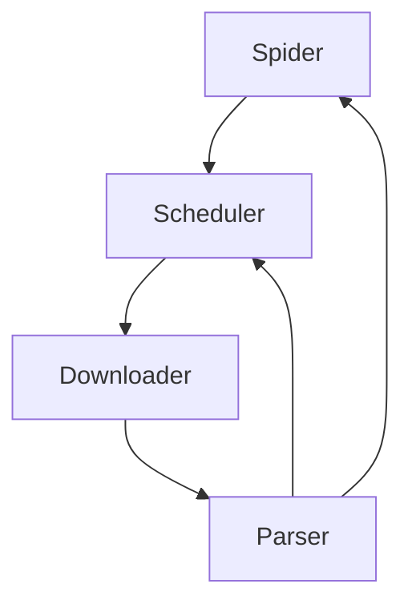

# WebAnts

A simple asynchronous web crawler framework built on `httpx` and `lxml`.

WebAnts keeps a small core: a `Spider` schedules requests, a `Downloader` performs
HTTP with retries, and a `Parser` extracts data. Configuration, middleware and
persistence are opt-in layers that are injected explicitly.

## Features

- Async request scheduling with per-domain concurrency and adaptive delay
- Priority queue with duplicate URL filtering
- HTTP retries with exponential backoff and `Retry-After` support
- `lxml`-based HTML parsing with CSS selectors, XPath and an LRU cache
- Descriptor-based item extraction (`AttrItem`, `LinkItem`, `ElementItem`, `TextItem`)
- Optional middleware (`ResponseCache`, `RequestDeduplicator`, `RateLimiter`, `CircuitBreaker`)
- Optional persistence backends (`JsonPersister`, `CsvPersister`, `SqlitePersister`)
- YAML configuration with typed environment overrides

## Requirements

- Python 3.12 or newer

## Install

With `uv` (recommended):

```bash
uv sync
```

With pip:

```bash
pip install .
```

Optional extras:

```bash
uv sync --extra monitoring     # psutil-based PerformanceMonitor
uv sync --extra playwright     # Playwright login helpers
```

## Quick start

```python
import asyncio

from webants import Result, Spider


class ExampleSpider(Spider):
    name = "example"
    start_urls = ["http://example.com/"]

    async def parse(self, response, **kwargs):
        title = response.text.split("<title>")[1].split("</title>")[0]
        yield Result(
            spider=self.name,
            fields={"title": title},
            url=str(response.url),
        )


async def main() -> None:
    spider = ExampleSpider()
    await spider.start()  # closes the spider and releases resources on exit


if __name__ == "__main__":
    asyncio.run(main())
```

`parse` is an async generator: yield `Result` objects for scraped data and
`Request` objects for follow-up pages.

## Architecture



| Module | Responsibility |
|--------|----------------|
| `spider.py` | `Spider` lifecycle, request pipeline, statistics, signals |
| `scheduler.py` | Priority queue, deduplication, domain concurrency, delays |
| `downloader.py` | `httpx` client, retries, header/cookie/body handling |
| `parser.py` | `lxml` parsing with selector cache |
| `libs/request.py` | `Request` data object |
| `libs/result.py` | `Result` and `Field` models |
| `libs/item.py` | Descriptor-based item classes |
| `libs/extractor.py` | Link, attribute, element and text extractors |
| `libs/middleware.py` | Middleware chain and built-in implementations |
| `libs/persister.py` | JSON (NDJSON), CSV and SQLite storage backends |
| `libs/config.py` | YAML configuration and `WEBANTS_*` environment overrides |

## Main data flow

1. `Spider` builds initial requests and hands them to the scheduler.
2. The scheduler dispatches requests to the downloader.
3. The downloader returns HTTP responses.
4. The parser/callback turns responses into `Result` or `Request` objects.
5. Results are dispatched (and optionally persisted); new requests are scheduled.

## Optional layers

`Spider()` keeps the default behavior. Config, middleware and persistence are
opt-in and passed explicitly:

```python
from pathlib import Path

from webants import Spider
from webants.libs.config import Config
from webants.libs.middleware import MiddlewareManager, ResponseCache
from webants.libs.persister import JsonPersister, PersisterManager

config = Config()
middleware = MiddlewareManager()
middleware.add_middleware(ResponseCache(ttl=60))

persister = PersisterManager(Path("data"))
persister.add_persister("json", JsonPersister(Path("data/results.json")))

spider = MySpider(config=config, middleware=middleware, persister=persister)
await spider.start()  # close() flushes and closes the injected persister
```

A complete, offline-runnable assembly is available in
`example/optional_layers.py`:

```bash
PYTHONPATH=. uv run python example/optional_layers.py
```

The async `signal_manager` is experimental and is not bridged to the Spider
lifecycle yet. Use `Spider.signals` for lifecycle events.

## Development

```bash
uv run pytest -q
uv run pytest -m "not slow"
uv run ruff check .
uv run ruff format --check .
uv run python -m isort --check .
```

Use `python -m isort` instead of the `isort` entry point on Windows; the console
script can fail with `Failed to canonicalize script path`.

Apply formatting:

```bash
uv run ruff format .
uv run python -m isort .
```

## Testing

All tests run offline. HTTP behavior is exercised with `httpx.MockTransport` or
mocked clients, so no external network access is required.

Test markers: `slow`, `integration`, `unit`.

```bash
uv run pytest -q
uv run pytest tests/test_spider.py
uv run pytest -m "not slow"
```

## License

MIT. See [LICENSE](LICENSE).
