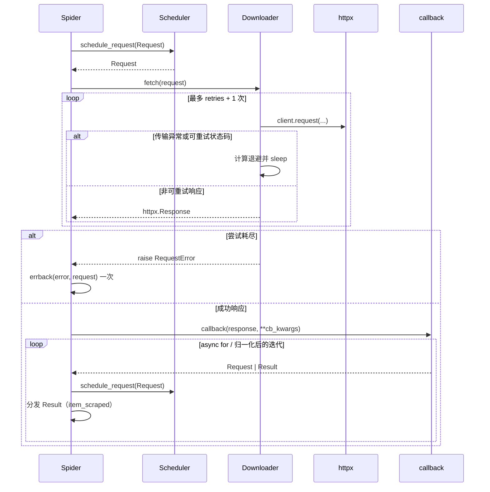

# ADR-0001：回调契约与重试归属

| 项目 | 内容 |
|------|------|
| 状态 | **Accepted（2026-11-04）** |
| 日期 | 2026-11-04（起草并接受） |
| 基线 | `master @ 23f8051` |
| 关联问题 | P0-01、P1-03、P1-13、P1-14、P1-19、P2-01、P2-02、P2-18 |
| 关联文档 | [08 §8.11 阶段 0](../wiki/08-issues-and-recommendations.md)、[03 爬虫主链路](../wiki/03-crawler.md) |
| 决策者 | 项目维护者 |

> 本文是接口与职责的决策记录，**不是已实现代码**。文中的签名、伪代码和实施拆解用于冻结方案，具体实现需另行提交。

## 1. 背景

当前主链路存在一个结构性矛盾：回调由谁调用、重试由谁负责，没有单一答案。由此产生了 P0-01 以及一串连带问题。

### 1.1 现状中的五套假设

| 位置 | 假设 |
|------|------|
| `Request.__init__`（`webants/libs/request.py:110-118`） | callback 必须是 coroutine function |
| `Spider.parse` 注解与文档（`webants/spider.py:285-297`） | 回调 yield `Request`/`Result`，即 async generator |
| `Spider.process_request`（`webants/spider.py:370-375`） | 用 `async for` 消费回调返回值 |
| `Downloader.fetch`（`webants/downloader.py:361-378`） | 回调是“接收 `(response, cb_kwargs)`、返回 response”的普通协程，并在下载器内调用 |
| `Downloader.fetch_retry`（`webants/downloader.py:289-359`） | 回调返回值可直接放入 response queue，失败用 `None`/`600` 表达 |

这五套假设互不兼容，结果是：

- 子类按文档写成 `async def parse(...): yield ...` 时，`start_requests()` 构造 `Request` 就会 `AssertionError`（`iscoroutinefunction` 对 async generator 返回 `False`）；
- 子类写成普通协程时，`process_request` 的 `async for` 会抛 `TypeError`；
- `fetch` 已经调用过一次回调，`process_request` 又调用一次；
- 失败被包装成 `status_code=600` 的伪响应，回调与统计都无法区分“传输失败”和“真实响应”；
- 重试逻辑只存在于 `fetch_retry`，Spider 使用的是 `fetch`，`retries` 参数在主链路上无效；即使改用 `fetch_retry`，`_retry_request` 也会把请求投递到 Downloader 私有队列，而 Spider 只消费 Scheduler 队列，重试会静默丢失。

### 1.2 决策驱动因素

1. **单一事实来源**：每个职责只能有一个所有者。
2. **可测试性**：下载逻辑应能用 `httpx.MockTransport` 完全离线测试；业务解析不应依赖真实网络。
3. **不跨层泄漏**：Scheduler 不应理解 HTTP 状态码、`Retry-After`；Downloader 不应理解 Item、Result、持久化。
4. **失败必须可见**：不得用伪状态码或空对象表示失败。
5. **迁移成本可控**：项目处于 `0.1.x` Alpha，主链路当前不可用，允许做一次清晰的破坏性调整。

## 2. 决策

### 2.1 职责边界（唯一所有者）

| 组件 | 负责 | 不负责 |
|------|------|--------|
| **Request** | 保存 URL、method、headers、body、cookies、callback、errback、cb_kwargs、retries、timeout、meta；构造时校验回调类型 | 不调用回调；不执行重试；不修改自身 `retries`/`delay` 表达重试进度 |
| **Scheduler** | 优先级队列、去重、域名并发、延迟、统计 | 不理解 HTTP 状态码；不做重试；不调用回调 |
| **Downloader** | 构造并发送 HTTP 请求；按状态码/异常重试；退避；返回 `httpx.Response` 或抛 `RequestError` | **不调用 callback/errback**；不解析 HTML；不产出 Result；不向 Scheduler 投递 |
| **Spider** | 调用 callback/errback；把 yield 的 Request 交给 Scheduler、Result 交给信号/持久化；生命周期与统计；熔断 | 不直接构造 HTTP 请求；不实现退避算法 |
| **callback** | 纯业务解析：接收 Response，yield `Request` 或 `Result` | 不负责下载；不负责重试；不直接操作 Scheduler/Downloader |
| **errback** | 处理最终失败（记录、告警、补偿） | 不负责重试；不负责资源释放 |

一句话：**Downloader 只下载，Spider 只调度回调，Scheduler 只排队。**

### 2.2 回调契约

#### 2.2.1 规范形态

**规范形态：async generator function。**

```python
async def parse(
    self, response: httpx.Response, **kwargs
) -> AsyncIterator[Request | Result]:
    ...
    yield Request(...)
    yield Result(...)
```

`errback`：

```python
async def handle_error(self, error: Exception, request: Request) -> None:
    ...
```

#### 2.2.2 Request 构造期校验

- callback / errback 必须是可调用对象，且满足以下之一：
  - `inspect.iscoroutinefunction(fn)`（普通协程，兼容形态）；
  - `inspect.isasyncgenfunction(fn)`（async generator，规范形态）。
- 校验前先 `inspect.unwrap(fn)`，以支持 `functools.wraps` 装饰器。
- 校验失败抛 `TypeError`，**不再使用 `assert`**。`assert` 在 `python -O` 下会被移除，不能作为公共 API 的契约检查。
- callback 为 `None` 合法，表示“只下载、不解析”；Spider 不应因此报错。

#### 2.2.3 调用与消费规则

1. `Downloader.fetch` **永远不调用** callback/errback。
2. `Spider.process_request` 对每个逻辑请求**恰好调用一次** callback。
3. `cb_kwargs` 只以关键字参数传递：`callback(response, **request.cb_kwargs)`；禁止位置参数。
4. `cb_kwargs` 中保留键 `response` 不允许出现，构造期或调用前抛 `TypeError`。
5. yield 的值只允许是 `Request` 或 `Result`；其他类型视为编程错误，抛 `TypeError`，该逻辑请求走 errback。
6. callback 为 `None` 时，Spider 只完成下载与统计，不产出 Request/Result。
7. callback 抛异常时，Spider 调用 errback **一次**；errback 自身抛异常只记录日志，不覆盖原始异常。
8. `errback` 固定接收 `(error, request)`；`cb_kwargs` 不传给 errback，避免签名歧义。

#### 2.2.4 兼容形态的归一化

为降低迁移成本，Spider 允许普通协程 callback。归一化只在 **Spider 的一个入口函数**内完成，不允许 Downloader 或用户代码各自解释。

| callback 类型 | 调用方式 | 允许的返回值 | Spider 的处理 |
|---------------|----------|--------------|----------------|
| async generator function | `async for` | 逐个 yield | 直接分发 |
| coroutine function | `await` | `None` | 不产出 |
| coroutine function | `await` | 单个 `Request` / `Result` | 分发一次 |
| coroutine function | `await` | 同步可迭代（list/tuple/generator） | 逐项校验并分发 |
| coroutine function | `await` | 异步可迭代 | `async for` 逐项校验并分发 |
| coroutine function | `await` | 其他（含 `httpx.Response`、dict、str） | 抛 `TypeError`，走 errback |
| 非协程/非 async generator | — | — | 构造期 `TypeError` |

> 明确禁止“协程返回 Response 以继续链式处理”的旧行为。Response 的后续处理只能通过 callback 内的业务逻辑完成，避免下载器与解析器职责再次混合。

#### 2.2.5 并发约定

同一个 callback 函数可能被多个请求并发调用。callback 必须是可重入的，或由用户自行加锁；Spider 不保证串行。`Request` 对象在进入 callback 后视为只读，callback 不得修改 `request.retries`、`request.delay` 等调度字段。

### 2.3 重试归属

#### 2.3.1 决策

**重试由 `Downloader.fetch` 内部完成。** Scheduler 不重试，Spider 不重试，`Request` 不携带重试状态机。

```python
async def fetch(self, request: Request) -> httpx.Response:
    """执行一次逻辑请求；内部处理重试。

    返回：最终 httpx.Response（非可重试状态）。
    抛出：RequestError（传输失败或可重试状态耗尽）。
    绝不调用 request.callback。
    """
```

#### 2.3.2 计数语义

- `request.retries` 表示**首次尝试之外的额外重试次数**；总尝试次数 = `max(1, request.retries + 1)`。
- 重试循环使用局部 `attempt` 变量，**不修改 `request.retries`**。原因：Request 可能被复用/并发读取；旧实现递减 `retries` 会让统计与重放不可预期。
- `request.delay` 只表示首次请求前的固定延迟，不再被重试逻辑写入；退避延迟只在 `fetch` 内部计算。

#### 2.3.3 可重试条件

| 类别 | 条件 | 是否重试 |
|------|------|----------|
| 传输异常 | `httpx.TimeoutException`（含 Connect/Read/Write/PoolTimeout） | 是 |
| 传输异常 | `httpx.NetworkError`（ConnectError/ReadError/WriteError/CloseError） | 是 |
| 传输异常 | `httpx.RemoteProtocolError` | 是 |
| 传输异常 | `httpx.NetworkError` 的底层原因是 `ssl.SSLError` / 证书校验失败 | 否，直接失败 |
| 传输异常 | `httpx.TooManyRedirects`、`UnsupportedProtocol` | 否，直接失败 |
| 状态码 | 408、425、429、500、502、503、504 | 是（可配置） |
| 状态码 | 其余 4xx（400/401/403/404/405/410 等） | 否，返回 Response 交给 callback |
| 状态码 | 2xx、3xx（重定向已由 httpx 跟随） | 否，成功返回 |

默认可重试状态码集合从当前 `RETRY_CODES` 中**移除 403、404、420**；保留 408、429、500、502、503、504，并新增 425。集合通过构造参数覆盖，不在 Scheduler 中配置。

#### 2.3.4 退避策略

对第 `n` 次重试（`n` 从 0 开始，表示首次失败后的第一次重试）：

```text
delay = min(max_delay, base_delay * backoff_factor ** n)
delay = delay * (1 + jitter_ratio * random())   # 建议 jitter_ratio = 0.25
```

- `base_delay` 默认 1.0s；`backoff_factor` 默认 2；`max_delay` 默认 60s。
- 429/503 若带 `Retry-After`：取 `max(计算值, Retry-After)`；`Retry-After` 同时支持秒数与 HTTP-date。
- 408/500/502/504 使用普通指数退避。
- 每次尝试使用 `request.timeout` 或 Downloader 默认超时。

#### 2.3.5 最终结果语义

| 最终情况 | `fetch` 行为 |
|----------|--------------|
| 收到非可重试状态码（含 2xx/3xx/4xx） | 返回该 `httpx.Response` |
| 传输异常且尝试耗尽 | 抛 `RequestError(code="FETCH_FAILED", retryable=False, metadata={url, attempts, cause})` |
| 可重试状态码且尝试耗尽 | 抛 `RequestError(code="RETRY_EXHAUSTED", retryable=False, metadata={url, status_code, attempts, response})` |

补充约定：

- **删除 `status_code=600` 哨兵**，不再构造伪响应。
- **删除 `_fetch` 返回 `Request` 表示失败的内部协议**；`_fetch` 只返回 Response 或抛异常。
- 非可重试的 4xx 是“传输成功但内容可能不可用”，由 callback 决定是否抛错；框架不替用户判定 404 页面是否有价值。
- `Spider.stats["successful_requests"]` 的口径是“逻辑请求处理完成且未抛异常”，不是“HTTP 2xx”。文档需明确这一点。
- 熔断器每个**逻辑请求**最多记录一次失败，不按每次 HTTP 尝试计数。

### 2.4 统计口径

| 指标 | 归属 | 定义 |
|------|------|------|
| `total_requests` | Downloader / Spider | 逻辑请求数（一次 `fetch` 或一次 `process_request` 计 1） |
| `total_attempts` | Downloader | 实际 HTTP 尝试次数（新增） |
| `retry_requests` | Downloader | 至少发生过一次重试的逻辑请求数 |
| `total_retries` | Downloader | 额外尝试次数（`total_attempts - total_requests` 的理论上限） |
| `successful_requests` | Downloader | 返回 Response 的逻辑请求数 |
| `failed_requests` | Downloader | 抛 `RequestError` 的逻辑请求数 |
| `successful_requests` | Spider | callback 正常完成（含无 callback）的逻辑请求数 |
| `failed_requests` | Spider | 进入 errback 路径的逻辑请求数，每个请求只加 1 |
| `items_scraped` | Spider | 成功分发的 Result 数 |

`Spider.handle_error` 默认实现**不再**递增 `failed_requests`；计数由 `process_request` 统一完成，避免用户自定义 errback 时重复或遗漏。

### 2.5 生命周期配合

`process_request` 的推荐结构（与 P1-01、P1-02、P1-18 一起落地）：

1. 记录 `scheduled` 标志与处理占位；
2. 熔断检查放在 `try` 内，拒绝时也走 `finally`；
3. `try` 中调用 `fetch` → 调用一次 callback → 分发结果；
4. `except` 中统一计数、记录熔断失败、调用 errback；
5. `finally` 中释放占位与调度资源，且每步独立容错，不覆盖原始异常。

## 3. 目标时序



## 4. 备选方案

| 方案 | 描述 | 结论 | 理由 |
|------|------|------|------|
| A. 保持现状：Downloader 调用回调 | 下载器内 `await callback(...)`，Spider 再消费返回值 | 拒绝 | 职责混合，直接导致 P0-01；无法同时满足协程与 async generator |
| B. Spider 负责重试 | `process_request` 内循环 `fetch` | 拒绝 | 重试逻辑与 Spider 生命周期耦合；状态码/Retry-After 细节上移到控制层；统计难分 |
| C. Scheduler 负责重试 | 失败后重新入队并延迟可见 | 暂不采用 | 需要延迟队列/可见时间；Scheduler 需理解 HTTP 状态，跨层；可作为未来的高级重试队列 |
| D. 只允许 coroutine 返回 list | 回调返回 `list[Request|Result]` | 拒绝 | 失去流式产出；与现有 `parse` 注解和 Scrapy 风格不一致；仍需处理单值/None 的归一化 |
| E. async generator 规范 + coroutine 兼容（**采纳**） | 规范形态 async generator，Spider 单点归一化 coroutine 返回值 | 采纳 | 流式、类型清晰；兼容旧写法；归一化集中，易测试 |
| F. 保留 600 哨兵 | 失败返回 `Response(status_code=600)` | 拒绝 | 伪状态码污染响应语义，容易被当正常页面解析；统计无法区分 |
| G. 重试请求投递到队列（现状 `_retry_request`） | 重试回到 `request_queue` | 拒绝 | Spider 不消费 Downloader 私有队列，重试静默丢失（P1-19）；且丢失 callback 上下文 |

## 5. 影响与后果

### 5.1 破坏性变更

1. `Downloader.fetch(request)` 不再调用 callback，返回类型固定为 `httpx.Response`。
2. `Downloader.fetch_retry` 废弃；行为并入 `fetch`。保留一个版本的兼容别名时，必须忽略 callback 并复用同一重试实现。
3. 删除 `_retry_request`、`_failed_urls`、`Spider.retry_failed`；不再有 Spider 级重试。
4. `Request` 的回调校验从 `assert iscoroutinefunction` 改为 `TypeError` + 双类型检查。
5. `Request.retries` 不再被递减；依赖该副作用的测试与用户代码需要调整。
6. `Request.delay` 不再被重试退避写入。
7. `Downloader.stats` 新增 `total_attempts`；`successful_requests`/`failed_requests` 口径按 2.4 调整。
8. `Spider.handle_error` 不再负责递增 `failed_requests`；自定义 errback 不再影响计数。
9. `Downloader.start_worker`/`start_downloader` 的 worker 模式需改为调用 `fetch` 并只入队成功响应；失败记录日志。该模式未被 Spider 使用，建议另行评估是否废弃。

### 5.2 非破坏性收益

- 主链路终于可以同时支持两种回调写法；
- 重试可以在 `httpx.MockTransport` 下完全离线测试；
- 失败不再伪装成 200/600，errback 与统计可信；
- 重试不再跨队列，P1-19 自然消失；
- 403/404 不再被无意义重试（P2-01）。

### 5.3 权衡

- 重试的 `sleep` 发生在 `fetch` 内，会占用当前域名并发槽位。当前规模下这是可接受的自然背压；若未来需要“退避期间让出槽位”，应引入带可见时间的延迟队列（方案 C），而不是把重试散落到 Spider。
- 规范化 coroutine 返回值增加了一个分支，但它集中在 Spider 一处，测试成本可控。规范文档仍推荐 async generator。

## 6. 实施拆解

> 以下为任务拆分，不代表本次已改代码。

| 任务 | 内容 | 主要文件 | 依赖 | 验收 |
|------|------|----------|------|------|
| C1 | `Request` 回调校验改为双类型 + `TypeError`；`cb_kwargs` 保留键检查 | `webants/libs/request.py` | — | 构造期用例 |
| C2 | `Downloader.fetch` 内联重试循环；新增可重试集合、退避、`Retry-After`；删除 600 | `webants/downloader.py` | C1 | MockTransport 用例 |
| C3 | `Spider.process_request` 单点调用回调并归一化；分发 Request/Result | `webants/spider.py` | C1、C2 | 主链路用例 |
| C4 | 删除 `fetch_retry`（或改为兼容别名）、`_retry_request`、`retry_failed`、`_failed_urls` | `webants/downloader.py`、`webants/spider.py` | C2、C3 | grep 无残留调用 |
| C5 | 统计口径统一：`total_attempts`、失败只计一次 | `webants/downloader.py`、`webants/spider.py` | C2、C3 | 统计断言 |
| C6 | 新增 `tests/test_spider.py`：async generator / coroutine / errback 三路径 | `tests/test_spider.py` | C3 | 全离线 |
| C7 | 重写下载器重试用例，移除真实网络依赖 | `tests/test_downloader.py` | C2 | `-m "not integration"` 可离线 |
| C8 | 文档同步：03 主链路、08 问题状态、09 符号索引、README | `docs/` | C1-C7 | 链接与行号校验 |

## 7. 验收标准

- [ ] `Request(callback=async_gen_fn)` 不再抛 `AssertionError`；非协程回调抛 `TypeError`。
- [ ] `Downloader.fetch` 在 callback 存在时，callback 调用次数为 0（由测试计数器断言）。
- [ ] 规范形态：async generator 回调 yield 2 个 Request 与 1 个 Result，Spider 正确分发。
- [ ] 兼容形态：coroutine 返回 `None` / 单个 Result / `list[Request]` / async iterable 均正确。
- [ ] coroutine 返回 `httpx.Response` 或非法类型时，该请求走 errback，计数只加 1。
- [ ] 传输异常重试耗尽抛 `RequestError(code="FETCH_FAILED")`，不再返回 600。
- [ ] 503 重试耗尽抛 `RequestError(code="RETRY_EXHAUSTED")`，`metadata` 含 `status_code` 与 `attempts`。
- [ ] 404 不重试，直接返回 Response；callback 可自行决定抛错。
- [ ] 429 带 `Retry-After: 2` 时，第二次尝试前至少等待 2 秒（用可注入的 clock/sleep 断言，不真实等待）。
- [ ] `request.retries` 在一次 `fetch` 前后保持不变。
- [ ] 熔断器对一次逻辑失败只记录一次，不按尝试次数累加。
- [ ] `uv run pytest -q tests/test_spider.py tests/test_downloader.py` 全绿且不访问网络。

## 8. 评审结论

原 5 个未决点按建议默认处理，随 ADR 接受一并冻结：

| # | 问题 | 结论 |
|---|------|------|
| 1 | `Request.retries` 是否改名为 `max_retries` | **保持 `retries` 不变**。定义为“首次尝试之外的额外重试次数”；改名留到下一个大版本，避免与本次契约重构叠加破坏 |
| 2 | `Retry-After` 的 HTTP-date 是否首版支持 | **首版同时支持秒数与 HTTP-date**。若排期紧张，可拆为 C2b 小任务，但对外契约不变 |
| 3 | worker 模式（`start_worker`/`start_downloader`）的去留 | **本次仅改造为 `fetch` 的兼容适配器**：只入队成功响应，失败记录日志；是否废弃另开 ADR，不阻塞本决策 |
| 4 | `RETRY_EXHAUSTED` 的 `metadata` 是否携带完整 Response | **不携带完整响应体**。只带 `status_code`、`headers`、`url`、`attempts`，避免延长大响应生命周期 |
| 5 | errback 是否接收 `**cb_kwargs` | **不接收**。errback 固定签名 `(error, request)`；需要时从 `request.cb_kwargs` 读取 |

## 9. 参考

- [08 问题与建议（修订版）](../wiki/08-issues-and-recommendations.md) — P0-01、P1-03、P1-14、P1-19
- [03 爬虫主链路](../wiki/03-crawler.md) — 当前调用顺序与缺陷位置
- [01 架构](../wiki/01-architecture.md) — 分层与运行时图
- 代码位置：`webants/spider.py:349-395`、`webants/downloader.py:205-378`、`webants/libs/request.py:99-122`
