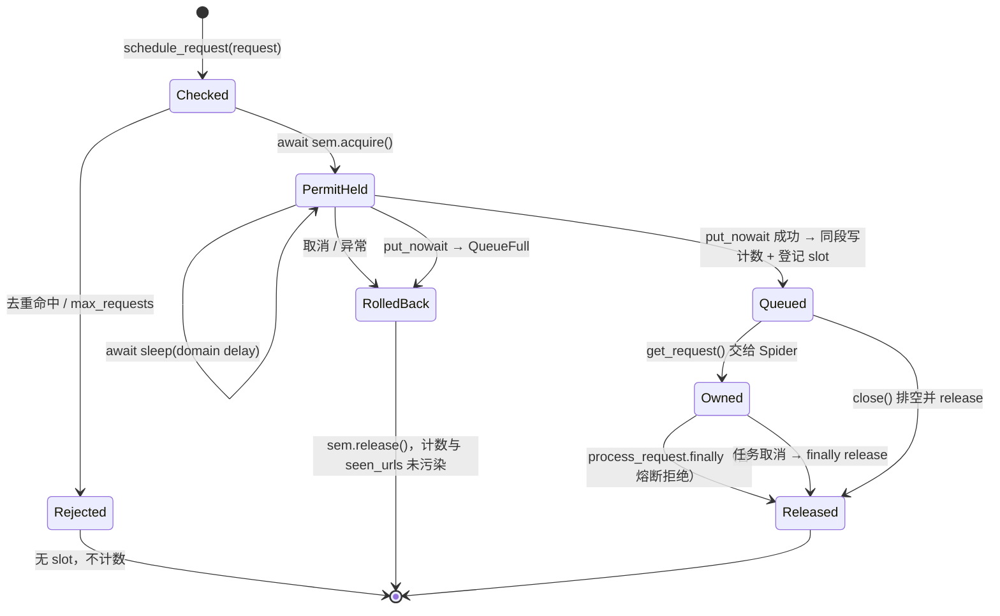

# ADR-0002：调度槽位所有权与请求生命周期

| 项目 | 内容 |
|------|------|
| 状态 | **Accepted（2026-11-04）** |
| 日期 | 2026-11-04（起草并接受） |
| 基线 | `master @ ee30d2b`（ADR-0001 C1–C8 已落地） |
| 关联问题 | **P1-01（主）**、P1-04、P1-18（收尾）、P2-20、P1-02、P1-20、P2-23；顺带闭合 P2-22 |
| 关联文档 | [08 §8.11 阶段 2](../wiki/08-issues-and-recommendations.md)、[03 爬虫主链路](../wiki/03-crawler.md)、[ADR-0001](0001-callback-contract-and-retry-ownership.md) |
| 决策者 | 项目维护者 |

> 本文冻结“谁获取资源、谁持有、谁释放、失败与取消时如何回滚”的契约，**不包含代码变更**。文中的类型与签名是方案描述，实施另行提交。

## 1. 背景

ADR-0001 把回调与重试归位之后，剩下的结构性问题是**资源的生命周期**：域名并发额度、调度计数、处理中登记这三类资源，获取点在 `Scheduler.schedule_request`，释放点在 `Spider.process_request` 的 `finally`，两点之间隔着队列、任务创建、熔断判断、下载、回调，且**没有任何显式的配对手柄**。释放方只能凭 URL 猜测“这个请求是不是我占用的那一份”。

### 1.1 现状：获取点与释放点不对称

| 资源 | 获取点 | 计数写入点 | 释放点 | 缺口 |
|------|--------|------------|--------|------|
| 域名信号量 | `scheduler.py:118`（`acquire`） | — | `scheduler.py:195`（`release`） | acquire 与计数之间隔 `await sleep`（`:146-150`）与 `await put`（`:163`） |
| `domain_stats[domain]["active_requests"]` | `scheduler.py:156` | 同点 | `scheduler.py:190` | key 不存在时直接 `KeyError` |
| `stats["current_requests"]` | `scheduler.py:158` | 同点 | `scheduler.py:191` | 无下限保护，可为负 |
| `seen_urls` | `scheduler.py:153` | 同点 | **从不撤销** | 入队失败后该 URL 永久屏蔽 |
| `Spider._processing`（URL 集合） | `spider.py:395` | 同点 | `spider.py:433`（`discard`） | 同 URL 并发时互相抹除（P2-20） |
| 队列条目本身 | `scheduler.py:163` | — | `get_request()`（`:176`） | 出队后任务未创建/被取消 → 槽位无人释放 |

`schedule_request` 用 `except Exception: return False` 收尾（`:166-168`），而 `asyncio.CancelledError` 在 Python 3.8+ 继承自 `BaseException`，**不会被该分支捕获**，因此取消路径完全没有任何回滚。

### 1.2 实测证据（2026-11-04，`master @ ee30d2b`）

以下均为本地脚本实测，非静态推断。

| # | 场景 | 实测结果 |
|---|------|----------|
| E1 | 未调度请求直接调用 `Scheduler.request_completed(request)` | `KeyError: 'example.com'`（原始 API 仍会抛，P1-01 的根因未动） |
| E2 | 调度 1 次，`request_completed` 调用 3 次（`max_domain_concurrent=2`） | `active_requests=-2`、`current_requests=-2`、信号量内部计数 **4 > 上限 2** |
| E3 | 2 个 `schedule_request` 在域名延迟 `sleep` 期间被取消（`max_domain_concurrent=2`） | 信号量内部计数 **0**（应为 2），后续第 3 个请求 `schedule_request` **永不返回**，爬虫静默挂死 |
| E4 | `max_queue_size=1`，队列满时调度第 2 个请求 | `await put` 无限阻塞；此时 `seen_urls` 已含该 URL、`active_requests` 已计为 2，但队列里根本没有它 → 已计数却永不释放，且该 URL 永久去重 |
| E5 | 同一 URL 的 2 个请求并发处理，其中一个先完成 | `_processing` 变为空集，主循环条件 `if not self._processing: break`（`spider.py:466-468`）**会在仍有请求在飞时退出并关闭爬虫** |
| E6 | 未 `start()` 直接 `await close()` | `close()` 因 `_running=False` 直接返回（`spider.py:481-482`），`httpx.AsyncClient` **未关闭**（P2-23） |

**第 1 阶段只做到了“不掩盖”**：`process_request` 用 `try/except KeyError` 把 `request_completed` 的异常降级成告警（`spider.py:434-439`），并把 `_processing.remove` 换成 `discard`。这消除了“KeyError 覆盖原始异常”这一表象（E1 的调用方侧），但槽位配对本体、计数漂移（E2）、取消泄漏（E3）、队列满计数泄漏（E4）、in-flight 塌缩（E5）都还在，因此 P1-01 在 8.13 中只能记为“部分缓解”。

### 1.3 决策驱动因素

1. **配对必须显式**：释放动作要绑定在“获取时产生的对象”上，而不是靠 URL 反查。理想状态下，P1-01 应当是**类型上不可能**，而不是靠 `except KeyError` 兜住。
2. **不变量必须可断言**：`active_requests` 与信号量剩余额度必须恒等对应，关停后必须归零，且能用公开接口测出来。
3. **失败路径不得静默**：入队失败、重复释放、关闭丢弃都要有计数与日志，但不允许用异常打断主链路。
4. **不跨层泄漏**（延续 ADR-0001）：Scheduler 不理解 HTTP；Spider 不直接摆弄 `Semaphore`；`Request` 不携带调度进度状态。
5. **取消是一等公民**：任务取消、超时退出、异常关闭都必须把资源恢复到初始值。

## 2. 决策

### 2.1 所有权矩阵

| 阶段 | 槽位持有者 | 移交点 | 释放责任 |
|------|------------|--------|----------|
| 入队前 | 无人 | — | — |
| 入队成功 → 出队 | **Scheduler**（slot 随队列条目一起排队） | `get_request()` 返回 slot | 若调用方随即放弃（关闭/取消），由调用方释放 |
| 出队 → 任务创建 | **Spider 主循环** | `create_task` 前登记到 in-flight 表 | 移交失败（取消）时由主循环释放 |
| 任务执行中 | **`process_request`** | 入口签收 | `finally` 中 `slot.release()`，含熔断拒绝路径 |
| 关闭 | Spider | `close()` 排空队列 | 逐个释放残留 slot 并计数 |

四条不变量（`Scheduler.audit()` 必须能验证）：

- **I1 恰好一次**：每个 `ScheduleSlot` 至多释放一次；释放的额度必然来自同一次成功入队。未入队则不存在 slot，也就无槽可放。
- **I2 不悬空**：任何已入队请求，要么被消费并释放，要么在关闭时被显式释放并计数；不得静默消失。
- **I3 恒等对账**：对每个域名 `active_requests == max_domain_concurrent - available`，且 `current_requests == Σ active_requests`。
- **I4 关停归零**：`close()` 返回后，所有域名 `active_requests == 0`、`available == max_domain_concurrent`、`current_requests == 0`、`Spider` in-flight 为空。

### 2.2 调度凭据 `ScheduleSlot`

由 `Scheduler` 私有创建，外部只持有引用：

```python
class ScheduleSlot:
    """一次成功入队所占用资源的句柄。只能由 Scheduler 构造。"""

    __slots__ = ("_scheduler", "_request", "_domain", "_seq", "_released")

    @property
    def request(self) -> Request: ...      # 队列条目携带的请求
    @property
    def domain(self) -> str: ...
    @property
    def released(self) -> bool: ...

    def release(self) -> bool:
        """幂等释放。返回 True 表示本次真正归还了资源；重复调用返回 False 并计数。"""
```

要点：

- 身份即凭据：默认对象 `hash`/`eq`，可直接放进 `set` 做 in-flight 跟踪，**不再以 URL 为 key**（消除 P2-20）。
- `release()` 幂等：内部 `_released` 标志 + `Scheduler` 侧的 outstanding 登记表；重复释放不抛异常，但 `stats["slot_mismatches"] += 1` 并 `logger.warning`。
- slot 不放进 `Request`。`Request.__slots__`（`webants/libs/request.py:33-53`）与 `copy()`（`:281-315`）都不携带调度状态，避免“拷贝出一个共享槽位的副本”，也与 ADR-0001 §2.1“Request 不表达调度/重试进度”一致。

### 2.3 `schedule_request` 的返回契约

```python
class ScheduleReason(Enum):
    SCHEDULED = "scheduled"        # 已入队，slot 有效
    DUPLICATED = "duplicated"      # 命中去重，无 slot
    LIMIT_REACHED = "limit"        # max_requests 已达上限，无 slot
    QUEUE_FULL = "queue_full"      # 队列满，已回滚，无 slot

@dataclass(frozen=True)
class ScheduleResult:
    reason: ScheduleReason
    slot: ScheduleSlot | None = None
    def __bool__(self) -> bool:     # 便于 `if result:`
        return self.reason is ScheduleReason.SCHEDULED

async def schedule_request(self, request: Request) -> ScheduleResult: ...
```

**破坏性变更**：返回值由 `bool` 改为 `ScheduleResult`。不提供 bool 兼容（项目处于 `0.1.x` Alpha，且旧语义“False 同时表示去重和队列满”正是问题所在）。`Spider._dispatch_item`（`spider.py:375-385`）当前完全忽略返回值，改为按 `reason` 分流；`request_scheduled` 信号只在 `SCHEDULED` 分支发送（顺带闭合 P2-22）。

入队顺序重排（P1-04 的前置，本次必须一起改）。核心原则：**唯一的失败点前移，计数写入与入队之间不得有 `await`**。

1. **可拒绝的前置检查（同步，不占资源）**：`max_requests` 上限、去重命中 → 直接返回 `LIMIT_REACHED` / `DUPLICATED`，不 acquire、不计数。
2. **额度获取（唯一的背压等待点）**：`await self.domain_semaphores[domain].acquire()`。此时**尚未写入任何计数与 `seen_urls`**，因此在这一步或其后的延迟期间被取消，回滚动作只有 `release()` 一次，不存在“计数已写但请求消失”。域名状态（dict 条目 + 信号量 + `active_domains`）的初始化也必须在这之前的同步段内原子完成。
3. **域名节流延迟（可取消，只占额度、不写计数）**：`await sleep(effective_delay)` 放在 slot 创建之前，处于 `try` 内。等待期间持有域名额度属于刻意的背压取舍（与 ADR-0001 §5.3 对退避期的结论一致），但取消/异常时只需 `release()`。
4. **入队 + 占位（同一同步段，段内禁止 `await`）**：先 `put_nowait((priority, seq, request, slot))`，**成功后**再写 `seen_urls`、`total_scheduled`、`active_requests`、`current_requests`、`last_request` 并登记 outstanding。`put_nowait` 是这一步唯一的失败点：抛 `QueueFull` 时 `release()` 并返回 `QUEUE_FULL`，此时计数与 `seen_urls` 尚未被污染，该 URL 之后可再次调度。
   - `seq` 为自增序号，使队列顺序全序且稳定，调度侧从此不再依赖 `Request.__lt__`（`request.py:229`）的非严格弱序比较。
5. **不再吞异常**：删除 `except Exception: return False`（`scheduler.py:166-168`）。可预期的拒绝必须由 `ScheduleReason` 表达；意外的 `Exception` 记录日志后向上抛出；`CancelledError` 必须原样传播（它继承 `BaseException`，现状的 `except Exception` 捕获不到，也就完全没有回滚）。

### 2.4 队列与消费

- `get_request() -> ScheduleSlot | None`：返回凭据而不是裸 `Request`；队列为空时返回 `None`。
- 空队列轮询使用 `get_nowait()` + `asyncio.sleep(poll_interval)`，**不用** `asyncio.wait_for(queue.get(), ...)`——后者在超时时取消 `Queue.get()` 存在“已取到元素但被取消”导致丢件的已知风险，而丢一个请求就等于漏一次释放。
- 队列满由 `put_nowait` + 回滚处理，新增真实的 `queue_full_count` 统计（当前该计数从不递增，见 E4）。

### 2.5 `process_request` 与 in-flight

```python
async def process_request(self, request: Request, *, slot: ScheduleSlot | None = None) -> None:
    ...
    finally:
        if slot is not None:
            slot.release()
```

- `slot=None` 明确表示“未经调度的直接调用”（测试、库内直接处理），不再需要 `try/except KeyError`（删除 `spider.py:434-439`）。
- `_processing: Set[str]`（`spider.py:211`）替换为 in-flight 表 `dict[asyncio.Task, ScheduleSlot]`；`get_stats()["processing"]` 仍输出 URL 列表以兼容展示，新增 `inflight_count`。E5 的塌缩消失，退出条件改用 `inflight_count`。
- 熔断拒绝（P1-18 已把判断移入 `try`）现在也天然释放，因为释放只依赖 `finally` 与 slot。

### 2.6 取消、超时与关闭（P1-02 / P1-20 / P2-23 消费本契约）

1. **任务跟踪**：`self._tasks: set[asyncio.Task]`，创建时 `add`，`add_done_callback` 中 `discard` 并消费 `task.exception()`（记入 `unhandled_task_errors`），消除“任务被 GC / 异常无人消费”。
2. **退出条件**：队列连续空且 in-flight 为空且连续空转超过 `idle_grace`（构造参数，默认 0.5s）才退出主循环；替换 `spider.py:466-470` 的 `if not request` 分支。
3. **关闭顺序**（`close()` 与 `_running` 解耦、幂等）：置 `_running=False` → 取消未完成任务并 `gather(..., return_exceptions=True)`（被取消任务的 `finally` 释放 slot）→ `Scheduler.discard_pending()` 排空队列并逐个 `release()`，计入 `discarded_on_close` → `await downloader.close()`（幂等）→ 只发送一次 `spider_stopped`。这同时修掉 E6。
4. **worker 模式**：`start_downloader` 只取消自己创建的 worker 任务列表（`downloader.py:466` 的 `asyncio.all_tasks()` 全量取消改为局部任务集），不触碰调用方的任务（P1-20）。

### 2.7 统计口径调整

| 指标 | 归属 | 变更 |
|------|------|------|
| `total_scheduled` | Scheduler | 只在 `SCHEDULED` 分支递增（回滚时不计） |
| `queue_full_count` | Scheduler | 由 `put_nowait` 的 `QueueFull` 真正递增（当前恒为 0） |
| `slot_mismatches` | Scheduler | **新增**：重复释放 + 未配对释放的次数 |
| `discarded_on_close` | Scheduler | **新增**：关闭时丢弃并释放的排队请求数 |
| `current_requests` / `active_requests` | Scheduler | 带上限断言与关停归零要求（I3/I4） |
| `inflight_count` | Spider | **新增**：替代 `_processing` 的语义 |
| `unhandled_task_errors` | Spider | **新增**：任务级未消费异常数 |
| `avg_request_time` | Spider | 本 ADR 不改口径（属 P2-21，第 5 阶段），但新增 `completed_requests` 计数为其提供正确分母 |
| `Scheduler.audit()` | Scheduler | **新增公开诊断接口**：返回每域名 `{active, available, max, mismatch}`、outstanding 数量与 I3/I4 的布尔结果，供关停断言与测试使用 |

`request_completed(request)` 保留为**兼容入口**：内部按 URL 找域名做 decref，带 `active_requests <= 0 → 告警 + 计 mismatch + 直接返回` 的下限保护（即 8.6 建议的实现），docstring 标注 `Deprecated`，保留一个发布周期后移除。新代码一律使用 slot。

## 3. 目标状态机




对账断言（关停后）：

```python
audit = scheduler.audit()
assert audit["mismatch_count"] == 0
assert audit["current_requests"] == 0
assert all(d["active"] == 0 and d["available"] == d["max"] for d in audit["domains"].values())
assert spider.get_stats()["inflight_count"] == 0
```

## 4. 备选方案

| 方案 | 描述 | 结论 | 理由 |
|------|------|------|------|
| A. 仅让 `request_completed` 容错（8.6 原建议） | 查不到就 `warning + return` | 部分采纳 | 消除 `KeyError`（E1），但无法区分“合法未入队”与“重复释放”，E2 的额度膨胀（`available > max`）与 E3/E4 的泄漏仍在；只作为兼容入口的兜底 |
| B. 在 `Request` 上加 `_scheduled` / `_slot` 标志 | 用请求对象携带调度状态 | 拒绝 | `Request` 有 `__slots__` 且 `copy()`/`replace()` 会复制或篡改该状态，可能出现“两个副本共享一个槽位”；违反 ADR-0001 §2.1 |
| C. Scheduler 内部按请求身份维护 outstanding | `request_completed` 查表，查不到 no-op | 拒绝 | `Request.__hash__` 基于 fingerprint，同 URL 的 `dont_filter` 副本互相冲突；用 `id()` 又与对象生命周期绑定，脆弱 |
| D. 显式凭据 `ScheduleSlot` 随队列传递（**采纳**） | 入队返回句柄，句柄随队列条目交给消费方，`finally` 释放 | 采纳 | 配对由类型保证，P1-01 变成不可能表达；同 URL 并发天然区分（P2-20）；不污染 `Request` |
| E. 引入带可见时间的延迟队列，彻底不在等待期占位 | 域名延迟与退避都不占槽位 | 本次不做 | 需要重写队列结构与背压模型，影响并发上限语义；与 ADR-0001 §5.3 的取舍一致，先修配对，再优化占位窗口 |
| F. `asyncio.TaskGroup` 托管全部任务 | 用结构化并发管理生命周期 | 暂不采纳 | 与“后台并发不限流”的现有模型不匹配（TaskGroup 会等全部子任务），且取消语义差异大；先做显式 task 集合 |
| G. 超时用 `wait_for(queue.get())` | 简洁 | 拒绝 | 取消 `Queue.get()` 有丢件风险，丢件即漏释放（见 2.4） |

## 5. 影响与后果

### 5.1 破坏性变更与迁移

| 变更 | 影响 | 迁移方式 |
|------|------|----------|
| `schedule_request` 返回 `ScheduleResult` | 直接读 bool 的调用方 | `if result:` 仍可用；需要区分原因时读 `result.reason`；断言 `is True` 需改 |
| `get_request()` 返回 `ScheduleSlot \| None` | 自定义消费者 | `slot.request` 取请求；处理完调用 `slot.release()` |
| `process_request(request, *, slot=None)` | 直接调用方 | 库内直接调用无需改动（`slot=None` 即不释放） |
| 队列条目结构 `(priority, seq, request, slot)` | 直接读 `request_queue` 的代码/测试 | 改用 `get_request()` 或 `audit()` |
| `_processing` 移除 | 依赖 `spider._processing` 的外部代码 | 用 `get_stats()["processing"]` / `inflight_count` |
| `request_completed(request)` 标记 Deprecated | 现有调用与 `tests/test_scheduler.py::test_request_completed` | 一个发布周期内保留幂等语义，之后移除 |
| `Spider.close()` 不再因 `_running=False` 提前返回 | 从未 `start()` 就 `close()` 的用法 | 行为变为“正确释放资源”，无需迁移；重复 `close()` 幂等 |
| `start_downloader` 不再取消全部任务 | 依赖该副作用停止宿主任务的调用方 | 调用方自行管理自己的任务 |

### 5.2 非破坏性收益

- 取消、队列满、熔断拒绝、关闭四条路径的额度都会恢复，8.12 的“三种场景计数恢复”才真正可验收；
- `seen_urls` 延后到入队成功之后写入，因队列满被拒的 URL 不再被永久屏蔽，可再次调度；
- 队列顺序不再依赖 `Request.__lt__` 的错误比较，同优先级排序稳定（P2-02 的调度侧一半被动消解，但 P2-02 本身仍在第 5 阶段）；
- `audit()` 给出可断言的资源健康度，主链路泄漏测试第一次成为可能；
- 爬虫不会再因额度泄漏而静默挂死（E3），也不会因 in-flight 塌缩而过早退出（E5）。

### 5.3 风险与权衡

- **同步段变长**：入队的关键段内不能有 `await`，自适应延迟的计算必须保持纯同步；域名初始化与信号量创建需一并在锁/同步段内完成，避免并发下 `active_domains` 重复递增。
- **“拿到额度后等待”仍会压低域名并发**：域名延迟期间该域名少一个额度，这是刻意的背压取舍，需在 03 文档写明；若后续吞吐受限，再走方案 E。
- **轮询空转**：`get_nowait` + `sleep(poll)` 会以 `poll_interval` 为代价换取“无超时 + 可退出”，默认 50ms 对网络型爬虫可忽略。
- **凭据泄漏成新风险**：调用方拿了 slot 不释放会永久占用额度。用 `audit()` 与 `slot_mismatches` 暴露，并在文档中明确“拿到 slot 必须 finally 释放”。

## 6. 实施拆解

> 以下为任务拆分，本次仅提交本 ADR，不改代码。

| 任务 | 内容 | 主要文件 | 依赖 | 覆盖问题 |
|------|------|----------|------|----------|
| L1 | `ScheduleSlot` + `ScheduleReason`/`ScheduleResult`；outstanding 登记与 `audit()` | `webants/scheduler.py` | ADR-0001 | P1-01 |
| L2 | `schedule_request` 重排：前置检查 → `acquire` → 延迟 → `put_nowait` 成功后同段写 `seen_urls` 与计数；`QueueFull` 只 `release`；异常不再吞成 `False`；`queue_full_count` 生效；队列条目带 `seq` | `webants/scheduler.py` | L1 | P1-01、P1-04 |
| L3 | `get_request()` 返回 slot + `get_nowait` 轮询；`discard_pending()`；`request_completed` 降级为幂等兼容入口 | `webants/scheduler.py` | L1、L2 | P1-01、P1-04 |
| L4 | `process_request(request, *, slot=None)`；删除 `try/except KeyError`；in-flight 表替代 `_processing`；`request_scheduled` 移到 `SCHEDULED` 分支 | `webants/spider.py` | L1-L3 | P1-01、P1-18、P2-20、P2-22 |
| L5 | 主循环：`_tasks` 集合 + done callback 消费异常 + `idle_grace` 退出条件 | `webants/spider.py` | L3、L4 | P1-02 |
| L6 | `close()` 与 `_running` 解耦、幂等、drain 残留 slot | `webants/spider.py` | L3-L5 | P2-23、P1-02 |
| L7 | `start_downloader` 只取消自建 worker | `webants/downloader.py` | — | P1-20 |
| L8 | 测试与文档：调度器取消/队列满/双重释放/关停归零用例；Spider 对账断言；同步 01/02/03/06/08/09 | `tests/`、`docs/` | L1-L7 | P1-01 等全部 |

## 7. 验收标准

- [ ] `Scheduler.request_completed(Request("http://never/scheduled"))` 不再抛异常，`slot_mismatches == 1`，`active_requests` 不下穿 0（复现 E1）。
- [ ] 同一 slot 连续 `release()` 三次，信号量剩余额度不超过 `max_domain_concurrent`，`current_requests` 不为负（复现并修复 E2）。
- [ ] 在域名延迟期间取消 `schedule_request` 任务：信号量恢复初始值、`seen_urls` 不含该 URL、`active_requests == 0`、后续请求仍可正常调度（复现并修复 E3）。
- [ ] `max_queue_size=1` 时第二个请求返回 `ScheduleReason.QUEUE_FULL`，**立即返回不阻塞**，`queue_full_count == 1`，且该 URL 可再次调度（复现并修复 E4）。
- [ ] 同 URL 两个请求并发处理时，`inflight_count` 为 2；其中一个结束后仍为 1，主循环不会退出（复现并修复 E5）。
- [ ] 未 `start()` 直接 `close()`：`httpx.AsyncClient.is_closed is True`；重复 `close()` 幂等，`spider_stopped` 只发一次（复现并修复 E6）。
- [ ] 熔断拒绝路径处理完成后，该域名 `active_requests` 与信号量与初始一致（P1-18 的释放侧）。
- [ ] 端到端跑完后 `scheduler.audit()` 满足第 3 节的四条断言（I3/I4）。
- [ ] `uv run pytest -q tests/test_scheduler.py tests/test_spider.py tests/test_downloader.py` 全绿且全程离线。
- [ ] `start_downloader` 结束时，宿主自己创建的任务仍处于未取消状态（P1-20）。

## 8. 评审结论

原 6 个未决点按建议默认处理，随本 ADR 接受一并冻结：

| # | 问题 | 结论 |
|---|------|------|
| 1 | 队列满时是阻塞背压还是立即拒绝 | **立即拒绝并回滚**，返回 `ScheduleReason.QUEUE_FULL`；Spider 记录告警，不做隐式重试（隐式重试会让“请求消失”难以归因） |
| 2 | 域名延迟是否继续占用槽位 | **保留占用**，但保证占位可回滚（等待期间不写计数，取消只需 `release()`）；带可见时间的延迟队列留待独立 ADR（方案 E） |
| 3 | `schedule_request` 是否提供 `bool` 兼容期 | **不提供**，直接改为 `ScheduleResult`（Alpha 阶段，旧语义“False 同时表示去重与队列满”本身有歧义） |
| 4 | `request_completed(request)` 兼容入口保留多久 | **一个发布周期**；期间每次调用计 `slot_mismatches` 并告警，之后移除 |
| 5 | 关闭时残留请求的处理 | **丢弃 + `discarded_on_close` 计数 + 日志**，不落盘、不重放 |
| 6 | `slot_mismatches > 0` 是否视为致命错误 | **不致命**：只告警与统计，避免诊断代码影响主链路 |

配套的实施顺序按 §6 的 L1–L8 执行，对应 [08 §8.11 阶段 2](../wiki/08-issues-and-recommendations.md) 的问题簇 B；L1–L4 为 P1-01 主线的最小闭环，L5–L7 是同一契约在取消、超时、关闭与 worker 模式上的消费方，L8 收测试与文档。

## 9. 参考

- [08 问题与建议（修订版）](../wiki/08-issues-and-recommendations.md) — P1-01、P1-02、P1-04、P1-18、P1-20、P2-20、P2-22、P2-23；§8.11 阶段 2 验收
- [03 爬虫主链路](../wiki/03-crawler.md) — 调度与处理顺序的现状描述
- [01 架构](../wiki/01-architecture.md) — §1.4 主流程时序、已知不完整点
- [ADR-0001 回调契约与重试归属](0001-callback-contract-and-retry-ownership.md) — §2.1 职责边界、§2.5 生命周期配合、§5.3 背压取舍
- 代码位置：`webants/scheduler.py:78-196`、`webants/spider.py:211`、`webants/spider.py:375-446`、`webants/spider.py:448-495`、`webants/downloader.py:457-472`
