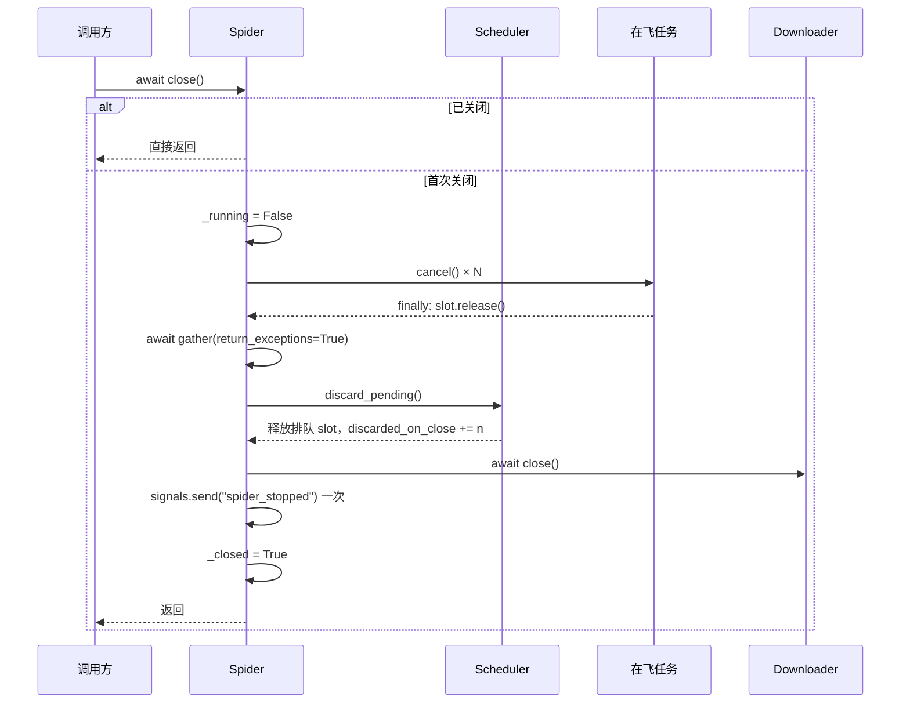

# ADR-0003：关闭、取消与主循环收敛

| 项目 | 内容 |
|------|------|
| 状态 | **Accepted（2026-11-04）** |
| 日期 | 2026-11-04（起草并接受） |
| 基线 | `master @ 3cb4eb1`（ADR-0002 L1–L4 已落地：slot 凭据、入队原子化、`audit()`） |
| 关联问题 | **P1-02（主）**、P2-23、P1-20；关联 P1-09（阶段 4 的 flush 接入点） |
| 关联文档 | [08 §8.11 阶段 2](../wiki/08-issues-and-recommendations.md)、[01 架构](../wiki/01-architecture.md)、[ADR-0002](0002-schedule-slot-ownership-and-request-lifecycle.md) |
| 决策者 | 项目维护者 |

> 本文冻结「进程内如何收敛、如何取消、关闭时各资源的释放顺序」的契约，**不包含代码变更**。文中的类型与签名是方案描述，实施另行提交。

## 1. 背景

ADR-0002 把「一次调度占用了什么、谁负责归还」定死了，L1–L4 已落地。但它对**收尾**只给了方向（§2.6 四条要点），三个关键点仍未定义：

1. 主循环判定「没有工作了」的精确条件。L4 为了让 `get_request()` 不再永久阻塞，把退出条件改成了「出队返回空 ∧ in-flight 为空」，这依赖一个隐含前提：**任何后续请求都只能由仍在飞的任务产生**。该前提当前成立，但没有任何余量，阶段 4 接入异步生产者（中间件、持久化回调）后就会失效。
2. `close()` 的语义。它现在仍是一个「只在运行中才有意义」的函数：未 `start()` 就 `close()` 直接返回，资源不释放；运行中 `close()` 不取消、不排空。
3. 取消的所有权边界。`Downloader.start_downloader` 结束时取消 `asyncio.all_tasks()` 中除自己以外的所有任务，这是库代码不该有的副作用。

这三点的共同点是**终态**：谁在什么条件下停止、停止时按什么顺序归还资源、停止后还能不能再启动。ADR-0002 的 I1–I4 只覆盖运行期，没有覆盖终态。

### 1.1 现状

| 资源 / 环节 | 获取点 | 写入点 | 释放点 | 缺口 |
|-------------|--------|--------|--------|------|
| 主循环退出判定 | — | `spider.py:502-509` | — | 只判「队列空 + in-flight 空」，无静默余量；队列为空由 `get_request()` 的 50ms 轮询间接提供 |
| 任务登记 | `spider.py:524`（主循环）、`spider.py:429`（直接调用） | 同点 | `spider.py:481-482`（done 回调） | 回调只 `pop`，**不消费 `task.exception()`**；无 `_tasks` 集合与异常计数 |
| 在飞任务取消 | — | — | — | 无任何取消路径；`close()` 不处理 `_inflight` |
| 队列残留 | `scheduler.py` `put_nowait` | — | `discard_pending()`（`scheduler.py:392`） | **无人调用**：`close()` 不排空 |
| `httpx.AsyncClient` | `Downloader.__init__` | — | `downloader.py:474-475` | `Spider.close()` 在 `_running=False` 时提前返回（`spider.py:532-535`），未 start 即泄漏 |
| 第三方任务 | — | — | — | `start_downloader` 取消 `asyncio.all_tasks()`（`downloader.py:466-468`） |
| `spider_stopped` 信号 | — | `spider.py:548` | — | 无「只发一次」保证；close 提前返回时永不发送 |

### 1.2 实测证据（2026-11-04，`master @ 3cb4eb1`）

> 以下为本地只读脚本实测，非静态推断。

| # | 场景 | 实测结果 |
|---|------|----------|
| E1 | 未 `start()` 直接 `await spider.close()` | `downloader.client.is_closed == False` —— client 未关闭（P2-23 复现） |
| E2 | 调度 3 条、取出 1 条并在飞、`await spider.close()` | 在飞任务 `done() == False`；`_inflight` 仍为 1；`scheduler.audit()["idle"] == False`；`current_requests == 3`；`request_queue.qsize() == 2`；`discarded_on_close` 未增加 |
| E3 | 先建一个宿主任务，再 `await start_downloader(2)` | `host_task.cancelled() == True` —— 宿主任务被连带取消（P1-20 复现） |
| E4 | 任务内逃逸 `BaseException` | 事件循环打印 `Task exception was never retrieved`；`stats["unhandled_task_errors"]` 不存在 |
| E5 | 单请求爬取，测量「最后一个请求完成 → `start()` 返回」 | 尾延迟约 62ms（≈ `poll_interval` 50ms），**没有任何静默窗口**；`idle_grace` 尚不可配 |

推论（标注为推断，不作为验收依据）：E5 的 62ms 说明退出速度只由轮询粒度决定；一旦阶段 4 的异步生产者晚于最后一个任务入队，当前条件会**直接漏掉它**，与 ADR-0002 E5 修复前的表现同类，只是触发者从「回调」变成「后台生产者」。

### 1.3 决策驱动因素

1. **终态必须可断言**：关闭后所有资源归零、`audit()["idle"]` 为真，且能用一条测试表达（ADR-0002 I4 的落地条件）。
2. **取消不得外溢**：库只能取消自己创建的任务。调用方或宿主框架的任务状态不在本库的处置范围内。
3. **关闭时长必须可控**：`close()` 不能因为某个下载卡住而变成几十秒；「优雅等待」需要单独的策略与超时语义，不能偷偷塞进 close。
4. **失败必须可见**：任务级未捕获异常不能只靠 GC 时的 stderr 警告暴露，必须进入统计与日志。
5. **不重复登记**：L1–L4 已建了 `_inflight`，再引入 `_tasks` 会造成两套生命周期状态。

## 2. 决策

### 2.1 所有权矩阵（收敛期）

| 阶段 | 持有者 | 移交点 | 释放责任 |
|------|--------|--------|----------|
| 主循环空转 | Spider | `get_request()` 返回 slot | 循环本身不持有资源 |
| 任务创建 → 任务结束 | Spider（`_inflight` 登记） | `add_done_callback` | 任务自身 `finally` 释放 slot；回调移除登记 |
| 任务结束 → 关闭 | 无人 | — | 已释放 |
| 关闭发起 | 调用方 | `close()` | Spider 负责取消在飞、排空队列、关闭 client |
| 排队请求 | Scheduler 队列 | `discard_pending()` | `close()` 调用，逐条 `slot.release()` |
| `httpx.AsyncClient` | Downloader | — | `downloader.close()`，幂等 |
| 第三方任务 | 调用方 | — | **本库不持有、不取消** |

不变量（全部可用 `audit()` 与 `get_stats()` 断言）：

- **I5 关停终态**：`close()` 返回后，`_inflight` 为空、`request_queue.qsize() == 0`、`scheduler.audit()["idle"]` 为真、`downloader.client.is_closed` 为真、`spider_stopped` 恰好发送一次。
- **I6 取消不外溢**：`close()` 与 `start_downloader()` 只取消自己记录的任务；调用方任务在调用前后 `cancelled()` 状态不变。
- **I7 幂等可重入**：`close()` 重复调用、并发调用，资源只释放一次，且不抛异常。
- **I8 终态不可重启**：`close()` 之后调用 `start()` 抛 `RuntimeError`；如需再次爬取，重新实例化。

### 2.2 主循环收敛契约

新增 Spider 构造参数：

```python
Spider(..., idle_grace: float = 0.5)
```

- 维护 `self._last_activity: float`（`time.monotonic()`，不用墙钟，避免系统时间跳变）。
- 更新点只有四处：`get_request()` 成功返回 slot、`create_task` 之后、任务结束回调、`_schedule()` 返回 `SCHEDULED`。
- 退出条件（三项同时成立）：

```text
get_request() 返回 None
且 not self._inflight
且 time.monotonic() - self._last_activity >= self.idle_grace
```

- `idle_grace=0` 时退化为 L4 现行条件（立即退出），供测试与「确定没有异步生产者」的场景使用。
- **禁止**用「空转次数」代替时间窗：次数与 `poll_interval` 耦合，无法表达「静默 0.5 秒」这一语义。
- 退出后仍走 `finally: await self.close()`，关闭语义与主动调用完全一致。

### 2.3 任务登记与异常消费

复用 `_inflight: dict[asyncio.Task, Request]` 作为唯一任务注册表，**不新增 `_tasks` 集合**（ADR-0002 §2.6 的 `_tasks` 意图由本表承载）。

```python
def _on_task_done(self, task: asyncio.Task) -> None:
    self._inflight.pop(task, None)
    self._last_activity = time.monotonic()
    if task.cancelled():
        self.stats["cancelled_requests"] += 1
        return
    exc = task.exception()          # 消费异常，避免 GC 时的 stderr 警告
    if exc is not None:
        self.stats["unhandled_task_errors"] += 1
        self.logger.error(f"Unhandled task error: {exc!r}", exc_info=exc)
```

- 回调必须是**同步函数**（`asyncio` 明确要求，不能 await）。
- `process_request` 已经捕获 `Exception`，本路径实际只处理**逃逸的 `BaseException`**（如用户 errback 中的 `SystemExit`、`MemoryError`、`KeyboardInterrupt`）。记录后**不重新抛出**：回调里抛出的异常只会进入事件循环的异常处理器，反而更难观测。
- 被取消的任务**不记 error、不计 `unhandled_task_errors`**，只计 `cancelled_requests`。

### 2.4 `close()` 契约

```python
async def close(self) -> None:
    """幂等、与 _running 解耦、可在未 start 时调用。"""
```

状态与同步：

- `_closed: bool`（已完成）、`_close_lock: asyncio.Lock`（串行化并发关闭）。
- 双重检查：进入时若 `_closed` 立即返回；取得锁后再检查一次。

严格顺序：

1. 置 `_running = False`（主循环不再创建新任务）；若 `finish_time` 未设置则写入。
2. **取消**在飞任务：快照 `list(self._inflight)`，逐个 `cancel()`，`await asyncio.gather(*snapshot, return_exceptions=True)`。
   - 取消后各任务的 `finally` 会 `slot.release()`，登记由回调清除。
3. **排空**队列：`self.scheduler.discard_pending()`，返回值累加到 Scheduler 的 `discarded_on_close`。
4. `await self.downloader.close()`（幂等：重复 `aclose()` 安全）。
5. 发送 `spider_stopped` **一次**。
6. 置 `_closed = True`。

顺序理由：

- 先停循环再取消任务：否则循环可能在取消过程中又 `create_task` 出新任务。
- 先取消任务再排空队列：被取消的任务可能正停在 `_schedule()` 里（取消会让 Scheduler 自行回滚），排空放在其后可清理它已成功入队但没人消费的条目。
- client 最后关：被取消的任务已经在 `finally` 里归还了 slot，不再需要网络；放在信号之前可以让监听者在收到 `spider_stopped` 时看到一个完整关闭的资源。

边界：

- **未 `start()` 就 `close()`**：跳过耗时统计（`_start_time == 0` 时不计算 duration），其余步骤照常执行。这是 E1 的修复点。
- **关闭后再 `start()`**：抛 `RuntimeError("Spider has been closed; create a new instance")`。
- **关闭后 `_schedule()`**：返回 `None` 并记 `warning`，签名改为 `-> Optional[ScheduleResult]`。不产生排队，也不伪造成 `QUEUE_FULL`/`LIMIT_REACHED` 这类语义不符的 reason。
- **被取消的请求**：不计入 `failed_requests`，不发送 `request_finished(success=False)`。取消不是失败，混入失败统计会让「熔断阈值」和「成功率」失真；观测走 `cancelled_requests`。
- 不实现 `__del__`：事件循环可能已关闭，无法可靠执行 async 关闭。
- 提供 `async with Spider(...)`：`__aenter__` 返回 `self` 且**不自动 start**；`__aexit__` 调用一次 `close()`。这是「忘记关闭」的最小迁移路径。

### 2.5 worker 模式的取消边界（P1-20）

```python
workers = [asyncio.create_task(self.start_worker()) for _ in range(many)]
try:
    await self.request_queue.join()
finally:
    for task in workers:
        task.cancel()
    await asyncio.gather(*workers, return_exceptions=True)
```

- 只取消 `workers`；`asyncio.all_tasks()` 从本方法中移除。
- `many = many or self.concurrency` 保持不变。
- worker 模式仍是「兼容适配器」，去留不在本 ADR（承接 ADR-0001 §8 结论 3）。
- `finally` 而非仅正常路径：`join()` 被取消时也必须回收自己创建的 worker，否则取消反而制造泄漏。

### 2.6 统计与观测

| 指标 | 归属 | 变更 |
|------|------|------|
| `unhandled_task_errors` | Spider | **新增**：任务级逃逸异常数（不含取消） |
| `cancelled_requests` | Spider | **新增**：被 `close()` 取消的在飞任务数 |
| `closed` | Spider `get_stats()` | **新增**：`_closed` 的只读投影，便于测试与运维断言 |
| `discarded_on_close` | Scheduler | 已有，本 ADR 要求 `close()` 真正调用 `discard_pending()` 使其生效 |
| `failed_requests` | Spider | **不变**：取消不计入 |
| `spider_stopped` | Signal | 语义收紧为「恰好一次」 |

## 3. 目标状态



关停后的可执行对账断言：

```python
audit = spider.scheduler.audit()
assert spider.get_stats()["inflight_count"] == 0
assert spider.get_stats()["closed"] is True
assert spider.scheduler.request_queue.qsize() == 0
assert audit["idle"] is True and audit["mismatch_count"] == 0
assert spider.downloader.client.is_closed is True
```

## 4. 备选方案

| 方案 | 描述 | 结论 | 理由 |
|------|------|------|------|
| A. 只在现有 `close()` 上加 `try/finally` | 保留 `if not self._running: return`，只保证异常时关 client | 拒绝 | 未 start 时仍然泄漏（E1）；在飞任务与排队项仍无人处理（E2），I5 无法成立 |
| B. 优雅排空：先等在飞任务自然结束（带超时），再取消 | 让已开始的下载尽量完成 | 留待后续 | 关闭时长被最慢请求绑定，超时后「丢弃还是继续等」需要单独策略；应作为 `stop(graceful=True, timeout=...)` 独立决策，不能混进 close |
| C. `asyncio.TaskGroup` 托管任务 | 结构化并发 | 拒绝 | 本框架有意不限制并发任务数（每请求一个任务、无上限）；TaskGroup 会等待全部子任务并在退出时强制取消，与现有模型冲突 |
| D. 用「连续空转 N 次」判定收敛 | 不引入时间窗 | 拒绝 | N 与 `poll_interval` 耦合，改轮询粒度就改变收敛语义；无法表达「静默 0.5s」 |
| E. `__del__` 里兜底关闭 | 忘记 close 也能释放 | 拒绝 | 析构可能发生在事件循环关闭之后，`await client.aclose()` 无法执行；只能制造误导性告警 |
| F. 关闭时把残留请求落盘待重放 | 不丢任务 | 留待后续 | 依赖持久化层与去重语义（P1-09/P1-11 阶段 4）；本 ADR 只做「释放并计数」 |
| G. 允许 close 后重启（重建 client） | 复用实例 | 拒绝 | 信号、统计、熔断器、`seen_urls` 的语义都不清晰；重建一半的状态比新建实例更容易出错 |
| H. 关闭时取消 `asyncio.all_tasks()`（现状 worker 做法） | 一行搞定 | 拒绝 | 取消宿主任务（E3），库代码不可接受的副作用；且会连带取消用户自己的后台任务 |
| I. 用 `asyncio.wait_for(queue.get(), ...)` 做退出超时 | 少写一个轮询 | 拒绝 | 已在 ADR-0002 §2.4 否决：取消 `Queue.get()` 有丢件风险，丢件等于漏释放 |
| J. 显式 slot + 关闭时取消 + 排空 + 幂等状态机（**采纳**） | §2.2–§2.5 | 采纳 | 终态可断言、取消不外溢、关闭时长可控、异常可观测；与 ADR-0002 的凭据模型同构 |

## 5. 影响与后果

### 5.1 破坏性变更与迁移

| 变更 | 影响 | 迁移方式 |
|------|------|----------|
| `close()` 在未 `start()` 时也会关闭 client | 依赖「close 是空操作」的代码 | 行为变为正确释放；重复关闭安全，无需迁移 |
| `close()` 后 `start()` 抛 `RuntimeError` | 复用实例反复跑的脚本 | 每次爬取新建 `Spider` 实例；或用 `async with` 包一次运行 |
| `close()` 取消在飞请求 | 期望「close 后回调仍会跑完」的代码 | 需要等待完成时，先 `await` 自己的同步点再 close；优雅停止待方案 B |
| `_schedule()` 返回 `Optional[ScheduleResult]` | 内部调用与测试 | `_dispatch_item` 忽略返回值；测试在关闭前调用即可 |
| 新增 `idle_grace` 构造参数（默认 0.5s） | 退出多等最多 0.5s | 需要立即退出时传 `idle_grace=0` |
| `start_downloader` 不再取消第三方任务 | 依赖该副作用结束宿主任务的代码 | 调用方自行管理自己的任务 |
| 新增 `unhandled_task_errors` / `cancelled_requests` / `closed` 统计 | 无 | 新增字段，向后兼容 |

### 5.2 非破坏性收益

- E1/E2/E3/E4 四个实测缺口全部有对应验收条件，I5/I6 可自动断言；
- 关闭时长有上界：`close()` = 「取消（立即）+ gather（瞬间）+ 排空（同步）+ aclose（毫秒级）」，不等待网络；
- 任务级逃逸异常从「GC 时的 stderr」变成「计数 + 带 traceback 的 error 日志」；
- 阶段 4 接入异步生产者时，`idle_grace` 提供了一个可调的安全窗口，而不是靠「正好没有晚到请求」。

### 5.3 风险与权衡

- **`idle_grace` 让每次空跑多等约 0.5s**：只影响「没有任何请求」的场景（启动即空队列），对批量爬取可忽略；测试里显式传 0 可保持快速。
- **直接取消会丢弃正在下载的页面**：这是刻意的——关闭是用户主动中断，不是「尽量完成」。若将来需要，新增 `stop(graceful=True)` 而不是改 close。
- **`close()` 依赖 `_close_lock`**：锁只在 Spider 内部使用，不与 Scheduler 的锁交叉，无死锁风险；锁必须在 close 之前创建（构造期），不能在关闭路径上懒初始化。
- **`cancelled_requests` 可能被误读为失败**：文档与统计说明中必须写明「取消不是失败，不计入 `failed_requests`」。

## 6. 实施拆解

> 本次仅提交本 ADR，不改代码。

| 任务 | 内容 | 主要文件 | 依赖 | 覆盖问题 |
|------|------|----------|------|----------|
| L5a | `idle_grace` 参数、`_last_activity` 更新点、三条件退出判定 | `webants/spider.py` | L4 | P1-02 |
| L5b | `_on_task_done`：登记清理、`cancelled_requests`、`unhandled_task_errors`、异常消费 | `webants/spider.py` | L5a | P1-02 |
| L6a | `close()` 状态机：`_closed` + `_close_lock`、取消、gather、drain、client、信号一次 | `webants/spider.py` | L5b | P2-23、P1-02 |
| L6b | 未 start 也能关闭、`start()` 拒绝重启、`__aenter__`/`__aexit__`、关闭后 `_schedule` 返回 `None` | `webants/spider.py` | L6a | P2-23 |
| L7 | `start_downloader` 改为只取消自建 worker（`try/finally`） | `webants/downloader.py` | — | P1-20 |
| L8 | 测试与文档：E1–E5 回归、`idle_grace` 时序、并发 close；同步 01/02/03/06/08/09 | `tests/`、`docs/` | L5–L7 | 全部 |

## 7. 验收标准

- [ ] 未 `start()` 直接 `close()`：`downloader.client.is_closed` 为真，`spider_stopped` 发送 1 次（复现并修复 E1）。
- [ ] 有 1 个在飞任务 + 2 条排队时 `close()`：任务全部结束、`_inflight` 为空、`qsize() == 0`、`discarded_on_close == 2`、`cancelled_requests == 1`、`audit()["idle"]` 为真（复现并修复 E2）。
- [ ] `close()` 连续调用两次、以及两个协程并发调用：`close()` 均正常返回，client 只被关闭一次、`spider_stopped` 只发一次、无异常（I7）。
- [ ] `close()` 后 `start()` 抛 `RuntimeError`（I8）。
- [ ] 任务内逃逸 `BaseException`：`unhandled_task_errors == 1`，且日志含 traceback；用 `loop.set_exception_handler` 断言**没有** `Task exception was never retrieved` 回调（复现并修复 E4）。
- [ ] `idle_grace=0` 时「最后一个请求完成 → `start()` 返回」< 0.2s；`idle_grace=0.5` 时 ≥ 0.5s（用 `time.monotonic()` 断言，证明参数生效；E5）。
- [ ] 一个宿主任务在 `await start_downloader(n)` 前后 `cancelled()` 均为 False；worker 任务已全部结束（复现并修复 E3）。
- [ ] 正常端到端：`await spider.start()` 返回后 `closed is True`、`audit()["idle"]` 为真、`mismatch_count == 0`。
- [ ] `uv run pytest -q tests/test_scheduler.py tests/test_spider.py tests/test_downloader.py` 全绿且离线。
- [ ] 文档同步：01/02/03/06/08/09 中关于 `close`、`_processing`、主循环退出与 worker 取消的描述改为新契约。

## 8. 评审结论

原 6 个未决点按建议默认处理，随本 ADR 接受一并冻结：

| # | 问题 | 结论 |
|---|------|------|
| 1 | `idle_grace` 默认值 | **0.5s**。轮询 50ms 的 10 倍，覆盖一次事件循环抖动与阶段 4 异步生产者的常见延迟；测试传 0 保持快速 |
| 2 | `close()` 是直接取消在飞任务，还是优雅等待 | **直接取消**。关闭时长可控；优雅停止另开 `stop(graceful=True, timeout=...)` 决策（方案 B） |
| 3 | 关闭后是否允许重启 | **禁止**，抛 `RuntimeError`。状态（seen_urls/熔断/信号/统计）无法干净复位 |
| 4 | 是否提供 `async with Spider(...)` | **提供**，`__aenter__` 不自动 start，`__aexit__` 只 close。成本低，直接消除「忘记关闭」类泄漏 |
| 5 | 被取消的请求是否计入 `failed_requests`、是否发 `request_finished` | **都不**。取消单独计 `cancelled_requests`，避免污染成功率与熔断阈值 |
| 6 | 是否新增 `ScheduleReason.CLOSED` | **不新增**。关闭后 `_schedule()` 返回 `None` 并告警，避免改动 ADR-0002 已冻结的 reason 枚举 |

实施顺序按 §6 的 L5a → L5b → L6a → L6b → L7 → L8。

## 9. 参考

- [08 问题与建议](../wiki/08-issues-and-recommendations.md) — P1-02、P1-20、P2-23；§8.11 阶段 2；§8.12「三种场景计数恢复」
- [01 架构](../wiki/01-architecture.md) — §1.2 运行时结构、§1.9 架构风险
- [ADR-0002](0002-schedule-slot-ownership-and-request-lifecycle.md) — §2.1 I2/I4、§2.4 轮询、§2.6 取消与关闭、§6 L5–L7
- 代码位置：`webants/spider.py:214`、`webants/spider.py:481-549`、`webants/scheduler.py:367-413`、`webants/downloader.py:457-476`
