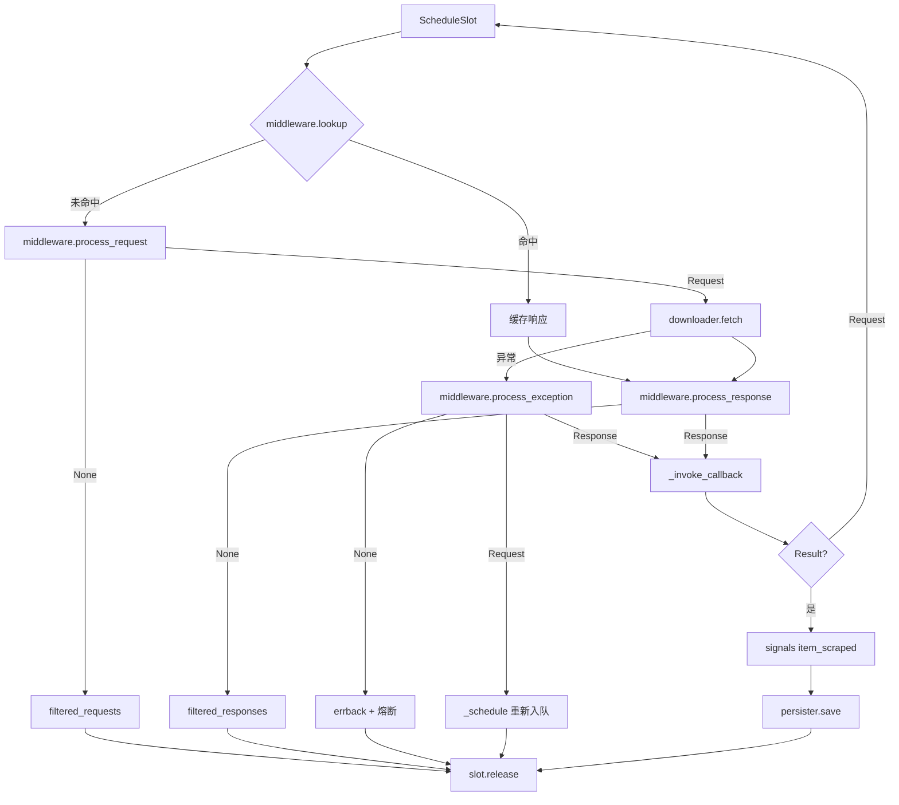

# ADR-0005：可选层接入与关闭语义：中间件缓存命中、配置注入、持久化 flush/close 与 JSON 原子追加

| 项目 | 内容 |
|------|------|
| 状态 | **Accepted（2026-11-05）** |
| 日期 | 2026-11-05（起草并接受） |
| 基线 | `master @ ccdaabc`（ADR-0001/0002/0003/0004 均已 Accepted 并落地；测试基线 `155 passed`） |
| 关联问题 | **P1-11（主）**、P1-09、P1-10、P2-19 |
| 关联文档 | [08 §8.11 阶段 4](../wiki/08-issues-and-recommendations.md)、[01 架构](../wiki/01-architecture.md)、[03 主链路](../wiki/03-crawler.md)、[06 依赖](../wiki/06-dependencies.md)、[ADR-0003](0003-shutdown-cancellation-and-loop-quiescence.md)、[ADR-0004](0004-data-correctness-link-filter-config-cache-signal.md) |
| 决策者 | 项目维护者 |

> 本文冻结「可选层如何进入 `Spider`、缓存命中在中间件链中的表示、持久化何时 flush/close、JSON 后端如何写入」的契约，**不包含代码变更**。文中的类型与签名是方案描述，实施另行提交。

## 1. 背景

8.11 的阶段 4 被归为「可选层接入与关闭语义」：`Config`、`MiddlewareManager`、`PersisterManager`、异步 `SignalManager` 都已实现，但没有任何核心模块引用它们。结果是文档声称的「支持中间件/持久化/配置」在实际运行路径上都不成立。

### 1.1 现状

| 环节 | 实现位置 | 当前行为 | 缺口 |
|------|----------|----------|------|
| Spider 组件构造 | `spider.py:174-182` | 直接 `Scheduler`/`Downloader`/`Parser`，参数来自构造参数 | 无 `Config` 入口；`config` 单例与 Spider 参数互不相干（P1-11） |
| Spider 可选层属性 | `spider.py:194-232` | 只有 `scheduler`/`downloader`/`parser`/`signals` | 无 `middleware`/`persister`/`config`（P1-11） |
| 请求处理 | `spider.py:430-501` | `downloader.fetch` → `_invoke_callback` | 中间件没有 `lookup`/`process_request`/`process_response`/`process_exception` 阶段（P1-11） |
| 结果分发 | `spider.py:418-428` | `Result` 只发同步 `item_scraped` 信号 | 不落盘；`PersisterManager` 无调用点（P1-11） |
| 关闭流程 | `spider.py:584-633` | 取消在飞 → 丢弃排队 → 关闭 downloader → 宣布关闭 | 不 flush/close persister，尾部批次丢失（P1-09） |
| 中间件链 | `middleware.py:454-505` | `process_request` 返回值被当作下一个 `Request` | `ResponseCache` 命中时返回 `httpx.Response`，后续中间件收到错误类型（P1-10） |
| 响应缓存 | `middleware.py:365-451` | 命中逻辑写在 `process_request`，无统计 | 缓存命中必须走「返回响应」这条非请求通道（P1-10） |
| Persister 基类 | `persister.py:22-91` | 只有 `save`/`load`，无 `flush`/`close`/`__aenter__` | 进程正常退出时不足 `batch_size` 的数据全部丢失（P1-09） |
| JSON 写入 | `persister.py:181-202` | 每批 `json.load` 全量读 → `extend` → `json.dump` 全量写 | O(n²)；直接 `open(path, "w")`，序列化失败即截断原文件（P2-19） |
| `Request.prepare` | `request.py:332-343` | 按请求持有的中间件列表执行 | 全仓库无调用点；与 Manager 语义重复（P1-11） |
| 异步信号 | `signals.py:261-280` | 全局 `signal_manager`，仅被 `middleware.py:25` 引用 | Spider 生命周期事件仍只走同步 `Spider.signals`（P1-11） |

### 1.2 实测证据（2026-11-05，`master @ ccdaabc`）

> 以下为本地只读探针实测，非静态推断。探针通过 `PYTHONPATH=. uv run python - <<'PY'` 运行，不联网、不修改仓库。

| # | 场景 | 实测结果 |
|---|------|----------|
| E1 | `JsonPersister(batch_size=100)` / `CsvPersister(batch_size=100)` / `SqlitePersister(batch_size=100)` 各 `save` 3 条后直接 `load` | JSON、CSV 文件均不存在，`load()` 为 `[]`；SQLite 行数为 `0`。三个后端与 `PersisterManager` 均无 `flush`/`close`/`__aenter__` |
| E2 | `MiddlewareManager` 依次挂 `ResponseCache`、`Recorder`；第一次请求下载并 `process_response`，第二次同 URL 请求 | `Recorder.process_request` 观察到的类型序列为 `['Request', 'Response']`；第二次 `process_request` 返回 `Response` 对象 |
| E3 | `Spider()` 实例属性与全仓库 import 关系 | `middleware`/`persister`/`config`/`signal_manager` 属性均不存在；`grep` 仅命中 `webants/libs/middleware.py:25` 对 `libs.signals` 的引用 |
| E4 | `JsonPersister(batch_size=2)` 连续 `save` 6 条（触发 3 次写）；以及首批成功后写入一个不可序列化对象 | 6 条数据共触发 2 次整文件读取；不可序列化对象使 `open(..., "w")` 后的文件只剩 38 字节且 `json.loads` 抛 `JSONDecodeError`——原记录被截断 |
| E5 | `Config()` 与 `Spider()` 的实际参数对比 | `config.get("scheduler.domain_delay") == 1`，`Spider().scheduler.domain_delay == 0`；`config.get("storage.batch_size") == 100`，但没有任何代码把它传给 `JsonPersister` |
| E6 | `Request.prepare` 调用点 | 全仓库无 `.prepare(` 调用；`Request.add_middleware` 也无调用方 |
| E7 | 基线回归 | `uv run pytest -q` → `155 passed in 14.31s`（离线） |

### 1.3 决策驱动因素

1. **默认行为不能变**：现有 `Spider()` 不接可选层时，请求路径、统计与关闭语义必须与 `ccdaabc` 一致；155 条基线不得减少。
2. **中间值类型必须单一**：请求阶段只接受 `Request`，响应是另一种类型；缓存命中不能用「让 `process_request` 返回响应」表达（E2）。
3. **关闭即落盘**：`close()` 是终态（ADR-0003），必须在这一个入口完成 flush，否则「正常退出也丢数据」无法通过验收（E1）。
4. **写入失败不能扩大损坏**：一次序列化错误不能让已落盘数据消失（E4）；文件格式要为追加写设计，而不是全量读改写（P2-19）。
5. **可选层显式接入**：`Config`、中间件、持久化由调用方注入；不自动消费全局单例，避免环境变量/全局状态改变隐式影响所有 Spider（E5）。
6. **异步信号不阻塞本阶段**：两套 Signal 体系并存是已登记技术债（08 §8.9/§8.10），阶段 4 只冻结「同步信号是 Spider 的稳定事件 API，异步信号暂列实验性」，不做桥接（见 §2.6、§4 方案 N/O）。

## 2. 决策

### 2.1 Spider 可选层注入（P1-11）

`Spider.__init__` 新增三个关键字参数，默认值均为 `None`：

```python
def __init__(
    self,
    *,
    concurrent_requests: int | None = None,
    request_timeout: float | None = None,
    retry_times: int | None = None,
    retry_delay: float | None = None,
    log_level: int | None = None,
    failure_threshold: int | None = None,
    recovery_timeout: float | None = None,
    idle_grace: float = 0.5,
    config: Config | None = None,
    middleware: MiddlewareManager | None = None,
    persister: PersisterManager | None = None,
    **kwargs,
):
```

不变量：

- **I1 默认不变**：`config`/`middleware`/`persister` 均为 `None` 时，组件参数与 `ccdaabc` 完全一致（`10 / 30 / 3 / 1.0 / INFO / 5 / 60.0`，调度器 `domain_delay=0`、`max_queue_size=10000`）。
- **I2 显式参数优先**：构造参数非 `None` 时覆盖 `config` 中的同名值；`config` 为 `None` 时使用 Spider 自身默认值（不是 `DEFAULT_CONFIG`）。
- **I3 注入即拥有**：`config` 只读；`middleware` 不持有需要关闭的资源；`persister` 的生命周期移交给 Spider——`Spider.close()` 负责 flush + close。需要跨 Spider 共享的存储应在上层另行管理，不通过 `Spider(persister=...)` 复用。
- **I4 全局单例不隐式生效**：模块级 `config` 与 `signal_manager` 不会因为导入而被 Spider 使用；必须显式传入 `Config(...)`。

`Spider.settings` 保留现有键（`CONCURRENT_REQUESTS`、`REQUEST_TIMEOUT`、`RETRY_TIMES`、`RETRY_DELAY`），并反映**最终生效值**；`custom_settings` 与 `**kwargs` 仍按现有规则合并到 `settings`，但不改变组件构造参数（与当前行为一致）。

### 2.2 Config 生效映射

只有显式传入 `config` 时，以下键才参与组件构造；否则走 Spider 默认值。

| Spider 参数 / 组件 | Config 键 | 无 `config` 时 |
|-------------------|-----------|----------------|
| `concurrent_requests` → Downloader | `downloader.concurrent_requests` | `10` |
| `request_timeout` → Downloader | `downloader.request_timeout` | `30` |
| `retry_times` → Downloader | `downloader.retry_times` | `3` |
| `retry_delay` → Downloader | `downloader.retry_delay` | `1.0` |
| 调度器 `max_domain_concurrent` | `scheduler.max_domain_concurrent` | 同 `concurrent_requests` |
| 调度器 `domain_delay` | `scheduler.domain_delay` | `0`（Scheduler 默认） |
| 调度器 `request_delay` | `scheduler.request_delay` | `0` |
| 调度器 `max_requests` | `scheduler.max_requests` | `0` |
| 调度器 `max_queue_size` | `scheduler.max_queue_size` | `10000` |
| Parser `encoding` | `parser.default_encoding` | `"utf-8"` |
| Parser `max_document_size` | `parser.max_document_size` | `10485760` |
| Parser `cache_size` | `parser.cache_size` | `1000` |
| `failure_threshold` | `spider.failure_threshold` | `5` |
| `recovery_timeout` | `spider.recovery_timeout` | `60.0` |
| `log_level` | `logging.level`（字符串→`logging` 级别） | `logging.INFO` |

要点：

- `concurrent_requests` 显式传入时**同时**设置 Downloader 并发与 `scheduler.max_domain_concurrent`（保持旧语义）；传入 `config` 且未显式覆盖时，两者分别取各自键。
- `logging.level` 只接受 `DEBUG`/`INFO`/`WARNING`/`ERROR`/`CRITICAL`（大小写不敏感）；未知值回退 `INFO` 并 `warning`。
- `downloader.user_agent` / `default_headers` 暂不接线：`_fetch` 的 `request.headers or self.headers` 恒取前者（P2-18），现在接线也不会生效。P2-18 留待阶段 5。
- `storage.*` 暂不自动构造 Persister；组装示例按配置值显式创建后端（见 §3.3）。存储工厂不在本 ADR 范围。

### 2.3 中间件契约（P1-10、P1-11）

#### 2.3.1 四个阶段

`Middleware` 增加一个**非抽象**方法 `lookup`，其余三个方法语义保持不变：

```python
class Middleware:
    async def lookup(self, request: Request) -> Any | None:
        """Return a cached response, or None to continue the request chain."""
        return None

    async def process_request(self, request: Request) -> Request | None: ...
    async def process_response(self, response: Any, request: Request) -> Any | None: ...
    async def process_exception(self, exception: Exception, request: Request) -> Request | Any | None: ...
```

`MiddlewareManager` 增加：

```python
async def lookup(self, request: Request) -> Any | None:
    """First non-None hit wins; chain order is registration order."""
```

不变量：

- **I5 缓存命中不进入请求链**：`lookup` 只返回响应或 `None`；`process_request` 的返回值只允许 `Request` 或 `None`。Manager 在 `process_request` 中校验返回值类型，非 `Request` 立即 `TypeError`（fail fast），不再把响应静默传给下一个中间件（E2）。
- **I6 阶段顺序**：`lookup`（注册顺序，首个命中即停止）→ `process_request`（注册顺序）→ 下载 → `process_response`（逆序）→ 回调。未命中时 `lookup` 不修改请求。
- **I7 命中仍走响应链**：缓存命中得到的响应仍执行 `process_response`（逆序），让压缩/过滤等中间件看到它；`ResponseCache.process_response` 对同 URL、同响应对象的再次调用只更新访问时间，不重复写入。TTL 因此是滑动过期。
- **I8 命中不下载**：`lookup` 命中时 Spider 不调用 `downloader.fetch`；该请求仍计为成功（回调正常执行），并额外累加 `cache_hits`。
- **I9 丢弃不是错误**：`process_request` 返回 `None` 表示中间件主动过滤，Spider 不调用 errback、不计失败，释放调度槽位后结束；`process_response` 返回 `None` 同理，均只累加独立统计。
- **I10 URL 不可变**：`process_request` 可以返回新的 `Request`，但其规范化 URL 的 host 必须与原请求一致。调度去重与 `ScheduleSlot` 的域计数都以原 URL 为准；跨域改写必须作为新请求通过回调产出，不能就地替换。
- **I11 异常阶段不循环**：`process_exception` 返回 `Request` 时，Spider 通过 `_schedule` 重新入队，并把 `request.meta["_middleware_retry"]` 加一；超过 `middleware_max_retries`（默认 3）后忽略替换，按原失败路径处理。返回响应时直接交给回调，不再重跑 `process_response`。返回 `None` 时走现有 errback + 熔断统计。
- **I12 中间件异常是请求失败**：`lookup`/`process_request`/`process_response` 抛出的异常与下载失败同级，走 errback、熔断计数与 `failed_requests`；`process_exception` 自身抛出的异常记录后视为该中间件「无替换」，继续询问下一个（与现有 Manager 行为一致）。

#### 2.3.2 `ResponseCache` 改造

- 命中判断、TTL 检查、LRU 访问时间更新全部移入 `lookup`；`lookup` 未命中时累加 `misses`，命中累加 `hits`，过期累加 `expired`，淘汰累加 `evictions`。
- `process_request` 变为纯透传（返回 `request`），保留方法以满足 ABC，也避免旧代码调用时失效。
- `process_response` 只在「URL 当前条目不是同一个响应对象」时写入；同对象命中只刷新时间。缓存条目统一为 `url -> (response, stored_at, last_access)`，淘汰按 `last_access`。
- 新增 `stats` 字典与 `MiddlewareManager.get_stats()`（按中间件类名聚合 `stats` 属性）。

### 2.4 持久化生命周期（P1-09）

#### 2.4.1 所有权矩阵

| 阶段 | 持有者 | 移交点 | 释放责任 |
|------|--------|--------|----------|
| 创建 Persister | 调用方 | `Spider(persister=...)` | **移交给 Spider** |
| `save(Result)` | Spider | `_dispatch_item` 内 `await` | 失败只记统计，不影响请求结果 |
| 未满批次 | Persister 实例 | `flush()` / `close()` | Persister 自身 |
| 关闭 | Spider | `Spider.close()` | 调用 `PersisterManager.close()`，先 flush 再标记关闭 |
| 关闭后写入 | — | — | 抛 `PersistenceError(code="PERSISTER_CLOSED")` |

#### 2.4.2 接口

```python
class BasePersister(ABC):
    async def flush(self) -> int: ...      # 写入当前批次，返回写入条数
    async def close(self) -> None: ...     # 幂等：flush 后标记关闭
    async def __aenter__(self) -> "BasePersister": ...
    async def __aexit__(self, exc_type, exc, tb) -> None: ...

    @abstractmethod
    async def _write_batch(self) -> int: ...
```

- 每个实例持有 `asyncio.Lock`；`save`、`flush`、`close` 在同一把锁内串行，关闭检查在锁内二次确认（幂等且并发安全）。
- `close()` 先 flush，再置 `_closed=True`；重复调用直接返回。`save()` 在 `_closed` 时抛 `PersistenceError`，不再静默返回 `False`。
- `_write_batch` 成功后才清空 `_batch` 并累加 `total_written`；失败保留批次并向上抛，`save` 捕获后记 `save_errors` 并返回 `False`（现有语义），`flush/close` 则把异常抛给调用方。
- `PersisterManager` 增加 `flush() -> dict[str, int]`、`close() -> dict[str, bool]`、`__aenter__/__aexit__`。`close()` 对每个后端调用 `close`，单个失败记录 `False` 并继续，不阻断其他后端。

#### 2.4.3 Spider 集成

- `_dispatch_item(Result)`：先发同步 `item_scraped`，再 `await self.persister.save(result)`；`PersisterManager.save` 返回 `dict[name, bool]`，任一 `False` 累加 `persist_failures`。持久化异常被捕获、记录并计数，**不把成功页面改写为失败请求**。
- `get_stats()` 在存在可选层时附加 `middleware_stats`、`persister_stats`。
- `Spider.close()` 顺序调整为：`_running=False` → 取消在飞并 `gather` → `scheduler.discard_pending()` → `persister.close()` → `downloader.close()` → 发 `spider_stopped` → `_closed=True`。`persister.close()` 的异常记录后继续关闭 downloader。
- 新增统计字段（可加不可减）：`filtered_requests`、`filtered_responses`、`middleware_retries`、`cache_hits`、`persist_failures`。

### 2.5 JSON 后端：NDJSON 追加与原子迁移（P2-19）

- 文件内容改为 **NDJSON**：每个条目一行紧凑 JSON（`json.dumps(item, ensure_ascii=..., separators=(",", ":")) + "\n"`）。`indent` 参数保留但不再影响输出（仅用于兼容旧签名）。
- `_write_batch`：在锁内取当前批次，若目标文件是旧版 JSON 数组（首个非空白字符为 `[`），一次性读出旧数组，连同新批次写入同目录临时文件，`os.replace` 原子替换；否则以 `"a"` 追加写入，单次 `write` 写完所有行后 `flush`。
- `load()`：优先按行解析 NDJSON；空行跳过；单行解析失败记录 `load_errors` 并跳过该行（不丢其他行）。若整文件是旧版数组（`[` 开头），按数组解析；两种格式都可读。
- `save()` 仍按 `batch_size` 触发 `_write_batch`；`flush()` 无条件写当前批次。
- 单进程内用实例锁串行化；**同一路径只允许一个写入者**（多进程/多实例并发写不在本 ADR 范围，README 注明）。
- `ensure_ascii=False` 继续生效；`ujson` 统一问题（P2-08）仍 Open，不在本 ADR 顺带修改。

### 2.6 事件：同步信号保持稳定，异步信号暂列实验性（P1-11 的边界）

- `Spider.signals`（同步 `Signal`）是 Spider 生命周期与统计的唯一稳定事件 API，本 ADR 不改变其名称、顺序与调用时机。
- 全局异步 `SignalManager` **不自动接入** Spider：不桥接 `spider_started`/`item_scraped` 等生命周期事件。中间件内部（如 `RequestDeduplicator`）继续按其自身语义发送 `request_dropped`。
- 文档必须把异步 `SignalManager` 标注为「实验性、需手工订阅；不随 Spider 生命周期触发」，并删除任何暗示它已接入的表述。桥接方案留给后续 ADR（08 §8.10 明确「两套 Signal 合并」是中期兼容层，不在本阶段）。
- `Request.prepare()` 保留但标注为 deprecated/未被 Spider 调用；中间件链由 `MiddlewareManager` 单点负责，避免同一请求被执行两遍。
- 同步 `Spider.signals.connect()` 增加类型守卫：拒绝协程函数（`inspect.iscoroutinefunction`），抛 `TypeError` 并提示改用异步 `SignalManager`。当前实现会把协程函数当普通函数调用，返回的协程无人 await，处理器实际不执行，只在 GC 时产生 `RuntimeWarning`——这是跨总线误用的静默失败，必须在边界上拦住。

### 2.6.1 为什么不桥接：可选方案与硬约束

阶段 4 的目标是「接上可选层、让关闭可控」。桥接异步信号会引入**第三条生命周期**（事件队列 + 分发任务 + 关闭排空），与 ADR-0003 刚稳定的「无在飞 + 静默」收敛条件叠加。当前异步总线在生产路径上只有中间件 `request_dropped` 一个消费者，Spider 生命周期事件没有异步订阅者，收益不足以抵消风险。

| 方案 | 形态 | 事件时序 | 对主循环的影响 | 关闭复杂度 | 结论 |
|------|------|----------|----------------|------------|------|
| **A. 不桥接（采纳）** | 同步 `Spider.signals` 是生命周期 API；异步 `SignalManager` 独立存在 | 只有一套生命周期时序 | 零开销 | 不变 | 阶段 4 范围最小，默认行为不变 |
| **B. 内联双发** | 每个钩子先 `signals.send(...)`，再 `await signal_manager.send(...)` | 两套总线各自有序，但跨总线顺序由调用点决定 | 热路径处理器串行执行，直接计入请求延迟 | 需处理取消、排空、关闭后事件 | 拒绝：热路径与关闭风险都不可控 |
| **C. 异步单源 + 同步门面** | Spider 只发异步；同步 API 变成门面 | 同步处理器无法在同步上下文 await，只能 `create_task` 或阻塞 | 同步语义被破坏（`send` 返回时处理器不再执行完） | 需要任务跟踪与排空 | 拒绝：破坏现有同步 API 契约与测试 |
| **D. 开关式双发** | `emit_global_signals=False` 默认关闭，开启时行为同 B | 同 B | 默认零开销，开启后同 B | 同 B | 可作未来增量，但不应在阶段 4 同时引入 |
| **E. 整体迁移到异步** | 删除同步 Signal，所有处理器改协程 | 单一有序总线 | 每个事件都可能挂起 | `_on_task_done` 等同步回调需改造 | 拒绝：破坏性大，属 v0.2 级变更 |

B/D 在阶段 4 不可接受，原因不是「多写几行」，而是四个硬约束：

1. **同步 done callback 无法 await**：`_on_task_done` 由事件循环同步调用，负责消费取消与逃逸异常（`spider.py:503-522`）。这类事件无法内联 `await signal_manager.send(...)`；只能 `create_task`，于是关闭时必须额外等待这些任务，否则会出现「`spider_closed` 已发、取消事件还没投递」的倒序。
2. **热路径放大延迟**：`item_scraped` 与 `response_received` 按条/按页触发，内联 await 会把处理器耗时直接加到每个抓取任务上。一个 50ms 的异步处理器足以把单任务吞吐拉低一个量级；抓取并发并不能抵消单任务内的串行等待。
3. **全局单例与多 Spider 隔离**：异步 `SignalManager` 是模块级单例（`signals.py:261-280`），全局接收器会收到所有 Spider 的事件；同步 `Spider.signals` 是实例级，天然隔离。桥接必须设计 sender 过滤与多实例生命周期，否则测试与生产会互相串扰。
4. **关闭终态需要新的排空条件**：ADR-0003 的退出条件是「队列空 ∧ 无在飞 ∧ 静默 ≥ `idle_grace`」。一旦事件改为排队投递，`close()` 必须增加「事件队列空 + 分发任务结束」这一条，并在 `spider_stopped` 之前完成；否则要么丢事件，要么事件在 `_closed=True` 之后才执行。

关于「同一处理器执行两遍」需要澄清：同步 `Signal.send` 不 await，协程函数注册进去并不会真正执行（只产生未 await 警告），所以同一个协程处理器通常无法同时挂在两套总线上。真正的风险是**两个语义相同的处理器分别订阅两套总线**，产生重复副作用；以及同步门面方案里为兼容而写的包装器导致的双发。I13 的类型守卫把第一种误用变成显式错误，剩下的是文档与评审问题。

ADR-0004 对异步信号排序的修正不会浪费：它仍然约束 `SignalManager` 的现有消费者（如中间件 `request_dropped`），也是未来桥接的前提；本 ADR 只是不在阶段 4 启用生命周期桥接。

**现在怎么用**：Spider 生命周期与统计订阅同步 `Spider.signals`；需要在可选层内部发异步事件时直接用 `signal_manager`，并自行按 sender 过滤。不要期待异步总线收到 `spider_started`/`item_scraped` 等生命周期事件。

**如果未来要桥接，最小条件**（建议另开 ADR-0006；已单独登记为待办 [BL-001](../backlog.md#bl-001-异步信号桥接)）：

- 新增显式开关（默认 `False`），不改变默认行为；
- 固定事件映射（如 `spider_started→spider_opened`、`spider_stopped→spider_closed`、`item_scraped`、`request_scheduled`、`request_dropped`），并明确缓存命中、持久化失败对应的事件；
- 同步上下文产生的事件进入**有界队列**，由单一分发任务消费；队列满时有明确的丢弃策略与统计，不阻塞抓取；
- `close()` 顺序为：停止生产 → 关闭队列 → 等待分发任务 → 发 `spider_closed`；`_closed=True` 之前不留下任何待投递事件；
- 覆盖顺序、取消、多 Spider sender 过滤、队列满、关闭排空的测试；
- 文档明确两套总线的分工，或在该 ADR 中决定弃用其中一套。

## 3. 目标状态

### 3.1 请求处理流水线



### 3.2 关闭顺序

```text
_running = False
  → cancel(in-flight) + gather
  → scheduler.discard_pending()
  → persister.close()   # flush 尾批，标记关闭；异常仅记录
  → downloader.close()
  → signals.send("spider_stopped")
  → _closed = True
```

### 3.3 组装示例（文档/示例代码目标）

```python
config = Config("config.yaml")
middleware = MiddlewareManager()
middleware.add_middleware(ResponseCache(ttl=300))
middleware.add_middleware(RequestDeduplicator())

persister = PersisterManager(config.get("storage.base_path"))
persister.add_persister(
    "json",
    JsonPersister(
        Path(config.get("storage.base_path")) / "results.json",
        batch_size=config.get("storage.batch_size"),
    ),
    is_default=True,
)

spider = MySpider(config=config, middleware=middleware, persister=persister)
async with spider:
    await spider.start()
```

### 3.4 可执行对账断言

```python
# 持久化：未满批次也能落盘
p = JsonPersister(tmp / "a.json", batch_size=100)
for i in range(3):
    await p.save({"i": i})
await p.close()
assert len(await p.load()) == 3

# 关闭后拒绝写入
try:
    await p.save({"i": 4})
    raise AssertionError("expected PersistenceError")
except PersistenceError:
    pass

# 缓存命中不进入请求链
mm = MiddlewareManager()
mm.add_middleware(ResponseCache())
mm.add_middleware(Recorder())
assert (await mm.process_request(req)) is req
await mm.process_response(resp, req)
assert (await mm.lookup(req)) is resp          # 命中
assert rec.saw == ["Request"]                  # Recorder 只见过请求

# JSON 追加：不整文件回读，旧数组可迁移
assert json_load_calls == 0                    # 纯追加写入期间
assert all(isinstance(item, dict) for item in await p.load())
```

## 4. 备选方案

| 方案 | 描述 | 结论 | 理由 |
|------|------|------|------|
| A. Spider 默认自动启用全部可选层 | 构造时自动创建 Config/Middleware/Persister | 拒绝 | 默认行为改变；持久化路径与网络行为对现有用户不可见地变化，违反 I1 |
| B. 显式构造注入，默认关闭（**采纳**） | §2.1 | 采纳 | 可预测、可测试；不使用可选层的调用方完全不受影响 |
| C. 自动消费模块级 `config` 单例 | 构造时读取全局 `config` | 拒绝 | 环境变量在导入期生效，多个 Spider 无法独立配置；测试之间会串扰（E5） |
| D. 仅提供 `from_config` 工厂 | 不扩展 `__init__` | 拒绝 | 两条构造路径并存，参数优先级仍要解释；显式注入更直接 |
| E. 缓存命中返回响应，Manager 负责识别 | 保留 `process_request` 返回 `Any` | 拒绝 | 链式契约永远无法类型化，新中间件还会踩同样的坑（E2） |
| F. 用 `CacheHit` 异常表达命中 | Spider 捕获后取响应 | 拒绝 | 用异常做正常控制流；与 `process_exception` 语义冲突 |
| G. Manager 增加独立 `lookup` 阶段（**采纳**） | §2.3 | 采纳 | 命中与请求加工分离，类型单一，测试可直接断言 |
| H. 只给 Spider 加 `flush`，不暴露 `close` | 关闭时调用私有 `_write_batch` | 拒绝 | 依赖私有方法；调用方无法在非 Spider 场景自行关闭 |
| I. `flush/close` + 实例锁（**采纳**） | §2.4 | 采纳 | 显式生命周期、幂等、可并发；与 `async with` 组合自然 |
| J. 每次 `save` 立即写盘 | 取消批量 | 拒绝 | 破坏现有批量语义与性能；小批量高频写入代价高 |
| K. `atexit` 兜底 flush | 进程退出钩子 | 拒绝 | 异步写入无法在同步钩子安全执行；事件循环可能已关闭 |
| L. JSON 保持数组 + 临时文件原子替换 | 修复损坏，保留格式 | 拒绝 | 仍要每批全量读改写，O(n²) 未解决（P2-19 的核心） |
| M. NDJSON 追加（**采纳**） | §2.5 | 采纳 | 追加 O(1)，崩溃最多损失最后一行；旧数组可自动迁移 |
| N. NDJSON 并在数组尾部 `]` 前插入 | 保留合法 JSON 数组 | 拒绝 | 依赖缩进/尾随空白等格式细节，任何手工编辑都会破坏偏移假设 |
| O. 自动桥接异步 SignalManager | Spider 生命周期事件双发 | 拒绝（本阶段） | 双发导致处理器执行两次；慢处理器阻塞主循环；两套体系合并应单独决策 |
| P. 异步信号保持实验性并文档标注（**采纳**） | §2.6 | 采纳 | 满足 P1-11「接入或明确标注为实验性」，不扩大阶段 4 风险 |
| Q. 持久化改为后台队列异步写 | 解耦爬取与磁盘 | 拒绝（本阶段） | 需要新的关闭语义与丢件策略；当前 await 批量追加的延迟可接受，后续按压测另开 ADR |

## 5. 影响与后果

### 5.1 破坏性变更与迁移

| 变更 | 影响 | 迁移方式 |
|------|------|----------|
| `Spider.__init__` 的可配置参数默认值改为 `None` | 依赖签名反射/默认值的代码 | 运行时有效默认值不变；通过 `inspect.signature` 读取默认值的工具需改为读取生效后的 `settings` |
| 传入 `config` 后调度器 `domain_delay` 变为配置值（默认 1） | 之前 Spider 路径是 0 | 需要 0 时在配置中显式写 `scheduler.domain_delay: 0`，或传 `Config` 前调整 |
| `Spider.close()` 会关闭注入的 persister | 复用同一个 `PersisterManager` 的多个 Spider 会在第一个关闭后失效 | 每个 Spider 使用独立 Manager；共享存储请在上层管理并通过自定义分发写入 |
| 关闭后 `save` 抛 `PersistenceError` | 之前静默追加到内存批次 | 在关闭前完成写入；Spider 内部已保证取消在飞后再关闭 |
| `JsonPersister` 文件格式改为 NDJSON | 外部工具按 JSON 数组读取会失败 | 继续用 `load()` 读取；外部工具改为逐行解析。旧数组文件在第一次写入时自动原子迁移 |
| `JsonPersister.indent` 不再影响输出 | 依赖缩进格式的差异对比 | NDJSON 一行一条；需要人类可读可先用 `load()` 再自行格式化 |
| `ResponseCache.process_request` 不再返回响应 | 直接调用该方法的代码拿不到命中响应 | 改用 `MiddlewareManager.lookup(request)` |
| 中间件 `process_request` 返回非 `Request` 抛 `TypeError` | 之前会静默流入下一环 | 修正中间件返回类型；缓存类中间件改用 `lookup` |
| 新增 `filtered_requests`/`filtered_responses`/`middleware_retries`/`cache_hits`/`persist_failures` 统计 | 依赖 `get_stats()` 精确键集合的代码 | 新字段为纯新增；需要固定键集合的调用方显式取子集 |
| 异步 `SignalManager` 仍不随 Spider 触发 | 期待异步生命周期的代码 | 订阅同步 `Spider.signals`；异步桥接待后续 ADR |
| 同步 `Spider.signals.connect` 拒绝协程函数 | 之前静默接受但处理器不执行 | 改用异步 `SignalManager`；或写一个真正同步的包装器 |

### 5.2 非破坏性收益

- E1/E4 的失败路径都有可断言的修复目标：`close()` 后条数一致、序列化失败不损坏已有记录。
- 中间件链获得类型化契约，`ResponseCache` 不再污染请求阶段；后续新增缓存/去重中间件只需实现 `lookup` 或返回 `Request`。
- `Config` 真正影响核心组件，YAML 与环境变量（`__` 分隔，ADR-0004）不再只是摆设。
- 可选层默认关闭，主链路回归范围可控；155 条基线是硬约束。
- 持久化与中间件都通过显式注入获得独立测试入口，不需要启动真实网络。

### 5.3 风险与权衡

- **NDJSON 是格式变更**：自动迁移降低升级成本，但 `os.replace` 失败会保留旧文件（批次不丢），需要验收覆盖。外部 BI/脚本需同步改为逐行读取。
- **持久化内联 await**：每 `batch_size` 条触发一次磁盘写，写放大时的延迟会传给抓取任务。当前锁保证串行，最坏情况等于磁盘写延迟；若压测显示瓶颈，后续 ADR 引入有界队列，而不是现在牺牲关闭确定性。
- **缓存滑动 TTL**：命中会刷新访问时间，热点 URL 可能长期不过期；这是显式语义，需要固定 TTL 的调用方应换用不可刷新的缓存实现。
- **中间件重试上限**：默认 3 次只防死循环，不区分业务；需要更多重试的中间件应自行管理并在超过上限后返回 `None`。
- **注入即拥有**：关闭注入的 persister 是简化所有权的选择；共享场景被明确排除，可能让部分用户意外，需在 README 和示例中醒目说明。
- **异步信号仍未接入**：P1-11 只完成「接入或明确标注」中的后者；这是有意的范围控制，不是遗漏，需在 8.13 的关闭说明中写清。

## 6. 实施拆解

> 本次仅提交本 ADR，不改代码。

| 任务 | 内容 | 主要文件 | 依赖 | 覆盖问题 |
|------|------|----------|------|----------|
| T1 | `BasePersister` 增加 `flush/close/__aenter__/__aexit__`、实例锁、关闭检查；三个后端实现 `_write_batch` 返回写入条数；`PersisterManager` 增加 `flush/close` 与上下文管理 | `webants/libs/persister.py` | — | P1-09 |
| T2 | `JsonPersister` 改为 NDJSON 追加、旧数组原子迁移、逐行容错读取、统计字段（`total_written`、`flush_count`） | `webants/libs/persister.py` | T1 | P2-19 |
| T3 | `Middleware.lookup` 默认实现；`MiddlewareManager.lookup` 与 `get_stats`；请求阶段返回类型校验；`ResponseCache` 命中逻辑迁移与统计 | `webants/libs/middleware.py` | — | P1-10 |
| T4 | Spider 注入 `config/middleware/persister`；Config 映射与优先级；请求流水线接入四个阶段；`_dispatch_item` 持久化；关闭顺序与新增统计；同步 `Signal.connect` 拒绝协程函数 | `webants/spider.py` | T1–T3 | P1-11、P1-09 |
| T5 | 测试：新增 `tests/test_persister.py`、`tests/test_middleware.py`；扩充 `tests/test_spider.py`（缓存命中、过滤、持久化、关闭 flush、异常替换、默认行为不变）；`tests/test_config.py` 增加 Spider 映射用例 | `tests/` | T1–T4 | 全部 |
| T6 | 文档与示例：新增 `example/optional_layers.py`；同步 01/03/06/08/README 与 `docs/adr/README.md`；标注异步信号实验性 | `example/`、`docs/` | T1–T5 | 全部 |

实施顺序：T1 → T2（持久化先具备关闭语义，再改格式）；T3 可与 T1/T2 并行；T4 依赖前三项；T5/T6 最后统一回归。阶段 5（其余 P2 + CI）不得与本次改动混在同一提交。

**实施记录（2026-11-05）**：T1–T6 已完成。新增 `tests/test_persister.py`、`tests/test_middleware.py`、`tests/test_spider_optional.py`，并在 `tests/test_config.py` 补齐 Spider 配置映射；全量 `uv run pytest -q` → `212 passed`。T6 新增 `example/optional_layers.py`（离线 MockTransport 可运行），并同步 01/02/03/04/06/08/09、wiki README、`docs/architecture.md` 与两份 README。

## 7. 验收标准

- [ ] E1：三个后端各 `save` 3 条（`batch_size=100`）后 `close()`，`load()` 返回 3 条；`PersisterManager.close()` 同样生效。
- [ ] `flush()` 返回实际写入条数；无待写数据时返回 0 且不创建文件。
- [ ] `close()` 幂等：连续调用两次不抛异常；关闭后 `save()` 抛 `PersistenceError(code="PERSISTER_CLOSED")`。
- [ ] 并发 `save`/`flush`/`close` 不丢批次：50 条并发写入后 `close()`，`load()` 恰为 50 条。
- [ ] E2：`ResponseCache` 命中时 `MiddlewareManager.lookup` 返回缓存响应，`process_request` 链中的后续中间件只收到 `Request`。
- [ ] 命中路径不调用 `downloader.fetch`（mock 断言零次），且回调正常执行；`cache_hits` 加一。
- [ ] `ResponseCache` 统计：首次未命中 `misses=1`，第二次 `hits=1`；过期后 `expired` 加一；超过 `max_size` 时 `evictions` 加一。
- [ ] `process_request` 返回非 `Request` 时抛 `TypeError`。
- [ ] 中间件过滤：`process_request` 返回 `None` 时 `filtered_requests` 加一、不调 errback、`scheduler.audit()["idle"]` 为真；`process_response` 返回 `None` 时 `filtered_responses` 加一。
- [ ] `process_exception` 返回 `Request` 时重新入队且 `middleware_retries` 加一；超过 `middleware_max_retries` 后按失败处理；返回响应时回调拿到该响应。
- [ ] E4：`JsonPersister` 连续 10 批写入期间不调用 `json.load` 读目标文件（旧数组迁移除外）；不可序列化对象导致写入失败时，已写入的行仍可完整 `load()`。
- [ ] 旧版 JSON 数组文件可被 `load()` 读取；下一次 `save` 后文件变为 NDJSON，旧记录条数不减少。
- [ ] 损坏的尾部行：手写追加半行后 `load()` 跳过该行并保留其余记录，`load_errors` 加一。
- [ ] `Spider()`（不传可选层）的 `settings`、组件参数、统计键与 `ccdaabc` 一致；155 条基线不得减少，新增用例计入总数。
- [ ] `Spider(config=Config())` 的调度器 `domain_delay == 1`、Parser `cache_size == 1000`；显式 `concurrent_requests=4` 覆盖配置值。
- [ ] `Spider.close()` 在存在 persister 时先 flush 再关闭；`close()` 后 `load()` 条数等于已分发 `Result` 数。
- [ ] 持久化失败（如只读目录）只增加 `persist_failures`，请求仍计成功、errback 不被调用。
- [ ] `Spider.get_stats()` 在无可选层时不出现 `middleware_stats`/`persister_stats`；注入后包含二者。
- [ ] 组装示例（Config + ResponseCache + RequestDeduplicator + JsonPersister）在离线 MockTransport 下完成「首页 → 子页 → Result → 落盘」。
- [ ] 同步 `Spider.signals.connect` 对协程函数抛 `TypeError`，异常信息指向 `SignalManager`；异步 `SignalManager.connect` 对非协程函数仍抛 `ValueError`。
- [ ] 不桥接时，异步 `signal_manager` 不收到 `spider_started`/`item_scraped`/`spider_stopped`（spy 断言零次）；中间件自身发送的 `request_dropped` 不受影响。
- [ ] 文档：异步 `SignalManager` 标注为实验性；`Request.prepare` 标注 deprecated；README 不再声称未接入的层已生效。
- [ ] `uv run pytest -q` 全绿且离线；`uv run python -m isort --check .` 对修改文件无非预期新增（Windows 下不要用 `uv run isort` 入口）。

## 8. 评审结论 / 未决点

**已接受（2026-11-05）**——以下结论随本 ADR 一并冻结，实施按此执行：

| # | 问题 | 结论 |
|---|------|------|
| 1 | 异步 `SignalManager` 是否在阶段 4 桥接 | **不桥接**；文档标注实验性，桥接另开 ADR |
| 2 | JSON 存储格式 | **NDJSON 追加**；旧数组自动迁移 |
| 3 | 注入的 persister 由谁关闭 | **Spider 关闭**（所有权移交）；共享场景不支持 |
| 4 | Result 持久化时机 | **内联 await**；不做后台队列 |
| 5 | 缓存命中是否继续走 `process_response` | **继续走**；TTL 滑动过期 |
| 6 | Config 生效方式 | **仅显式传入时生效**；显式构造参数优先 |
| 7 | 中间件替换请求的重试上限 | `middleware_max_retries = 3`，可通过构造参数调整 |
| 8 | 旧版 JSON 数组迁移时机 | **下一次写入时原子迁移**；`load()` 保持双格式可读 |
| 9 | `Request.prepare` 的去留 | **保留并标注 deprecated**，不删除；删除属阶段 5 清理项 |
| 10 | 是否在阶段 4 顺带修 P2-08（ujson） | **否**；持久化序列化入口统一留待阶段 5 |

## 9. 参考

- [08 问题与建议](../wiki/08-issues-and-recommendations.md) — P1-09、P1-10、P1-11、P2-19；§8.4 簇 D；§8.11 阶段 4；§8.12 持久化条目
- [01 架构](../wiki/01-architecture.md) — 可选层未接线、两套 Signal 体系、架构风险
- [03 主链路](../wiki/03-crawler.md) — 请求处理与关闭流程
- [06 依赖](../wiki/06-dependencies.md) — 可选层无入边、`JsonPersister` 直接 `import json`
- [ADR-0003](0003-shutdown-cancellation-and-loop-quiescence.md) — 关闭/取消/收敛契约
- [ADR-0004](0004-data-correctness-link-filter-config-cache-signal.md) — Config 深合并与 `__` 环境变量、异步信号排序
- [待办 BL-001](../backlog.md#bl-001-异步信号桥接) — 异步信号桥接的最小条件、触发条件与验收
- 代码位置：`webants/spider.py:174-232,418-501,584-633`、`webants/libs/middleware.py:29-84,365-451,454-572`、`webants/libs/persister.py:22-91,94-202,205-321,324-473,476-605`、`webants/libs/config.py:78-341`、`webants/libs/signals.py:25-280`、`webants/libs/request.py:332-343`、`webants/downloader.py:335-429,475-478`、`webants/libs/result.py:183-201`
