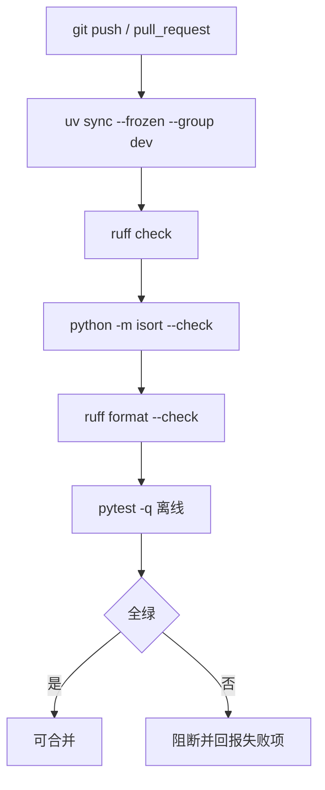

# ADR-0006：工程收口：剩余 P2 修正、CI 与仓库卫生

| 项目 | 内容 |
|------|------|
| 状态 | **Accepted（2026-11-05）** |
| 日期 | 2026-11-05（起草并接受） |
| 基线 | `master @ a95f35a`（ADR-0001～0005 均已 Accepted 并落地；`uv run pytest -q` → `212 passed`） |
| 关联问题 | **P2-04（主）**、P2-05、P2-14、P2-02、P2-03、P2-06、P2-07、P2-08、P2-09、P2-10、P2-11、P2-12、P2-13、P2-18、P2-21；本次取证新发现 **P2-24（建议登记）** |
| 关联文档 | [08 §8.11 阶段 5](../wiki/08-issues-and-recommendations.md#811-修订后的路线)、[08 §8.12](../wiki/08-issues-and-recommendations.md#812-验收清单)、[06 依赖](../wiki/06-dependencies.md)、[01 架构](../wiki/01-architecture.md)、[ADR-0004](0004-data-correctness-link-filter-config-cache-signal.md)、[ADR-0005](0005-optional-layer-wiring-and-persistence-lifecycle.md) |
| 决策者 | 项目维护者 |

> 本文冻结阶段 5「其余 P2 + CI + 仓库卫生」的逐项决策与验收口径，**不包含代码变更**。文中签名与文件布局是方案描述，实施另行提交。

## 1. 背景

阶段 1–4 已把主链路、生命周期、数据正确性与可选层接入收口，剩余问题集中在两类：

1. **行为边界的零散正确性问题**（P2-02/03/06/07/08/09/10/11/12/18/21）。它们单条影响小，但都处于公开边界（请求头、排序、提取结果、序列化、URL 工具、统计口径），一旦被下游依赖就难以修改。
2. **工程质量与仓库卫生**（P2-04/05/13/14）。当前没有 CI，lint 与格式检查无法稳定执行，README 混入 AI 对话，依赖清单与 manifest 不一致，构建缺少 `[build-system]`。

阶段 5 的验收目标是「`ruff`、`isort`、`ruff format`、`pytest` 在 CI 全绿」。因此本 ADR 必须先冻结：哪些行为要改、改成什么、哪些依赖文件是唯一事实源、CI 跑哪些命令。

### 1.1 现状

| 条目 | 实现位置 | 当前行为 | 缺口 |
|------|----------|----------|------|
| P2-02 | `request.py:229-231` | `__lt__` 返回 `not self.priority < other.priority`；等优先级时 `a < b` 与 `b < a` 同时为真 | 非严格弱序；与调度器「低值先出」不一致 |
| P2-02（续） | `scheduler.py:141-145,322` | 队列元素为 `(priority, sequence, request, slot)`，从不比较 `Request` | `__lt__` 是未使用但公开的错误语义 |
| P2-03 | `extractor.py:211-219` | `if link := Link(...)` 恒真（`Link` 无 `__bool__`），空 URL 也会被加入 | 恒真判断无意义，`None` URL 可流入结果 |
| P2-03（续） | `extractor.py:689-703` | `except AttribExtractor:` 捕获的是普通类 | 元素无 `attrib` 时抛 `TypeError`，原异常被替换 |
| P2-04 | `readme.md:49-370` | 第 49 行起是 AI 对话原文（约 322 行），没有任何标题 | README 不可作为项目说明使用 |
| P2-04（续） | `requirements.txt:1-19` | 缺 `pyyaml`、`psutil`，无 dev 依赖，版本为旧冻结值 | 按该文件安装无法导入 `Config` |
| P2-04（续） | 工作区 `__pycache__` | `.venv` 外有 79 个 `.pyc`（均未被 git 跟踪） | 本地多版本产物残留；`.gitignore` 未覆盖 `.pytest_cache/`、`.ruff_cache/` |
| P2-05 | 全仓库 | `ruff` 10 个 F401；`isort` 10 个文件不合格；格式化未纳入门禁 | dev 依赖缺 `ruff`（含 formatter）；无统一门禁 |
| P2-06 | `statistic.py:12,106` | 顶层 `import psutil`，`PerformanceMonitor.__init__` 直接调用 | 未声明依赖，导入模块即 `ModuleNotFoundError` |
| P2-07 | `login.py:50-53,110-135` | async 函数内 `time.sleep(5)`；登录后固定访问 `http://108.170.5.99/...` | 阻塞事件循环；IP 硬编码，工具不可复用 |
| P2-08 | `persister.py:12,322-328` | 直接 `import json`；其余模块经 `misc.py` 优先 `ujson` | 序列化入口不统一 |
| P2-09 | `persister.py:542-555,566,629-631,667` | 表名直接拼进 DDL/DML | 任意字符串可进入 SQL 标识符位置 |
| P2-10 | `webants/__init__.py:1` | 空文件 | 无公共导出，`import webants` 得不到任何符号 |
| P2-11 | `result.py:107` | `self.crawl_time = crawl_time or time.time()` | 显式传 `0` 被覆盖为当前时间 |
| P2-12 | `url.py:240-253` | `parts.path.split('/', maxsplit=1)[1]` | `http://x`（空路径）抛 `IndexError` |
| P2-12（续） | `url.py:256-275` | `url.replace(host_old, new_host, 1)` | `host_old is None`（相对 URL）时抛 `TypeError` |
| P2-13 | `pyproject.toml:5`、`setup.py:14` | 声明 `README.md`，实际文件为 `readme.md` | 大小写敏感文件系统上构建/安装失败 |
| P2-14 | 仓库根目录 | 无 `.github/`、无 `.gitlab-ci.yml`、无 `[build-system]`；`setup.py` 与 `pyproject.toml` 元数据重复 | 无 CI；构建后端依赖隐式默认；两套元数据会漂移 |
| P2-18 | `request.py:18-24,105`、`downloader.py:189-196,225` | `Request` 总填充默认头；`_fetch` 取 `request.headers or self.headers` | Downloader 级自定义头（含 UA）永远不生效 |
| P2-21 | `spider.py:756-766` | `avg = (avg*(total-1)+elapsed)/total`，`total_requests` 含未完成请求 | 并发下均值被分母稀释；代码注释已承认 |
| P2-24（新） | `extractor.py:384-403` | `extract_and_filter_links(unique=True)` 用 `set(links)` 去重，`Link` 无 `__eq__`/`__hash__` | 相同 URL 的 `Link` 不被去重 |

### 1.2 实测证据（2026-11-05，`master @ a95f35a`）

> E2–E7、E9 为本地只读探针实测（`PYTHONPATH` 指向仓库，不联网、不修改文件）；E8、E10–E14 为命令输出或文件事实。

| # | 场景 | 实测结果 |
|---|------|----------|
| E1 | 基线回归 | `uv run pytest -q` → `212 passed in 16.83s`（离线） |
| E2 | 两个同优先级 `Request("http://a.com/1")` 比较 | `a < b` 与 `b < a` 均为 `True`；不满足非对称性 |
| E3 | `Request("http://a.com")` 的 `headers` 与 `Downloader(headers={"User-Agent":"CustomUA"})` | `Request.headers` 非空（默认 UA）；`_fetch` 实际使用 `request.headers`，`CustomUA` 被忽略 |
| E4 | `AttribExtractor(attr="href")._extract_element("plain string")` | `TypeError: catching classes that do not inherit from BaseException is not allowed` |
| E5 | `extract_and_filter_links(html, unique=True)` 两个相同 URL | 返回 2 条（`len({a, b}) == 2`）；URL 去重失效 |
| E6 | `url_to_path("http://x")` / `url_with_host("/y", "b.com")` | 前者 `IndexError: list index out of range`；后者 `TypeError: replace() argument 1 must be str, not None` |
| E7 | `Result(spider=..., fields={}, crawl_time=0)` | `crawl_time == 1793871269.6198409`（被替换为当前时间） |
| E8 | `uv run ruff check .` / `uv run python -m isort --check .` / `uv run black --check .` | ruff `Found 10 errors`（`example/use_item.py` 7 个、`statistic.py` 3 个 F401）；isort 10 个文件不合格；black 报 `Failed to canonicalize script path`（未安装；本 ADR 决定以 `ruff format` 替代） |
| E9 | `uv run python -c "import webants.utils.statistic"` | `ModuleNotFoundError: No module named 'psutil'` |
| E10 | `requirements.txt` 与 `pyproject.toml` 对比 | 缺 `pyyaml`、`psutil`；无 `pytest`/`ruff`/`black`/`isort`；`httpx==0.28.1`、`lxml==5.3.2` 为旧冻结值 |
| E11 | `readme.md` 行数与内容 | 共 370 行；第 49 行起为 `Based on the request "...审计代码..."` 开头的 AI 对话，直到文件末尾，无任何 Markdown 标题 |
| E12 | `pyproject.toml:5` 与仓库文件 | 声明 `README.md`，实际为 `readme.md`；`setup.py:14` 同样 `open("README.md")` |
| E13 | `.github/`、`[build-system]` | 均不存在；`git remote -v` 为 `https://github.com/fengqimin/WebAnts.git` |
| E14 | `spider.py:764-766` 与 `get_stats()` | 分母为 `stats["total_requests"]`，该值在请求开始即累加；`completed_requests` 已单独维护但未参与均值 |

### 1.3 决策驱动因素

1. **默认行为可解释**：除显式列出的边界修正外，`Spider()` 的请求路径、统计键与关闭语义不得改变；212 条基线不得减少。
2. **单一事实源**：依赖、构建、README 各只保留一个来源（`pyproject.toml` + `uv.lock` + `README.md`），消除会漂移的副本。
3. **门禁可本地复现**：CI 执行的每条命令必须能在本地用同一入口跑通；Windows 下 `isort` CLI 失效的问题用 `python -m isort` 规避。
4. **公开边界先冻结语义**：请求头优先级、`Request` 排序、`Link` 去重、统计均值都属外部可观察行为，必须在实现前写清契约与迁移方式。
5. **不外扩**：异步信号桥接（BL-001）、后台持久化队列、分布式能力不在本阶段；在本 ADR 范围内发现的新问题（P2-24）必须单独登记、单独验收。

## 2. 决策

### 2.1 优先级与请求头（P2-02、P2-18）

#### 2.1.1 `Request.__lt__` 与调度顺序

- 以调度器现有的元组队列为唯一权威：`(priority, sequence, request, slot)` 进入 `asyncio.PriorityQueue`（min-heap），**数值小者先出队**，同优先级按 `sequence` 先入先出。
- `Request.__lt__` 改为严格弱序，并与上述语义一致：

```python
def __lt__(self, other: "Request") -> bool:
    """Lower ``priority`` value is dequeued first; equal priorities are equivalent."""
    return self.priority < other.priority
```

- 不新增 `__eq__`（保持对象身份相等），因此「同优先级」在堆中互相等价，不违反严格弱序。
- 调度器不改：它继续依赖元组的 `sequence` 保证全序，不依赖 `Request.__lt__`。

不变量：

- **I1**：`a < a` 恒为 `False`；`a < b` 与 `b < a` 不能同时为 `True`。
- **I2**：`priority=1` 的请求先于 `priority=5` 出队；相同优先级按入队顺序出队（既有行为不变）。

#### 2.1.2 请求头合并（P2-18）

- `Request.headers` 只保存**调用方显式传入**的头，不再注入 `DEFAULT_REQUEST_HEADERS`。
- `Downloader._setup_headers` 不再自动注入 `User-Agent`；默认头的唯一定义仍在 `request.DEFAULT_REQUEST_HEADERS`。
- 新增可测试的合并入口：

```python
# webants/downloader.py
def effective_headers(self, request: Request) -> dict[str, str]:
    return {**DEFAULT_REQUEST_HEADERS, **self.headers, **request.headers}
```

- `_fetch` 一律使用 `effective_headers(request)`；Cookie 与 Referer 的既有合并逻辑在其结果上继续叠加。

优先级：**默认头 < Downloader 头 < Request 头**。不变量：

- **I3**：`Request(url)` 的 `headers == {}`。
- **I4**：`Downloader(headers={"User-Agent": "X"})` 抓取未显式设置 UA 的请求时，实际发送 `X`。
- **I5**：请求显式设置 `headers={"User-Agent": "Y"}` 时，实际发送 `Y`。
- **I6**：未配置任何头时，实际发送 `DEFAULT_REQUEST_HEADERS`（与旧默认值逐键一致）。

### 2.2 提取器收尾（P2-03、P2-24）

1. `AttribExtractor._extract_element`：先判断 `hasattr(element, "attrib")`，不是元素对象时返回 `None`，删除 `except AttribExtractor`。
2. `extract_links`：去掉恒真的 `if link := Link(...)` 包装；解析出的 URL 为空或 `None` 时跳过，不构造空的 `Link`。
3. `extract_and_filter_links(unique=True)`：不再用 `set(links)`；按 `link.url` 用有序字典保序去重，保留**首次出现**的 `Link`（含其 `unique` 标志）。
4. **不**给 `Link` 增加 `__eq__`/`__hash__`：`Link` 仍按对象身份作为字典键，避免改变现有调用方对 `Link` 的相等性预期。

不变量：

- **I7**：对非元素对象调用 `AttribExtractor._extract_element` 返回 `None`，不抛异常。
- **I8**：`extract_links` 不返回 `url` 为空串/`None` 的 `Link`。
- **I9**：`extract_and_filter_links(unique=True)` 对相同 URL 只保留一条且顺序为首次出现顺序；`unique=False` 时保留全部重复项（既有语义）。
- **I10**：`Link` 的 `__eq__`/`__hash__` 未定义，`Link("u") != Link("u")` 仍成立（身份语义）。

### 2.3 持久化与工具边界（P2-08、P2-09、P2-11、P2-12）

#### 2.3.1 序列化入口（P2-08）

在 `webants/utils/misc.py` 增加统一入口并导出：

```python
def dumps(obj: Any, **kwargs) -> str:
    """Serialize with ujson when available, otherwise stdlib json."""


def loads(text: str | bytes, **kwargs) -> Any:
    """Deserialize with the same backend as dumps."""
```

- `JsonPersister` 的 `_serialize` 与 `load` 全部改用 `misc.dumps`/`misc.loads`；不再直接 `import json`。
- 契约：输出为紧凑 JSON（无多余空格），`ensure_ascii` 参数继续生效；`misc.dumps` 在 `ujson` 不支持某个关键字时去掉该关键字并重试一次，不得静默吞掉序列化错误。
- `misc.__all__` 增加 `dumps`、`loads`。

#### 2.3.2 SQLite 表名（P2-09）

- `SqlitePersister.__init__` 校验 `table_name`：必须匹配 `^[A-Za-z_][A-Za-z0-9_]{0,63}$`，否则抛 `ValueError`。
- 校验发生在任何 SQL 执行之前；列名仍来自 `Field` 元数据，本阶段不扩展到列名重命名。

#### 2.3.3 `crawl_time` 与 URL 工具（P2-11、P2-12）

- `Result.crawl_time`：`time.time() if crawl_time is None else crawl_time`；`0` 与负值按显式值保留。
- `url_to_path`：路径为空或没有 `/` 时返回 `""`，不再索引越界；既有非空路径行为不变。
- `url_with_host`：`new_host is None` 或 `urlparse(url).hostname is None` 时原样返回 `url`；`key` 过滤逻辑不变。

### 2.4 统计口径（P2-21）

- 新增 `stats["total_request_time"]`（累计秒数，浮点，初值 `0.0`）。
- `finally` 中：先 `completed_requests += 1`、`total_request_time += elapsed`，再计算
  `avg_request_time = total_request_time / completed_requests`（`completed_requests == 0` 时为 `0.0`）。
- 语义：`avg_request_time` 是**已完成请求的平均耗时**；`total_requests` 继续表示已开始请求数，不再参与均值。
- 统计键只增不减；`get_stats()` 返回深拷贝的既有行为不变。

### 2.5 可选依赖与工具可复用性（P2-06、P2-07）

#### 2.5.1 psutil（P2-06）

- `pyproject.toml` 增加可选组：

```toml
[project.optional-dependencies]
playwright = ["playwright>=1.51.0"]
monitoring = ["psutil>=5.9"]
```

- `statistic.py` 顶层改为 `try: import psutil / except ImportError: psutil = None`，模块导入不再失败。
- `PerformanceMonitor.__init__` 在 `psutil is None` 时抛 `RuntimeError`，消息包含 `python -m pip install "webants[monitoring]"`。
- 不把 `psutil` 加入核心依赖：核心导入链不引用该模块，加入会增加所有用户的安装体积。

#### 2.5.2 登录工具（P2-07）

- `async_login_with_playwright` / `sync_login_with_playwright` 增加关键字参数 `sample_url: str | None = None`；为 `None` 时跳过登录后的示例页访问，不再硬编码 `http://108.170.5.99/...`（注释同步删除）。
- async 版本中的 `time.sleep(5)` 改为 `await asyncio.sleep(5)`；sync 版本继续使用 `time.sleep`（其调用方本身就是同步 API）。
- 其余 CSS 选择器、`data_path`、`headless` 参数保持原样。

### 2.6 打包、导出与仓库卫生（P2-10、P2-13、P2-14、P2-04）

#### 2.6.1 元数据与构建（P2-13、P2-14、P2-04）

- 新增 `[build-system]`：

```toml
[build-system]
requires = ["setuptools>=75.6"]
build-backend = "setuptools.build_meta"
```

- `pyproject.toml` 补齐 `setup.py` 中独有且仍有效的元数据：`authors`、`license`（MIT）、`keywords`、`urls`、`classifiers`。
- **删除 `setup.py`**：两处版本/依赖/README 路径已经漂移，保留只会继续分叉；构建改由 `pyproject.toml` 驱动。
- **删除 `requirements.txt`**：`uv.lock` 是唯一锁文件；按 E10，该文件既不能覆盖运行依赖，也不包含开发依赖。安装方式统一为 `uv sync` 或 `pip install .`。
- 文件名统一为 **`README.md`**（大写）：`pyproject.toml:5` 与文档引用保持大写；Windows 大小写不敏感，重命名需用两步 `git mv`（`readme.md → readme.tmp → README.md`）。
- 新增 `LICENSE`（MIT，版权人沿用 `setup.py:9` 的 `fengqimin`），与元数据一致。

#### 2.6.2 README 重构（P2-04）

- 删除 `readme.md` 第 49–370 行的 AI 对话原文。
- 保留并补齐以下章节：Overview、Architecture、Main Data Flow、Install、Quick Start、Optional layers、Development、Testing、License。
- `Development` 必须列出与 CI 完全一致的命令（见 2.7）。
- `readme.cn.md` 同步同样结构，内容按中文表达，不引入与 `README.md` 冲突的事实。

#### 2.6.3 公共导出（P2-10）

`webants/__init__.py` 定义并导出核心爬取类型：

```python
from webants.libs.item import AttrItem, ElementItem, Item, LinkItem, TextItem
from webants.libs.request import Request
from webants.libs.result import Field, Result
from webants.spider import Spider

__all__ = [
    "Spider",
    "Request",
    "Result",
    "Field",
    "Item",
    "AttrItem",
    "LinkItem",
    "ElementItem",
    "TextItem",
]
```

- 可选层（`Config`、中间件、持久化）仍从 `webants.libs.*` 导入，不进入根命名空间，避免把实验性接口固化为稳定 API。
- 根模块导入不得引入 `playwright`、`psutil` 等可选依赖。

### 2.7 CI 门禁（P2-05、P2-14）

- 格式化工具由 **`ruff format`** 承担，不再引入 `black`：
  - dev 依赖组补充 `ruff`（固定下限），删除 `[tool.black]` 配置，同步修改 `AGENTS.md` 中的格式化约定与本机脚本；
  - `pyproject.toml` 增加 `[tool.ruff]`（`line-length = 100`、`target-version = "py312"`、`extend-exclude = ["docs"]`——ruff 0.17 会格式化 Markdown 代码围栏，历史 ADR 必须保持冻结）、`[tool.ruff.lint]`（显式 `select = ["E4", "E7", "E9", "F"]`，避免 ruff 新版本扩大默认规则集导致门禁漂移）与 `[tool.ruff.format]`，与 isort 的 black profile 保持一致；
  - 本地命令统一为 `uv run ruff format .` / `uv run ruff format --check .`。
- 新增 `.github/workflows/ci.yml`，在 `push` 与 `pull_request` 上运行，**Python 3.12 与 3.14 两个 job 并行**，使用 `astral-sh/setup-uv` 固定到 `0.13.x`（本地验证版本 `0.13.7`，支持 Python 3.14）并开启缓存：

```yaml
name: ci
on: [push, pull_request]
jobs:
  test:
    runs-on: ubuntu-latest
    strategy:
      fail-fast: false
      matrix:
        python-version: ["3.12", "3.14"]
    steps:
      - uses: actions/checkout@v4
      - uses: astral-sh/setup-uv@v5
        with:
          version: "0.13.x"
          enable-cache: true
          python-version: ${{ matrix.python-version }}
      - run: uv sync --frozen --group dev
      - run: uv run ruff check .
      - run: uv run python -m isort --check .
      - run: uv run ruff format --check .
      - run: uv run pytest -q
```

- 一次性清理：`example/use_item.py` 的 7 个未使用导入、`statistic.py` 的 3 个未使用导入；isort 修正 10 个文件。
- **`ruff format` 格式化单独成一次提交**（仅格式，不含逻辑），避免与行为修改混在一起难以复核。
- CI 与服务端无关，全部测试离线；禁止在测试中访问公网。

不变量：

- **I11**：本地与 CI 使用同一条命令检查，不允许「本地通过、CI 失败」的分叉脚本。
- **I12**：构建只依赖 `pyproject.toml` + `uv.lock`；仓库中不再存在第二份依赖清单或第二份元数据。

## 3. 目标状态



可执行对账断言：

```python
# P2-02：严格弱序，低值先出
a, b = (
    Request("http://a/1", callback=cb, priority=1),
    Request("http://a/2", callback=cb, priority=5),
)
assert (a < a) is False and not (a < b and b < a) and a < b

# P2-18：头优先级
assert Request("http://a/", callback=cb).headers == {}
d = Downloader(headers={"User-Agent": "D"})
assert d.effective_headers(Request("http://a/", callback=cb))["User-Agent"] == "D"
r = Request("http://a/", callback=cb, headers={"User-Agent": "R"})
assert d.effective_headers(r)["User-Agent"] == "R"

# P2-03 / P2-24
assert AttribExtractor(attr="href")._extract_element("text") is None
links = extract_and_filter_links(html, unique=True)
assert len({l.url for l in links}) == len(links) == 1

# P2-09 / P2-11 / P2-12
try:
    SqlitePersister(tmp / "a.db", table_name="x; DROP TABLE y")
    raise AssertionError("expected ValueError")
except ValueError:
    pass
assert Result(spider=s, fields={}, crawl_time=0).crawl_time == 0
assert url_to_path("http://x") == ""
assert url_with_host("/y", "b.com") == "/y"

# P2-21：均值只按已完成请求计算
assert stats["avg_request_time"] == stats["total_request_time"] / stats["completed_requests"]

# P2-10：根导出
import webants

assert webants.Spider and webants.Request and webants.Result
```

## 4. 备选方案

| 方案 | 描述 | 结论 | 理由 |
|------|------|------|------|
| A. 保持 `Request.__lt__` 现状，只加文档说明 | 声明「请不要直接比较 Request」 | 拒绝 | 公开魔术方法返回非严格弱序，任何 `heapq`/`sorted` 调用都会得到随机结果；文档无法阻止误用 |
| B. 删除 `Request.__lt__` | 让直接比较抛 `TypeError` | 拒绝（本阶段） | 破坏性更强，且无法区分「有意排序」与「误用」；修正为正确语义成本更低 |
| C. `__lt__` 改为低值先出（**采纳**） | §2.1.1 | 采纳 | 与调度器元组顺序、docstring 一致；实现一行且可断言 |
| D. Request 继续填充默认头，Downloader 合并时让 Request 胜出 | `{**self.headers, **request.headers}` | 拒绝 | 默认头永远非空，Downloader 配置仍不生效，P2-18 未解决 |
| E. Request 保留默认头，另加 `explicit_headers` 字段 | 记录哪些头由调用方提供 | 拒绝 | 双字段语义需要调用方同步维护，易漂移；默认头本不属于请求 |
| F. 默认头只由 Downloader 提供（**采纳**） | §2.1.2 | 采纳 | 单一来源、优先级可直接断言；`Request` 回归「描述一次请求」的职责 |
| G. `Link` 增加 `__eq__`/`__hash__` 以实现去重 | 按 URL 相等 | 拒绝 | 改变对象身份语义，已有代码可能依赖 `Link` 作为独立键；去重需求只在提取函数内 |
| H. 在 `extract_and_filter_links` 内按 URL 保序去重（**采纳**） | §2.2 | 采纳 | 影响面最小，保留首次出现的对象与顺序 |
| I. 保留 `requirements.txt`，由 CI 校验与 `uv export` 一致 | 生成式清单 | 拒绝 | 仍需额外同步步骤与 diff 门禁；`uv.lock` 已覆盖锁定职责 |
| J. 删除 `requirements.txt` 与 `setup.py`（**采纳**） | §2.6.1 | 采纳 | 消除两处已漂移的事实源；`pip install .` 与 `uv sync` 均可用 |
| K. `psutil` 加入核心依赖 | 直接声明 | 拒绝 | 核心路径不用它；为可选监控能力增加所有用户的安装成本 |
| L. psutil 可选 extra + 导入降级（**采纳**） | §2.5.1 | 采纳 | 模块可导入，使用监控时给出明确安装提示 |
| M. 登录工具直接删除 | 移除 playwright 工具 | 拒绝 | 已有使用场景；参数化成本低，删除属越界 |
| N. 登录工具参数化 + async 改 `asyncio.sleep`（**采纳**） | §2.5.2 | 采纳 | 修阻塞与硬编码，同时保持同步 API 可用 |
| O. CI 跑 3.12 + 3.14 两个 job（**采纳**） | §2.7 | 采纳 | 同时验证声明的下界与当前最新版；`fail-fast: false` 保证两个版本各自给出结论 |
| P. CI 只跑 pytest，lint 留本地 | 最小门禁 | 拒绝 | 阶段 5 的验收明确要求 ruff/isort/format 在 CI 全绿 |
| Q. 保留 black 并新增为 dev 依赖 | 沿用现有配置 | 拒绝 | `ruff format` 覆盖同等职责且少一个依赖；保留两套格式化工具只会引入配置分叉 |
| R. 只跑 Python 3.14 | 单一 job、CI 最快 | 拒绝 | `requires-python >=3.12` 的下界完全未验证，发布后才暴露兼容问题 |

## 5. 影响与后果

### 5.1 破坏性变更与迁移

| 变更 | 影响 | 迁移方式 |
|------|------|----------|
| `Request.headers` 不再包含默认头 | 读取 `request.headers` 期望拿到 `Accept`/`User-Agent` 的代码 | 改用 `DEFAULT_REQUEST_HEADERS` 或 `Downloader.effective_headers(request)` |
| Downloader 默认头合并顺序改变 | 之前依赖「请求默认头覆盖 Downloader 头」的行为 | 在 Request 上显式设置需要覆盖的头；否则 Downloader 头生效（这是修复目标） |
| `Request.__lt__` 方向翻转 | 直接把 `Request` 放入 `heapq` 并以「大值优先」为前提的代码 | 改为依赖调度器元组顺序；或对 priority 取负 |
| `extract_and_filter_links(unique=True)` 真正去重 | 依赖重复项的调用方 | 传 `unique=False`；去重按 URL、保留首次出现 |
| `AttribExtractor._extract_element` 对非元素返回 `None` | 依赖异常判断输入非法的代码 | 在使用前自行 `isinstance` 校验 |
| `SqlitePersister` 拒绝非法表名 | 使用带空格/连字符表名的现有数据库 | 改用合法标识符（字母/数字/下划线，首字符非数字，≤64） |
| `Result(crawl_time=0)` 保留 0 | 依赖「0 表示未提供」的代码 | 显式传 `None` 表示使用当前时间 |
| `url_to_path` / `url_with_host` 边界返回变化 | 之前捕获 `IndexError`/`TypeError` 的调用方 | 改为判断空串/原样返回 |
| `avg_request_time` 口径变化 | 依赖旧均值（含未完成请求）的监控看板 | 断言改用 `total_request_time / completed_requests`；需要吞吐指标时另取自 `completed_requests` |
| 仓库删除 `setup.py`、`requirements.txt` | 使用 `pip install -r requirements.txt` 或修改 `setup.py` 的流程 | 改用 `uv sync` 或 `pip install .`；元数据改 `pyproject.toml` |
| `readme.md` 重命名为 `README.md` | 大小写敏感脚本中的硬编码路径 | 统一引用大写文件名 |
| 新增可选组 `monitoring` | 无（纯新增） | 需要监控时安装 `webants[monitoring]` |
| 根命名空间新增导出 | 无（纯新增） | 可选层仍从 `webants.libs.*` 导入 |
| `ruff format` 全仓格式化 | 一次性大 diff | 单独格式提交；审阅时跳过该提交或补 `.git-blame-ignore-revs` |

### 5.2 非破坏性收益

- 阶段 5 的验收条件从「人工判断」变成 CI 的四个可复现门禁。
- 依赖、构建、README 各只剩一个事实源，安装失败与元数据漂移不再重复出现。
- 请求头优先级、排序、去重、统计均值都有直接可断言的契约，后续 ADR 不需要重新解释。
- 可选依赖不再让「导入模块」失败，`statistic` 与 `login` 成为真正可选的能力。
- `import webants` 即可取得核心类型，示例与使用文档可以更短。

### 5.3 风险与权衡

- **头语义变更影响面最大**：`Request.headers` 从「含默认值」变为「仅显式值」。通过 I3–I6 的四条测试和迁移说明控制；Spider 自身不读取 `request.headers` 做逻辑判断。
- **`ruff format` 一次性格式化**：会触碰大量文件。用独立提交隔离；若仓库后续引入 `git blame` 噪音，可补 `.git-blame-ignore-revs`。`ruff format` 与 black 大部分兼容，但不保证逐字节一致，首次格式化后需接受既有文件的 diff。
- **删除 `requirements.txt`**：对不用 uv 的下游是硬变更。迁移方式明确（`pip install .`），且现有文件本身不可用（缺 `pyyaml`），保留的收益低于维护成本。
- **`ujson` 与标准库的差异**：极端数值/非字符串键的序列化结果可能不同。契约限定为「JSON 兼容对象」，并保留 `misc.loads` 统一入口，问题可集中修复。
- **CI 引入新平台依赖**：`setup-uv` 版本固定为 `0.6.x`，避免上游漂移；若 GitHub Actions 配额受限，可改为本地脚本复用同一命令序列，但不得改变命令本身。
- **P2-24 属新增范围**：它不在原 8.3 表内，本 ADR 只登记与修复去重语义，不扩展到 `Link` 相等性设计。

## 6. 实施拆解

> 本次仅提交本 ADR，不改代码。实施按任务号逐个推进，每个 T 完成后跑通测试再进入下一个。

| 任务 | 内容 | 主要文件 | 依赖 | 覆盖问题 |
|------|------|----------|------|----------|
| T1 | 构建与依赖清单：`[build-system]`、元数据迁移、`ruff` 入 dev 组（含 formatter）并移除 black 配置、新增 `LICENSE`、删除 `setup.py` 与 `requirements.txt` | `pyproject.toml`、`LICENSE`、`setup.py`、`requirements.txt` | — | P2-04、P2-13、P2-14 |
| T2 | README 重构：两步 `git mv` 改名为 `README.md`，删除 AI 对话，补齐安装/快速开始/开发/许可章节，同步 `readme.cn.md`；`.gitignore` 补 `.pytest_cache/`、`.ruff_cache/`；清理本地 `__pycache__` | `README.md`、`readme.cn.md`、`.gitignore` | — | P2-04、P2-13 |
| T3 | `Request.headers` 仅存显式头；`Downloader.effective_headers` 与合并顺序；`Request.__lt__` 改严格弱序 | `webants/libs/request.py`、`webants/downloader.py` | — | P2-02、P2-18 |
| T4 | 提取器：`_extract_element` 类型判断、`extract_links` 去空、`extract_and_filter_links` 按 URL 保序去重 | `webants/libs/extractor.py` | — | P2-03、P2-24 |
| T5 | `misc.dumps/loads` 统一序列化；SQLite 表名校验；`crawl_time is None`；URL 工具边界 | `webants/utils/misc.py`、`webants/libs/persister.py`、`webants/libs/result.py`、`webants/utils/url.py` | — | P2-08、P2-09、P2-11、P2-12 |
| T6 | 统计均值改累计耗时/已完成数；psutil 可选 extra + 导入降级；登录工具参数化与 `asyncio.sleep` | `webants/spider.py`、`webants/utils/statistic.py`、`webants/utils/login.py`、`pyproject.toml` | T1 | P2-21、P2-06、P2-07 |
| T7 | 根命名空间 `__all__` 与 re-export | `webants/__init__.py` | T3–T5 | P2-10 |
| T8 | 门禁归零：清 F401、isort 修正、`ruff format` 独立格式提交；新增回归测试；新增 CI workflow；同步 06/08/README、`AGENTS.md` 与 ADR 索引 | `example/`、`webants/`、`tests/`、`.github/workflows/ci.yml`、`AGENTS.md`、`docs/` | T1–T7 | P2-05、P2-14、全部 |

实施顺序：T1 → T2（先让门禁与文档可用）→ T3/T4/T5/T6 可并行 → T7 → T8 统一回归并提交。

**实施记录（2026-11-05）**：T1–T8 已完成。`pyproject.toml` 增加 `[build-system]`、元数据与 `[tool.ruff.lint] select`，删除 `setup.py`/`requirements.txt` 并新增 `LICENSE`；README 重构并统一大写；`Request.headers`/`effective_headers`、提取器去重、`misc.dumps/loads`、表名校验、URL 边界、统计均值、psutil 可选 extra、登录工具参数化、根命名空间导出全部落地；新增 `tests/test_url.py`、`tests/test_statistic.py`、`tests/test_login_tool.py`、`tests/test_package.py` 及相应回归用例。`uv run pytest -q` → `242 passed`；`ruff check`、`python -m isort --check`、`ruff format --check` 全部通过；CI workflow 使用 Python 3.12/3.14 双 job。本次格式化单独成提交（`ruff format` 重排 34 个文件）。

测试新增建议：

- `tests/test_request.py`：`__lt__` 三条断言、`headers` 空字典、`crawl_time=0`。
- `tests/test_downloader.py`：头优先级三层矩阵（默认/Downloader/Request）。
- `tests/test_extractor.py`：非元素输入、空 URL 跳过、重复 URL 去重、`unique=False` 保留重复。
- `tests/test_persister.py`：非法表名、序列化入口可读写中文、`import persister` 不依赖 ujson 之外的入口。
- `tests/test_url.py`（新建）：`url_to_path`/`url_with_host` 边界。
- `tests/test_spider.py`：只完成 1 个请求时均值等于该请求耗时，不按 `total_requests` 稀释。
- `tests/test_package.py`（新建）：根导出与可选依赖不被导入。

## 7. 验收标准

- [ ] E2：`a < a` 为 `False`；等优先级互不小于；`priority=1` 先于 `priority=5` 出队。
- [ ] E3/I3–I6：`Request().headers == {}`；Downloader 自定义 UA 生效；Request 显式 UA 覆盖 Downloader；无配置时发送 `DEFAULT_REQUEST_HEADERS`。
- [ ] E4：`AttribExtractor._extract_element` 对字符串返回 `None`，无 `TypeError`。
- [ ] E5：相同 URL 在 `extract_and_filter_links(unique=True)` 中只保留一条；`unique=False` 保留全部。
- [ ] E6：`url_to_path("http://x") == ""`；`url_with_host("/y", "b.com") == "/y"`；既有正常路径结果不变。
- [ ] E7：`Result(..., crawl_time=0).crawl_time == 0`；不传时仍为当前时间。
- [ ] `SqlitePersister(table_name="bad name")` 抛 `ValueError`；合法表名读写正常。
- [ ] `JsonPersister` 经 `misc.dumps/loads` 完成中文与 emoji 往返，内容逐条一致。
- [ ] E9：`uv run python -c "import webants.utils.statistic"` 在无 `psutil` 环境成功；`PerformanceMonitor()` 抛带安装提示的 `RuntimeError`。
- [ ] async 登录函数体内无 `time.sleep`；`sample_url=None` 时不访问示例页。
- [ ] E14：`avg_request_time == total_request_time / completed_requests`；只完成 1 个请求时不被 `total_requests` 稀释。
- [ ] `uv build` 成功，构建过程只读取 `pyproject.toml`；仓库中不存在 `setup.py`、`requirements.txt`。
- [ ] `README.md` 不含 `Based on the request` / `I'll help` 等对话文本；包含 Install、Quick Start、Development、Testing、License 章节。
- [ ] `python -c "import webants"` 不导入 `playwright`、`psutil`；`webants.Spider`、`Request`、`Result`、`Field` 可用。
- [ ] `uv run ruff check .` → 0 错误。
- [ ] `uv run python -m isort --check .` → 通过（Windows 下不使用 `uv run isort` 入口）。
- [ ] `uv run ruff format --check .` → 通过。
- [ ] `uv run pytest -q` → 全绿且离线；不得少于 212 passed，新增用例计入总数。
- [ ] `.github/workflows/ci.yml` 可在 GitHub 上解析，并在 Python 3.12 与 3.14 两个 job 中执行上述四条检查命令；本地用同一命令序列可复现。
- [ ] 文档同步：`06-dependencies.md` 删除 requirements/setup 的漂移描述并记录 `monitoring` extra；`08` 的 P2 状态与验收清单更新；`AGENTS.md` 的格式化命令改为 `ruff format`；ADR 索引状态与本文件一致。

## 8. 评审结论 / 未决点

**已接受（2026-11-05）**——全部选择点随本 ADR 冻结，实施按 §6 的 T1–T8 推进：

| # | 问题 | 结论 / 建议默认值 |
|---|------|------------------|
| 1 | `requirements.txt` 去留 | **已确认（2026-11-05）：删除**；`uv.lock` 为唯一锁文件，迁移到 `uv sync` / `pip install .` |
| 2 | `setup.py` 去留 | **已确认（2026-11-05）：删除**；元数据与构建全部迁入 `pyproject.toml` |
| 3 | README 主文件命名 | **已确认（2026-11-05）：`README.md`（大写）**；`readme.cn.md` 保留为中文版 |
| 4 | 是否纳入新发现的 P2-24（Link 去重失效） | **已确认（2026-11-05）：纳入本阶段**，按 URL 保序去重；不改变 `Link` 相等性 |
| 5 | CI 平台与版本 | **已确认（2026-11-05）：GitHub Actions + ubuntu-latest**，Python 3.12 与 3.14 两个 job，`setup-uv` 固定 `0.13.x` |
| 6 | `psutil` 依赖方式 | **已确认（2026-11-05）：可选 extra `monitoring` + 导入降级**，不进核心依赖 |
| 7 | `Request.headers` 语义 | **已确认（2026-11-05）：仅显式头**；默认头由 `Downloader.effective_headers()` 按「默认 < Downloader < Request」合并 |
| 8 | `Request.__lt__` 方向 | **已确认（2026-11-05）：低值先出**，与调度器一致；保留方法不删除 |
| 9 | 根命名空间导出范围 | **已确认（2026-11-05）：仅核心爬取类型**；可选层继续从 `webants.libs.*` 导入 |
| 10 | `avg_request_time` 口径 | **已确认（2026-11-05）：累计耗时 / 已完成请求数**；新增 `total_request_time`，不删旧键 |
| 11 | 格式化工具的提交方式 | **已确认（2026-11-05）：`ruff format` 独立格式提交**，不与逻辑修改混合 |
| 12 | 多 Python 版本矩阵 | **已确认（2026-11-05）：3.12 + 3.14 两个 job**，`fail-fast: false` |

## 9. 参考

- [08 问题与建议](../wiki/08-issues-and-recommendations.md) — §8.3 P2 总表、§8.4 簇 D/E、§8.11 阶段 5、§8.12 验收清单、§8.13 实施状态
- [06 依赖](../wiki/06-dependencies.md) — requirements 漂移、可选层依赖声明
- [01 架构](../wiki/01-architecture.md) — 模块职责与公共入口
- [ADR-0004](0004-data-correctness-link-filter-config-cache-signal.md) — `Config` 深合并、信号排序（`signals.py` 的 `(-priority, seq)` 先例）
- [ADR-0005](0005-optional-layer-wiring-and-persistence-lifecycle.md) — NDJSON 序列化现状、`storage.*` 未自动接线
- 代码位置：`webants/libs/request.py:18-24,105,229-231`、`webants/downloader.py:189-196,225`、`webants/libs/extractor.py:38-55,211-219,354-403,689-703`、`webants/libs/persister.py:12,322-328,542-555,566,629-631,667`、`webants/libs/result.py:107`、`webants/utils/url.py:240-275`、`webants/spider.py:756-766`、`webants/utils/statistic.py:12,106`、`webants/utils/login.py:17-53,76-135`、`webants/__init__.py:1`、`pyproject.toml:5,7-31,57-64`、`setup.py:14,26-35`、`readme.md:49-370`、`requirements.txt:1-19`
