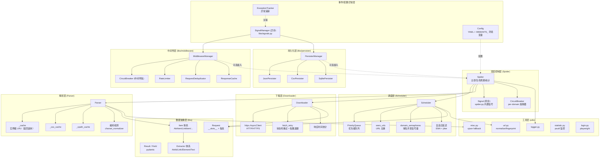
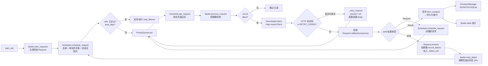
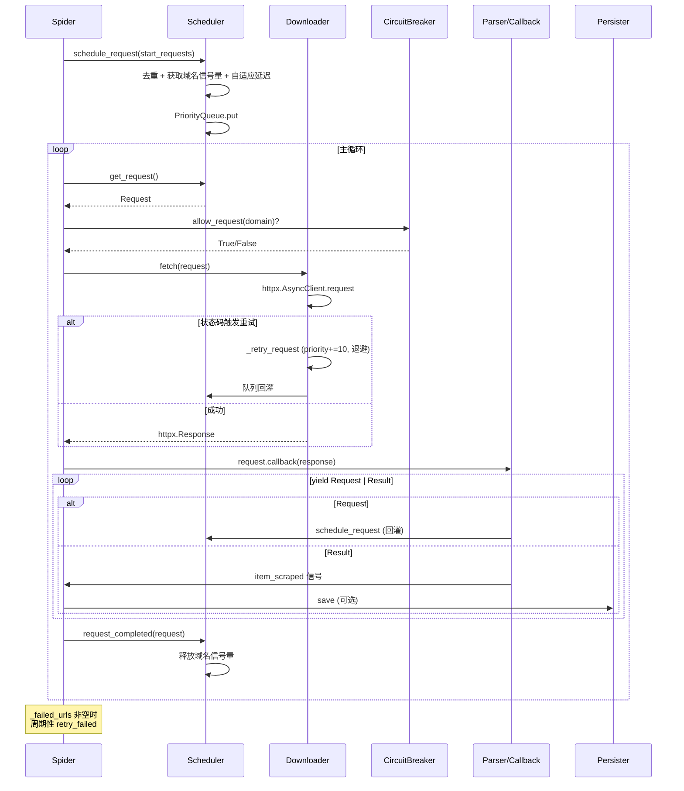
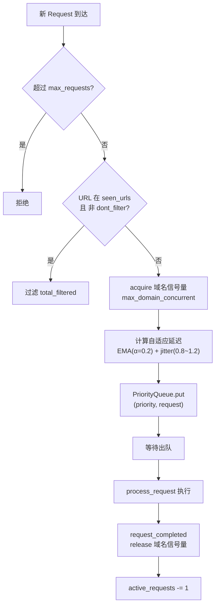

# WebAnts 爬虫架构分析

## 一、架构图

## 二、数据流图

### 2.1 主数据流（Request/Response 生命周期）

### 2.2 组件交互时序

### 2.3 并发控制数据流

## 三、关键设计要点

| 维度 | 机制 | 位置 |
|---|---|---|
| **优先级** | `PriorityQueue`，`__lt__` 反转 → 数值越大越先出队 | `request.py:177` / `scheduler.py:163` |
| **去重** | `seen_urls: Set[str]`，`Request.fingerprint()` 基于 method+url+body | `scheduler.py:95` / `request.py:189` |
| **域名并发** | 每域名独立 `asyncio.Semaphore(max_domain_concurrent)` | `scheduler.py:111` |
| **自适应限速** | 指数移动平均(α=0.2)估算延迟 + 随机抖动 | `scheduler.py:124-149` |
| **重试** | 按 HTTP 状态码配置 `max_retries`/`backoff_factor`，指数退避 | `downloader.py:88-98,289-359` |
| **熔断** | 两套独立实现：Spider per-domain 状态机 + 中间件版 | `spider.py:70` / `middleware.py:87` |
| **解析缓存** | 实例级 `OrderedDict`（默认 1000 条）按内容 hash 缓存，每次返回深拷贝 + CSS/XPath 表达式缓存 | `parser.py:55,186,195` |
| **信号系统** | 同步(Spider 内部) + 异步(全局 `signal_manager`)，两套并存 | `spider.py:24` / `libs/signals.py:27` |

> ⚠️ **历史陷阱（已修正）**：`Downloader.get_stsats` 拼写错误已改为 `get_stats`；`exception_tracker` 全局实例已取消注释并强化 `track()` 以兼容普通 `Exception`；`pyyaml` 已加入 `pyproject.toml`/`setup.py` 依赖；`setup.py` 已对齐 `pyproject.toml`（httpx、Python>=3.12、版本 0.1.1）。剩余未声明依赖：`utils/statistic.py` 需要 `psutil`。详见 `AGENTS.md`。
