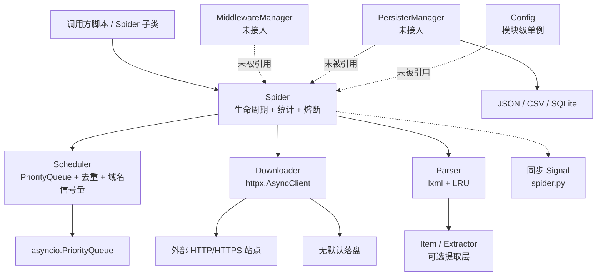
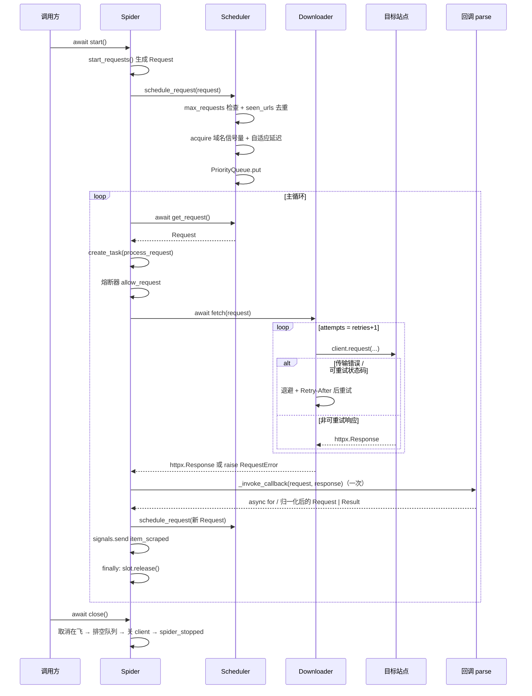
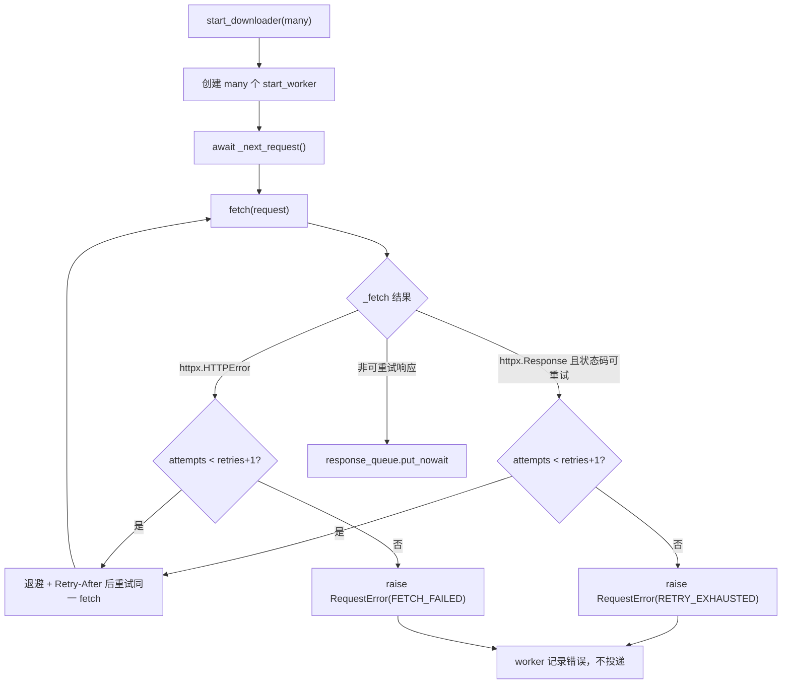

# 01 架构

## 1.1 项目定位

WebAnts 解决的是“用少量代码搭一个可控的异步爬虫”的问题：调用方继承 `Spider`、声明 `start_urls` 和 `parse` 回调，框架负责调度、下载、解析、统计与失败重试。它不是一个开箱即用的采集应用，也不提供 HTTP API、任务队列或前端；更像一套可组装的爬虫内核。

当前代码呈现出明显的“两代设计并存”：

- **第一代（已接入）**：`Spider` + `Scheduler` + `Downloader` + `Parser`，构造函数里直接实例化（`webants/spider.py:168-176`）。
- **第二代（未接线）**：`MiddlewareManager`、`PersisterManager`、异步 `SignalManager`、`Config`。它们实现完整，但没有任何核心模块 import 它们（实测 grep 仅 `libs/middleware.py:25` 引用了 `libs/signals.py`）。

理解这一点是读懂仓库的关键：不要把未接线的层当成运行路径的一部分。

## 1.2 运行时结构

运行进程只有一个：调用方的 Python 进程。没有守护进程、消息队列或数据库服务；唯一的网络外部依赖是目标站点（以及启用 `utils/login.py` 时的浏览器二进制）。

## 1.3 分层视图

| 层 | 组成 | 是否在运行路径 | 证据 |
|----|------|----------------|------|
| 入口/生命周期 | `Spider.__init__`、`start`、`close`、`get_stats` | 是 | `webants/spider.py:143-652` |
| 调度 | `Scheduler` | 是 | `webants/scheduler.py:21-208` |
| 下载 | `BaseDownloader`、`Downloader` | 是 | `webants/downloader.py:22-418` |
| 解析 | `Parser` | 是（需调用方显式使用） | `webants/parser.py:26-262` |
| 数据抽象 | `Request`、`Result`、`Field`、`Item`、`Extractor` | 部分（`Request` 必用） | `webants/libs/` |
| 中间件 | `MiddlewareManager` 及四个实现 | 否 | `webants/libs/middleware.py:454-572` |
| 持久化 | `JsonPersister`、`CsvPersister`、`SqlitePersister` | 否 | `webants/libs/persister.py:94-605` |
| 事件 | 同步 `Signal`（spider）、异步 `SignalManager`（libs） | 同步版是；异步版否 | `webants/spider.py:24-67`、`webants/libs/signals.py:27-277` |
| 配置/异常 | `Config`、异常层级、`ExceptionTracker` | 异常类是；Config 否 | `webants/libs/config.py:77-260`、`webants/libs/exceptions.py:41-416` |
| 工具 | 日志、URL、misc、statistic、login | 部分是 | `webants/utils/` |

## 1.4 核心数据流

### 主流程（ADR-0001 实施后）

> 依据 [ADR-0001](../adr/0001-callback-contract-and-retry-ownership.md)：`Downloader.fetch` 不再调用回调，重试内联；`Spider._invoke_callback` 单点归一化 async generator / coroutine。依据 [ADR-0002](../adr/0002-schedule-slot-ownership-and-request-lifecycle.md)：调度资源以 `ScheduleSlot` 为凭据，由 `process_request` 的 `finally` 释放；`request_completed` 仅为兼容入口。实现见 `webants/spider.py:333-501`、`webants/downloader.py:335-432`。

### 下载重试与 worker 兼容适配器

证据：`webants/downloader.py:335-432`、`:435-472`。`Spider.process_request` 也调用同一个 `fetch`（`webants/spider.py:463`），Spider 级 `_failed_urls` / `retry_failed` 已随 ADR-0001 移除；worker 模式仅是兼容适配器，不再跨队列重试。`start_downloader` 只取消并回收自己创建的 worker，不再调用 `asyncio.all_tasks()`（[ADR-0003](../adr/0003-shutdown-cancellation-and-loop-quiescence.md) §2.5）。

### 关闭与收敛

关闭是**终态**：`close()` 返回后 `_inflight` 为空、队列为空、`scheduler.audit()["idle"]` 为真、client 已关闭、`spider_stopped` 恰好发送一次；之后 `start()` 抛 `RuntimeError`。严格顺序为「停主循环 → 取消在飞任务并 `gather` → `discard_pending()` → `downloader.close()` → 发信号 → 置 `_closed`」。`close()` 幂等且可在未 `start()` 时调用。主循环的退出条件是「`get_request()` 返回 `None` ∧ `_inflight` 为空 ∧ 静默时长 ≥ `idle_grace`」。契约见 [ADR-0003](../adr/0003-shutdown-cancellation-and-loop-quiescence.md)，实现见 `webants/spider.py:503-641`。

## 1.5 目录 → 责任

| 目录/文件 | 责任 | 关键入口 |
|-----------|------|----------|
| `webants/spider.py` | 生命周期、信号、熔断、统计、回调归一化 | `Spider.start` `:524` |
| `webants/scheduler.py` | 队列、去重、域名并发、延迟 | `Scheduler.schedule_request` `:78` |
| `webants/downloader.py` | HTTP、重试、退避、`Retry-After`、统计 | `Downloader.fetch` `:335` |
| `webants/parser.py` | 解析、缓存、选择器 | `Parser.parse` `:107` |
| `webants/libs/request.py` | 请求模型与校验 | `Request.__init__` `:55` |
| `webants/libs/result.py` | 结果与字段模型 | `Result.__init__` `:68` |
| `webants/libs/item.py` | 描述符式提取 | `LinkItem` `:106` |
| `webants/libs/extractor.py` | 提取器与链接过滤 | `FilteringLinkExtractor` `:759` |
| `webants/libs/middleware.py` | 中间件链（未接入） | `MiddlewareManager` `:454` |
| `webants/libs/persister.py` | 存储后端（未接入） | `PersisterManager` `:476` |
| `webants/libs/signals.py` | 异步信号（未接入） | `signal_manager` `:260` |
| `webants/libs/config.py` | 配置（未接入） | `config` `:260` |
| `webants/libs/exceptions.py` | 异常与追踪 | `exception_tracker` `:416` |
| `webants/utils/url.py` | URL 归一化/指纹 | `normalize_url` `:67` |
| `tests/` | 单元测试 | `tests/conftest.py:15-35` |
| `example/use_item.py` | Item 演示 | 模块级执行 `:415-418` |

## 1.6 技术选型

| 选择 | 理由（从代码可推断） | 代价 |
|------|----------------------|------|
| `httpx.AsyncClient` | 原生 async、支持 HTTP/2、连接池与超时对象 | 回调/队列语义需自己维护；`proxy` 参数与版本绑定 |
| `lxml` + `cssselect` | 解析快、CSS/XPath 都支持 | 依赖 C 扩展；`etree.HTML` 宽松解析会掩盖坏文档 |
| `pydantic` v2 | `Field` 自动校验、`model_dump` 序列化 | 每个字段都是模型对象，批量数据内存开销高 |
| 自建 `PriorityQueue` 调度 | 完全控制优先级、去重、域名并发 | 无持久化，进程退出即丢；`put` 可能阻塞 |
| 双 Signal 体系 | 同步版简单，异步版支持优先级 | 两套 API 易混用，事件语义不统一 |
| JSON/CSV/SQLite 三种持久化 | 覆盖调试、导出、轻量查询 | 均无 flush/close，尾部数据会丢 |
| 元类自动注册 Extractor | 新增提取器无需改工厂 | 名字前缀匹配，隐式约定；`RegexExtractor` 仍是空实现 |

## 1.7 ADR 风格决策

| 决策 | 备选 | 结果 / 影响 |
|------|------|-------------|
| 用回调返回值驱动后续请求 | 由 Spider 统一解析并返回列表 | 早期回调既是协程又被 `async for` 迭代；ADR-0001 冻结为 “async generator 规范 + coroutine 兼容归一化”（P0-01 已关闭） |
| 调度器持有域名信号量 | Downloader 内限流 | 信号量在入队前 acquire，队列满时阻塞且异常路径不释放（P1-04） |
| `Request.__lt__` 反转比较 | 常规小值优先 | 数值越大越先出队；重试 `priority += 10` 实际提高优先级，与注释矛盾（P2-02） |
| 保留两套熔断器 | 统一为一套 | `spider.py` 与 `middleware.py` 各一份，状态互不共享 |
| 保留两套信号 | 统一为异步一套 | `Spider` 用同步、`libs` 用异步；异步版未接入主链路 |
| 可选层不接入 Spider | 构造函数注入 | 使用方必须自行组装，默认行为与文档中的“支持中间件/持久化”不一致 |
| 解析结果用 pydantic `Field` 包装 | 直接存原始值 | 每个值带 source/extractor/timestamp/metadata，便于溯源但体积大 |

> 回调契约与重试归属的正式决策见 [ADR-0001](../adr/0001-callback-contract-and-retry-ownership.md)（Accepted，2026-11-04）。本节中与 P0-01 相关的取舍以 ADR 为准。

## 1.8 非功能特性

- **并发**：调度器为每个域名建 `asyncio.Semaphore(max_domain_concurrent)`（`webants/scheduler.py:111-113`），下载器另有 `asyncio.Semaphore(concurrency)`（`webants/downloader.py:154`）。两者默认值都来自 `Spider(concurrent_requests=10)`，但分属不同层，实际并发是两层约束的叠加。
- **可靠性**：重试完全内聚在 `Downloader.fetch`（`webants/downloader.py:335-432`）；耗尽后抛 `RequestError`，`Spider.process_request` 走 errback 一次。Spider 级 `_failed_urls` 已随 ADR-0001 移除；主循环按 `poll_interval` 轮询而非阻塞，退出需同时满足「队列空 ∧ 无在飞任务 ∧ 静默 ≥ `idle_grace`」，关闭走 ADR-0003 的释放顺序。
- **可观测性**：`Spider.get_stats()` 聚合 scheduler/parser/downloader 统计（`webants/spider.py:450-466`）；日志通过 `get_logger` 按名字复用 handler（`webants/utils/logger.py:31-35`）。
- **安全**：框架不处理认证、不校验目标站点、默认跟随重定向并带固定 UA（`webants/downloader.py:150,187-190`）；SQLite 表名用 f-string 拼接（`webants/libs/persister.py:354,451`），仅在配置可信时安全。
- **可移植性**：`setup.py` 声明 `Operating System :: Microsoft :: Windows`（`setup.py:33`），但源码本身使用 `pathlib`，跨平台障碍主要来自测试与示例中的硬编码路径。

## 1.9 架构风险

| 风险 | 说明 | 关联问题 |
|------|------|----------|
| 主链路回调已修复，生命周期已收敛 | `Downloader.fetch` 不再调用回调；Spider 归一化调用；`_inflight` 按 task 登记，关闭顺序与终态可断言 | P0-01、P1-02、P2-23 Closed |
| 调度/处理生命周期已解耦 | 调度资源以 `ScheduleSlot` 为凭据，`finally` 释放；`request_completed` 仅为兼容入口 | P1-01、P1-04、P2-20 Closed |
| 可选层“存在但不可用” | 中间件、持久化、配置、异步信号均未接入 | P1-11 |
| 重试语义分裂 | 已按 ADR-0001 收敛到 `Downloader.fetch`；`fetch_retry` 仅别名 | ~~P1-03、P2-01~~ Closed |
| 数据易丢失 | Persister 无 flush；无进程退出钩子 | P1-09 |
| 配置合并错误 | 嵌套 YAML 会被拍平到顶层 | P1-06 |

架构层面的建议顺序：回调契约（P0-01）、重试归属（P1-03）与生命周期/关闭契约（P1-01/02/04/18/20、P2-20/23）均已冻结并落地；下一步处理数据正确性问题簇（8.11 阶段 3），最后决定可选层是接入还是移出文档承诺（P1-11）。
