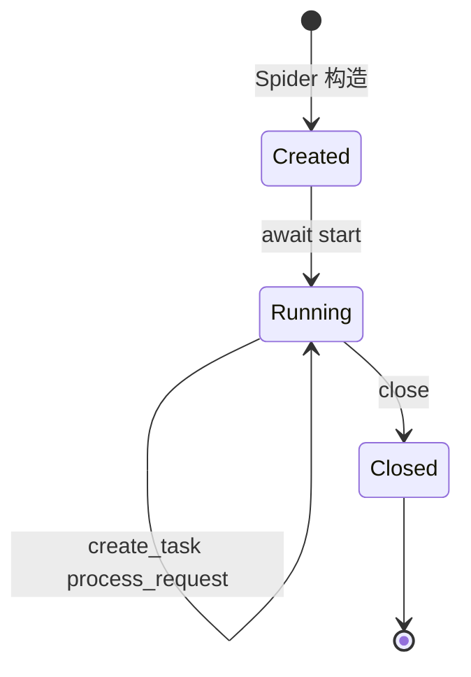

# 02 编程接口（对外 API）

本仓库**没有 HTTP 服务、没有路由、没有请求/响应模型**。所谓“API 层”就是对外暴露的 Python 类与方法。本章按调用方最可能接触的顺序列出契约；所有路径相对仓库根目录。

## 2.1 应用生命周期

`Spider` 是唯一的总入口，没有 `main()` 或 CLI。典型生命周期：

| 阶段 | 方法 | 行为 | 证据 |
|------|------|------|------|
| 构造 | `Spider.__init__(**kwargs)` | 实例化 Scheduler/Downloader/Parser，初始化统计、熔断表、失败集合、同步 Signal | `webants/spider.py:141-216` |
| 启动 | `await Spider.start()` | 生成初始请求并入队，进入主循环，按需 `retry_failed` | `webants/spider.py:397-430` |
| 处理 | `await Spider.process_request(request)` | 熔断检查、下载、调用回调、回灌新请求、发信号 | `webants/spider.py:349-395` |
| 关闭 | `await Spider.close()` | 关闭 downloader、记录时长、发 `spider_stopped` | `webants/spider.py:432-448` |
| 观测 | `Spider.get_stats()` | 合并 spider/scheduler/parser/downloader 统计 | `webants/spider.py:450-466` |

构造参数：

| 参数 | 默认 | 作用 | 落点 |
|------|------|------|------|
| `concurrent_requests` | `10` | 同时传给 scheduler 的域名并发与 downloader 的并发 | `webants/spider.py:144,168-175` |
| `request_timeout` | `30` | 下载超时（秒） | `webants/spider.py:145,174` |
| `retry_times` | `3` | 写入 `Request.retries` | `webants/spider.py:146,281` |
| `retry_delay` | `1.0` | 只写入 `self.settings`，未传给 Downloader | `webants/spider.py:147,184` |
| `log_level` | `logging.INFO` | 各组件日志级别 | `webants/spider.py:148,165-176` |
| `failure_threshold` | `5` | 熔断阈值 | `webants/spider.py:149,211` |
| `recovery_timeout` | `60.0` | 熔断恢复时间 | `webants/spider.py:150,212` |
| `**kwargs` | — | 原样并入 `self.settings` | `webants/spider.py:179-186` |

> `retry_delay` 没有传给 `Downloader`（后者自己从 `kwargs.get("retry_delay", 1)` 取值），二者默认值相同但修改 `Spider(retry_delay=...)` 不会影响下载器重试间隔。

## 2.2 Spider 扩展点

子类通常只需覆盖两个成员：

| 成员 | 签名 | 说明 | 证据 |
|------|------|------|------|
| `start_urls` | `List[str]` | 初始 URL 列表（类属性） | `webants/spider.py:138` |
| `parse` | `async def parse(self, response, **kwargs)` | 默认实现直接 `raise NotImplementedError` | `webants/spider.py:285-297` |
| `handle_error` | `async def handle_error(self, failure, request)` | 计失败、记录 URL、按域名熔断 | `webants/spider.py:299-320` |
| `retry_failed` | `async def retry_failed(self)` | 对 `_failed_urls` 中未被处理的 URL 重新入队 | `webants/spider.py:322-347` |
| `custom_settings` | `Dict[str, Any]` | 合并进 `self.settings` | `webants/spider.py:139,179-186` |

`parse` 的注解写的是 `AsyncGenerator[Union[Request, Result], None]`（`webants/spider.py:285-287`），但函数体没有 `yield`，所以它是普通协程；而 `Request` 又强制回调必须是 coroutine function（`webants/libs/request.py:110-114`）。如果子类按注解写成 `async def parse(...): yield ...`，构造 `Request` 时会触发 `AssertionError`。这是当前最重要的契约冲突（[P0-01](08-issues-and-recommendations.md)）。

## 2.3 Scheduler 接口

| 方法 | 签名 | 返回值 | 说明 | 证据 |
|------|------|--------|------|------|
| `schedule_request` | `async (request: Request) -> bool` | `True` 入队，`False` 被过滤/超限 | 去重、域名状态、信号量、自适应延迟、`put` | `webants/scheduler.py:78-168` |
| `get_request` | `async () -> Optional[Request]` | 下一个请求 | 阻塞等待；取出后可选全局延迟 | `webants/scheduler.py:170-181` |
| `request_completed` | `(request) -> None` | — | 减 active、释放域名信号量 | `webants/scheduler.py:183-196` |
| `get_stats` | `() -> dict` | 统计快照 | 含 `queue_size`、`domain_stats` | `webants/scheduler.py:198-208` |

构造参数：`max_requests`（0 不限）、`request_delay`、`domain_delay`、`max_domain_concurrent`、`max_queue_size`（默认 10000）、`log_level`（`webants/scheduler.py:24-43`）。注意 `Spider` 只传了 `max_domain_concurrent` 和 `log_level`，其余用默认值（`webants/spider.py:168-170`）。

## 2.4 Downloader 接口

| 方法 | 签名 | 返回值 | 说明 | 证据 |
|------|------|--------|------|------|
| `fetch` | `async (request) -> httpx.Response` | 成功响应；失败时构造 `status_code=600` 的响应 | Spider 主链路使用；会调用一次 callback | `webants/downloader.py:361-378` |
| `fetch_retry` | `async (request) -> Optional[httpx.Response]` | 成功响应 / `None`（等待重试）/ 600 | worker 模式使用，按状态码重试 | `webants/downloader.py:289-359` |
| `start_worker` | `async () -> None` | — | 永久循环消费 `request_queue` | `webants/downloader.py:380-392` |
| `start_downloader` | `async (many: int = None) -> None` | — | 启动 N 个 worker，`join` 后取消所有任务 | `webants/downloader.py:394-409` |
| `close` | `async () -> None` | — | `client.aclose()` | `webants/downloader.py:411-414` |
| `get_stats` | `() -> dict` | 统计副本 | 含请求数、重试数、响应时间 | `webants/downloader.py:416-418` |

构造参数（关键字）：`concurrency`、`log_level`、`loop`，以及 `kwargs` 中的 `delay`、`timeout`、`retry_delay`、`headers`、`cookies`、`encoding`、`limits`、`proxies`、`follow_redirects`、`http2`（`webants/downloader.py:100-168`）。

`BaseDownloader` 还接受 `request_queue` 与 `response_queue`，并在构造时用 `assert isinstance(...)` 校验类型（`webants/downloader.py:31-51`）。`Spider` 没有使用这两个队列。

## 2.5 Parser 接口

| 方法 | 签名 | 返回值 | 说明 | 证据 |
|------|------|--------|------|------|
| `parse` | `(content: str \| bytes, encoding=None)` | `etree._Element` | 解码、哈希、LRU 缓存解析 | `webants/parser.py:107-164` |
| `css` | `(tree, selector) -> list` | 元素列表 | 表达式缓存；异常返回 `[]` | `webants/parser.py:178-195` |
| `xpath` | `(tree, xpath) -> list` | 结果列表 | 表达式缓存；异常返回 `[]` | `webants/parser.py:197-214` |
| `extract` | `(content, extractor, encoding=None)` | `Any` | 字符串以 `//` 开头走 XPath，否则 CSS；可传 callable | `webants/parser.py:216-242` |
| `get_stats` | `() -> dict` | 统计 + cache_info | — | `webants/parser.py:244-255` |
| `clear_caches` | `() -> None` | — | 清空文档/CSS/XPath 缓存 | `webants/parser.py:257-262` |

## 2.6 Request 接口

| 能力 | 说明 | 证据 |
|------|------|------|
| 构造校验 | `validate=True` 时校验 method 与 URL；URL 必须含 scheme 与 netloc | `webants/libs/request.py:99-102,143-169` |
| 回调校验 | callback/errback 必须是 coroutine function，否则 `AssertionError` | `webants/libs/request.py:110-118` |
| 默认头 | `DEFAULT_REQUEST_HEADERS` 与传入 headers 合并 | `webants/libs/request.py:18-24,105` |
| 优先级 | `__lt__` 返回 `not self.priority < other.priority`，数值大者先出队 | `webants/libs/request.py:175-177` |
| 指纹 | `fingerprint()` 由 method + 归一化 URL + body 组成 | `webants/libs/request.py:189-225` |
| 复制/替换 | `copy(**kwargs)` 新建；`replace(**kwargs)` 原地修改 | `webants/libs/request.py:227-276` |
| 中间件钩子 | `prepare()` 依次 await `_middlewares` 的 `process_request` | `webants/libs/request.py:278-297` |

构造参数（全部可选，除 `url`）：`method`、`headers`、`body`、`cookies`、`encoding`、`callback`、`errback`、`cb_kwargs`、`dont_filter`、`priority`、`retries`、`delay`、`timeout`、`meta`、`referer`、`validate`、`normalize`（`webants/libs/request.py:55-76`）。

## 2.7 Result / Field 接口

| 方法 | 说明 | 证据 |
|------|------|------|
| `Result(spider, fields, status_code=200, url=None, mediatype=None, title=None, crawl_time=0.0)` | 原始值自动包成 `Field`；`None` 值记入 `_errors` | `webants/libs/result.py:68-107` |
| `add_field(name, field)` | 新增字段，失败记错误 | `webants/libs/result.py:117-134` |
| `get_field` / `get_value` | 取 `Field` / 取原始值 | `webants/libs/result.py:136-157` |
| `is_valid` / `get_errors` / `get_warnings` | 校验结果与错误副本 | `webants/libs/result.py:159-181` |
| `to_dict` | 字段经 `model_dump` 转 dict | `webants/libs/result.py:183-201` |
| `save` | 空实现，占位 | `webants/libs/result.py:203-209` |

`Field` 的约束：`value` 不能为 `None`、`extractor` 必须是字符串、`extra="forbid"`、`validate_assignment=True`（`webants/libs/result.py:11-46`）。

## 2.8 Item / Extractor 接口

| 类型 | 用途 | 关键参数 | 证据 |
|------|------|----------|------|
| `AttrItem` | 取元素属性值 | `attr` 必填；`selector`/`xpath`/`tags` 三选一 | `webants/libs/item.py:90-103` |
| `LinkItem` | 取并过滤链接 | `base_url`、`hosts_allow`、`extensions_deny`、`normalize` 等 | `webants/libs/item.py:106-152` |
| `ElementItem` | 返回元素本身 | `selector`/`xpath`/`tags` | `webants/libs/item.py:155-168` |
| `TextItem` | 取文本 | `iter_text`、`many` | `webants/libs/item.py:171-191` |
| `*Descriptor` | 类属性式声明 | 同对应 Item 的参数 | `webants/libs/item.py:194-312` |

工厂：`ExtractorFactory.create_extractor(name)` 按**前缀**匹配已注册类名（`webants/libs/extractor.py:430-441`），注册由元类 `_ExtractorMeta` 自动完成（`webants/libs/extractor.py:444-459`）。

## 2.9 可选层接口

| 组件 | 主要方法 | 是否接入主链路 |
|------|----------|----------------|
| `MiddlewareManager` | `add_middleware`、`process_request`、`process_response`、`process_exception` | 否（`webants/libs/middleware.py:454-572`） |
| `JsonPersister`/`CsvPersister`/`SqlitePersister` | `save`、`load`、`update_stats` | 否（`webants/libs/persister.py:94-605`） |
| `PersisterManager` | `add_persister`、`save`、`load`、`sync`、`get_stats` | 否（`webants/libs/persister.py:476-605`） |
| `SignalManager` | `register`、`connect`、`disconnect`、`send` | 否（`webants/libs/signals.py:165-256`） |
| `Config` | `get`、`set`、`as_dict`、`save`、`load_config` | 否（`webants/libs/config.py:77-257`） |

## 2.10 错误处理

| 异常 | 触发点 | 是否被捕获 | 结果 |
|------|--------|------------|------|
| `InvalidRequestMethod` | 非法 HTTP method | 否 | 构造 `Request` 时抛出 |
| `ValueError` | URL 缺少 scheme/netloc、`extract` 的 extractor 类型错误 | 否 | 调用方处理 |
| `AssertionError` | 回调不是协程函数、Item 赋值类型错误 | 否 | 构造期失败 |
| `httpx.HTTPError` | 网络/超时 | `_fetch` 捕获 | 返回原 `Request`，`failed_requests+1`（`webants/downloader.py:245-255`） |
| 其他 `Exception` | `_fetch` 内任何异常 | 捕获 | 同样返回 `Request`（`:257-261`） |
| 回调异常 | `fetch`/`fetch_retry` 内 | 不捕获 | 冒泡到 `process_request`，走 errback |
| `ParserError` | 解析失败、超限、编码失败 | 否 | 抛给调用方（`webants/parser.py:98-105`） |
| `CircuitBreakerError` | 中间件熔断打开 | 否 | 中间件链未接入，实际不触发 |

`exception_tracker` 只在中间件与异步信号中使用（`webants/libs/middleware.py:502,537,570`、`webants/libs/signals.py:83`），主链路不记录。

## 2.11 后台任务与并发语义

- `Spider.start` 用 `asyncio.create_task(self.process_request(request))` 启动任务，但**不保存引用、不 await**（`webants/spider.py:421`）；`close()` 只关闭 downloader，不等待这些任务（`:432-448`）。
- `Downloader.start_downloader` 在 `request_queue.join()` 后会取消**事件循环内所有其他任务**（`webants/downloader.py:402-405`），这会误伤同进程内的其他协程。
- `Scheduler.schedule_request` 在入队前 `await asyncio.sleep(effective_delay)`（`webants/scheduler.py:145-150`），因此调度是串行的；`PriorityQueue.put` 在队列满时会一直等待（`:163`）。
- 共享可变状态包括 `seen_urls`、`domain_stats`、`domain_semaphores`、`Parser._cached_parse` 的全局 LRU、`ExtractorFactory.extractors` 类字典；均无锁，依赖单事件循环串行执行。
