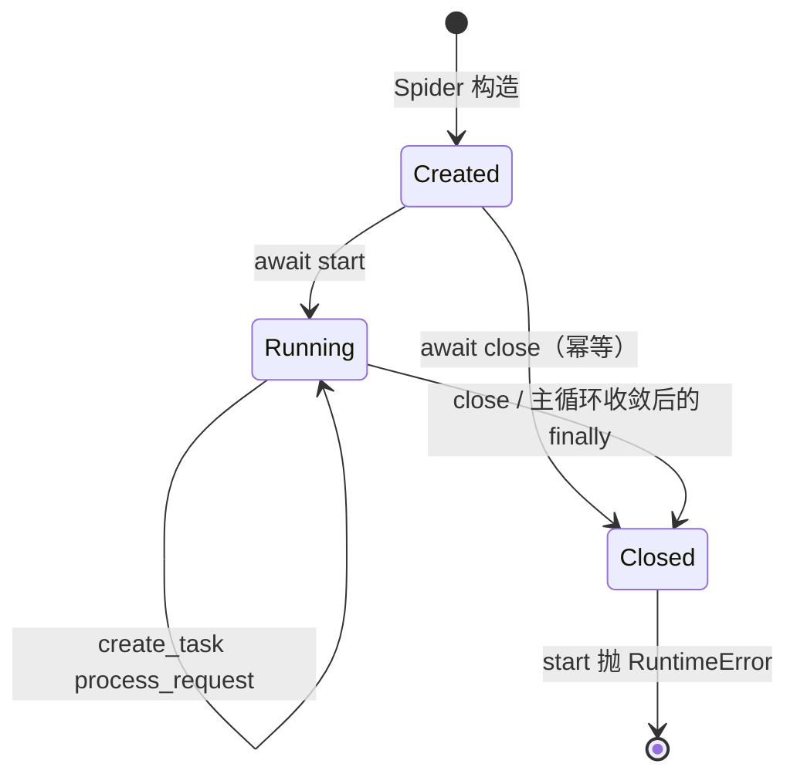

# 02 编程接口（对外 API）

本仓库**没有 HTTP 服务、没有路由、没有请求/响应模型**。所谓“API 层”就是对外暴露的 Python 类与方法。本章按调用方最可能接触的顺序列出契约；所有路径相对仓库根目录。

## 2.1 应用生命周期

`Spider` 是唯一的总入口，没有 `main()` 或 CLI。典型生命周期：

| 阶段 | 方法 | 行为 | 证据 |
|------|------|------|------|
| 构造 | `Spider.__init__(**kwargs)` | 解析 Config 映射，实例化 Scheduler/Downloader/Parser，保存可选层注入，初始化统计、熔断表、同步 Signal、关闭状态与 `_close_lock` | `webants/spider.py:161-340` |
| 启动 | `await Spider.start()` | 生成初始请求并入队，进入轮询主循环；关闭后调用抛 `RuntimeError` | `webants/spider.py:849-882` |
| 处理 | `await Spider.process_request(request, slot=...)` | 熔断检查、可选中间件四阶段、下载、`_invoke_callback` 归一化并分发、持久化、发信号、`finally` 中 `slot.release()` 并清登记 | `webants/spider.py:657-820` |
| 关闭 | `await Spider.close()` | 幂等、与 `_running` 解耦：取消在飞 → 排空队列 → persister flush/close → 关 downloader → 发 `spider_stopped`（恰好一次）→ 置 `_closed` | `webants/spider.py:864-924` |
| 上下文 | `async with Spider(...) as spider:` | `__aenter__` 不自动 start；`__aexit__` 调用一次 `close()` | `webants/spider.py:931-936` |
| 观测 | `Spider.get_stats()` | 合并 spider/scheduler/parser/downloader 统计；注入可选层时附加 `middleware_stats`/`persister_stats` | `webants/spider.py:926-950` |

构造参数（默认值为 `None` 时取 Config 或内置默认；显式参数优先）：

| 参数 | 默认 | 作用 | 落点 |
|------|------|------|------|
| `concurrent_requests` | `None` → `10` | 同时传给 scheduler 的域名并发与 downloader 的并发；显式传入时两者都使用该值 | `webants/spider.py:161-230` |
| `request_timeout` | `None` → `30` | 下载超时（秒） | `webants/spider.py:232-236` |
| `retry_times` | `None` → `3` | 写入 `Request.retries` | `webants/spider.py:237-241,408-430` |
| `retry_delay` | `None` → `1.0` | 写入 `self.settings` 并传给 Downloader | `webants/spider.py:242-246,300-305` |
| `log_level` | `None` → `INFO` | 各组件日志级别（支持字符串） | `webants/spider.py:263-268,341-354` |
| `failure_threshold` | `None` → `5` | 熔断阈值 | `webants/spider.py:247-251` |
| `recovery_timeout` | `None` → `60.0` | 熔断恢复时间 | `webants/spider.py:252-256` |
| `idle_grace` | `0.5` | 主循环在“队列空 + 无在飞任务”后继续等待的静默窗口（秒）；`0` 表示立即退出，供测试使用 | `webants/spider.py:172,386` |
| `middleware_max_retries` | `3` | `process_exception` 返回新 `Request` 时的最大重试次数 | `webants/spider.py:173,612-655` |
| `config` | `None` | 显式注入的 `Config`；只在参数未显式传入时生效 | `webants/spider.py:175-226` |
| `middleware` | `None` | 可选 `MiddlewareManager`；提供 `lookup`/`process_*` 四阶段 | `webants/spider.py:176,571-610` |
| `persister` | `None` | 可选 `PersisterManager`；所有权移交 Spider，关闭时 flush | `webants/spider.py:177,552-568` |
| `**kwargs` | — | 原样并入 `self.settings` | `webants/spider.py:308-317` |

> 不传 `config` 时有效默认值与旧版一致；传入 `Config` 后按 `downloader.*`/`scheduler.*`/`parser.*`/`spider.*`/`logging.level` 映射（ADR-0005 §2.2）。`retry_delay` 现在会传给 Downloader。

## 2.2 Spider 扩展点

子类通常只需覆盖两个成员：

| 成员 | 签名 | 说明 | 证据 |
|------|------|------|------|
| `start_urls` | `List[str]` | 初始 URL 列表（类属性） | `webants/spider.py:138` |
| `parse` | `async def parse(self, response, **kwargs)` | 规范形态为 async generator，逐个 `yield Request`/`Result`；协程返回值由 Spider 归一化 | `webants/spider.py:286-298`、`webants/spider.py:317-373` |
| `handle_error` | `async def handle_error(self, failure, request)` | 默认 errback：只记录日志；计数与熔断由 `process_request` 负责 | `webants/spider.py:300-315` |
| `custom_settings` | `Dict[str, Any]` | 合并进 `self.settings` | `webants/spider.py:139,179-186` |

`parse` 可以是 async generator function 或 coroutine function，`Request.__init__` 会同时接受两者；非 callable 或同步函数在构造期抛 `TypeError`（`webants/libs/request.py:167-202`）。协程回调可以返回 `None`、单个 `Request`/`Result`、同步或异步可迭代对象，由 `Spider._consume_callback_value` 归一化。契约依据见 [ADR-0001](../adr/0001-callback-contract-and-retry-ownership.md)。

## 2.3 Scheduler 接口

| 方法 | 签名 | 返回值 | 说明 | 证据 |
|------|------|--------|------|------|
| `schedule_request` | `async (request: Request) -> ScheduleResult` | `SCHEDULED` 时带 `slot`；否则带 `reason` | 去重、域名状态、信号量、自适应延迟、`put_nowait`；拒绝不泄漏额度 | `webants/scheduler.py:265-365` |
| `get_request` | `async () -> Optional[ScheduleSlot]` | 下一个 slot；空队列轮询后返回 `None` | 非阻塞；调用方持有 slot 并负责释放 | `webants/scheduler.py:367-390` |
| `discard_pending` | `() -> int` | 丢弃条数 | 关闭时逐条 `slot.release()`，累加 `discarded_on_close` | `webants/scheduler.py:392-413` |
| `request_completed` | `(request) -> None` | — | **已弃用**：按 URL 释放不可区分同 URL 并发请求，仅保留兼容；不配对时计 `slot_mismatches` | `webants/scheduler.py:415-445` |
| `audit` | `() -> dict` | 对账快照 | 含 `idle`、`balanced`、`mismatch_count`、`outstanding` | `webants/scheduler.py:447-490` |
| `get_stats` | `() -> dict` | 统计快照 | 含 `queue_size`、`domain_stats`、`discarded_on_close` | `webants/scheduler.py:492-510` |

构造参数：`max_requests`（0 不限）、`request_delay`、`domain_delay`、`max_domain_concurrent`、`max_queue_size`（默认 10000）、`log_level`（`webants/scheduler.py:24-43`）。注意 `Spider` 只传了 `max_domain_concurrent` 和 `log_level`，其余用默认值（`webants/spider.py:168-170`）。

## 2.4 Downloader 接口

| 方法 | 签名 | 返回值 | 说明 | 证据 |
|------|------|--------|------|------|
| `fetch` | `async (request) -> httpx.Response` | 非可重试响应；否则抛 `RequestError(FETCH_FAILED/RETRY_EXHAUSTED)` | 主链路使用；内部完成重试、退避、`Retry-After`；**不调用回调** | `webants/downloader.py:335-432` |
| `fetch_retry` | `async (request) -> httpx.Response` | 同 `fetch` | 兼容别名，仅保留一个版本 | `webants/downloader.py:431-433` |
| `start_worker` | `async () -> None` | — | worker 兼容适配器：`fetch` 成功入 `response_queue`，`RequestError` 记日志 | `webants/downloader.py:435-455` |
| `start_downloader` | `async (many: int = None) -> None` | — | 启动 N 个 worker，`join` 后只取消并回收**自己创建**的 worker（`try/finally`） | `webants/downloader.py:457-472` |
| `close` | `async () -> None` | — | `client.aclose()`；重复调用安全 | `webants/downloader.py:475-478` |
| `get_stats` | `() -> dict` | 统计副本 | 含 `total_requests/total_attempts/total_retries/retry_requests` 等 | `webants/downloader.py:479-481` |

构造参数（关键字）：`concurrency`、`log_level`、`loop`，以及 `kwargs` 中的 `delay`、`timeout`、`retry_delay`、`retry_backoff_factor`、`retry_max_delay`、`retry_jitter`、`retry_status_codes`、`headers`、`cookies`、`encoding`、`limits`、`proxies`、`follow_redirects`、`http2`（`webants/downloader.py:100-171`）。

`BaseDownloader` 还接受 `request_queue` 与 `response_queue`，并在构造时用 `assert isinstance(...)` 校验类型（`webants/downloader.py:31-51`）。`Spider` 没有使用这两个队列。

## 2.5 Parser 接口

| 方法 | 签名 | 返回值 | 说明 | 证据 |
|------|------|--------|------|------|
| `parse` | `(content: str \| bytes, encoding=None)` | `etree._Element` | 解码、哈希、实例级缓存；每次返回深拷贝 | `webants/parser.py:106-184` |
| `css` | `(tree, selector) -> list` | 元素列表 | 表达式缓存；异常返回 `[]` | `webants/parser.py:204-220` |
| `xpath` | `(tree, xpath) -> list` | 结果列表 | 表达式缓存；异常返回 `[]` | `webants/parser.py:222-238` |
| `extract` | `(content, extractor, encoding=None)` | `Any` | 字符串以 `//` 开头走 XPath，否则 CSS；可传 callable | `webants/parser.py:240-266` |
| `get_stats` | `() -> dict` | 统计 + cache_info | 含 `cache_hits/cache_misses` 与兼容的 `cache_info` | `webants/parser.py:268-284` |
| `clear_caches` | `() -> None` | — | 清空文档/CSS/XPath 缓存 | `webants/parser.py:286-291` |

> Parser 缓存契约见 [ADR-0004](../adr/0004-data-correctness-link-filter-config-cache-signal.md)：缓存归实例所有，key 仅内容哈希；`parse()` 返回副本，调用方修改不会污染缓存；构造参数 `cache_size`（默认 1000，0 表示禁用）。

## 2.6 Request 接口

| 能力 | 说明 | 证据 |
|------|------|------|
| 构造校验 | `validate=True` 时校验 method 与 URL；URL 必须含 scheme 与 netloc | `webants/libs/request.py:99-102,143-169` |
| 回调校验 | callback/errback 必须是 coroutine function，否则 `AssertionError` | `webants/libs/request.py:110-118` |
| 默认头 | `DEFAULT_REQUEST_HEADERS` 与传入 headers 合并 | `webants/libs/request.py:18-24,105` |
| 优先级 | `__lt__` 返回 `not self.priority < other.priority`，数值大者先出队 | `webants/libs/request.py:175-177` |
| 指纹 | `fingerprint()` 由 method + 归一化 URL + body 组成 | `webants/libs/request.py:189-225` |
| 复制/替换 | `copy(**kwargs)` 新建；`replace(**kwargs)` 原地修改 | `webants/libs/request.py:227-276` |
| 中间件钩子 | `prepare()` 依次 await `_middlewares` 的 `process_request` | `webants/libs/request.py:278-297` |

构造参数（全部可选，除 `url`）：`method`、`headers`、`body`、`cookies`、`encoding`、`callback`、`errback`、`cb_kwargs`、`dont_filter`、`priority`、`retries`、`delay`、`timeout`、`meta`、`referer`、`validate`、`normalize`（`webants/libs/request.py:55-76`）。

## 2.7 Result / Field 接口

| 方法 | 说明 | 证据 |
|------|------|------|
| `Result(spider, fields, status_code=200, url=None, mediatype=None, title=None, crawl_time=0.0)` | 原始值自动包成 `Field`；`None` 值记入 `_errors` | `webants/libs/result.py:68-107` |
| `add_field(name, field)` | 新增字段，失败记错误 | `webants/libs/result.py:117-134` |
| `get_field` / `get_value` | 取 `Field` / 取原始值 | `webants/libs/result.py:136-157` |
| `is_valid` / `get_errors` / `get_warnings` | 校验结果与错误副本 | `webants/libs/result.py:159-181` |
| `to_dict` | 字段经 `model_dump` 转 dict | `webants/libs/result.py:183-201` |
| `save` | 空实现，占位 | `webants/libs/result.py:203-209` |

`Field` 的约束：`value` 不能为 `None`、`extractor` 必须是字符串、`extra="forbid"`、`validate_assignment=True`（`webants/libs/result.py:11-46`）。

## 2.8 Item / Extractor 接口

| 类型 | 用途 | 关键参数 | 证据 |
|------|------|----------|------|
| `AttrItem` | 取元素属性值 | `attr` 必填；`selector`/`xpath`/`tags` 三选一 | `webants/libs/item.py:90-103` |
| `LinkItem` | 取并过滤链接 | `base_url`、`hosts_allow`、`extensions_deny`、`normalize` 等 | `webants/libs/item.py:106-152` |
| `ElementItem` | 返回元素本身 | `selector`/`xpath`/`tags` | `webants/libs/item.py:155-168` |
| `TextItem` | 取文本 | `iter_text`、`many` | `webants/libs/item.py:171-191` |
| `*Descriptor` | 类属性式声明 | 同对应 Item 的参数 | `webants/libs/item.py:194-312` |

工厂：`ExtractorFactory.create_extractor(name)` 按**前缀**匹配已注册类名（`webants/libs/extractor.py:430-441`），注册由元类 `_ExtractorMeta` 自动完成（`webants/libs/extractor.py:444-459`）。

## 2.9 可选层接口

| 组件 | 主要方法 | 是否接入主链路 |
|------|----------|----------------|
| `MiddlewareManager` | `add_middleware`、`lookup`、`process_request`、`process_response`、`process_exception`、`get_stats` | 可选：`Spider(middleware=...)`（`webants/libs/middleware.py:474-570`） |
| `JsonPersister`/`CsvPersister`/`SqlitePersister` | `save`、`load`、`flush`、`close`、`update_stats` | 可选：经 `PersisterManager` 注入（`webants/libs/persister.py:26-690`） |
| `PersisterManager` | `add_persister`、`save`、`load`、`flush`、`close`、`sync`、`get_stats` | 可选：`Spider(persister=...)`（`webants/libs/persister.py:692-820`） |
| `SignalManager` | `register`、`connect`、`disconnect`、`send` | 实验性、未桥接 Spider 生命周期（`webants/libs/signals.py:167-279`；排序语义见 ADR-0004；桥接待办 BL-001） |
| `Config` | `get`、`set`、`as_dict`、`save`、`load_config` | 可选：`Spider(config=...)`（`webants/libs/config.py:78-338`；映射见 ADR-0005） |

## 2.10 错误处理

| 异常 | 触发点 | 是否被捕获 | 结果 |
|------|--------|------------|------|
| `InvalidRequestMethod` | 非法 HTTP method | 否 | 构造 `Request` 时抛出 |
| `ValueError` | URL 缺少 scheme/netloc、`extract` 的 extractor 类型错误 | 否 | 调用方处理 |
| `TypeError` | 回调/errback 不是可调用/协程函数、`cb_kwargs` 非法 | 否 | 构造 `Request` 期失败（`webants/libs/request.py:167-223`） |
| `httpx.HTTPError` | 网络/超时 | `_fetch` 抛出、`fetch` 捕获 | 未耗尽则退避重试；耗尽抛 `RequestError(FETCH_FAILED)` |
| `RequestError` | 重试耗尽 / 传输失败 | 否 | `Spider.process_request` 捕获，走 errback 一次；`code` 区分 `FETCH_FAILED`/`RETRY_EXHAUSTED` |
| `RuntimeError` | 已关闭的 Spider 再 `start()` | 否 | 关闭是终态；需重新实例化（`webants/spider.py:531-532`） |
| 回调抛异常 | `Spider._invoke_callback` 内 | 不捕获 | 冒泡到 `process_request`，走 errback |
| `ParserError` | 解析失败、超限、编码失败 | 否 | 抛给调用方（`webants/parser.py:98-105`） |
| `CircuitBreakerError` | 中间件熔断打开 | 否 | 中间件链未接入，实际不触发 |

`exception_tracker` 只在中间件与异步信号中使用（`webants/libs/middleware.py:502,537,570`、`webants/libs/signals.py:83`），主链路不记录。

## 2.11 后台任务与并发语义

- `Spider.start` 用 `asyncio.create_task(self.process_request(request, slot=slot))` 启动任务，并在让出控制权**之前**登记到 `_inflight`（task → Request）并挂 `_on_task_done`；任务结束回调清理登记、消费异常并按需计数（`webants/spider.py:503-522,573-577`）。
- 主循环按 `Scheduler.poll_interval` 轮询：`get_request()` 返回 `None` 时，只有「无在飞任务」且「静默 ≥ `idle_grace`」才退出（`webants/spider.py:549-561`）。
- `close()` 会取消在飞任务（库只取消自己创建的任务）、`scheduler.discard_pending()` 归还排队凭据、关闭 client；重复/并发调用安全，且关闭后不可重启（[ADR-0003](../adr/0003-shutdown-cancellation-and-loop-quiescence.md)）。
- `Downloader.start_downloader` 只取消本方法创建的 worker（`try/finally`），不再调用 `asyncio.all_tasks()`（`webants/downloader.py:457-472`）。
- `Scheduler.schedule_request` 在入队前 `await asyncio.sleep(effective_delay)`（`webants/scheduler.py:145-150`），因此调度是串行的；`PriorityQueue.put` 在队列满时会一直等待（`:163`）。
- 共享可变状态包括 `seen_urls`、`domain_stats`、`domain_semaphores`、`ExtractorFactory.extractors` 类字典；均无锁，依赖单事件循环串行执行。`Parser` 的文档缓存归实例所有（ADR-0004），不再跨实例共享。
