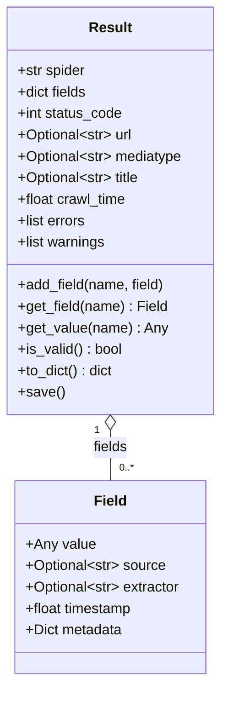
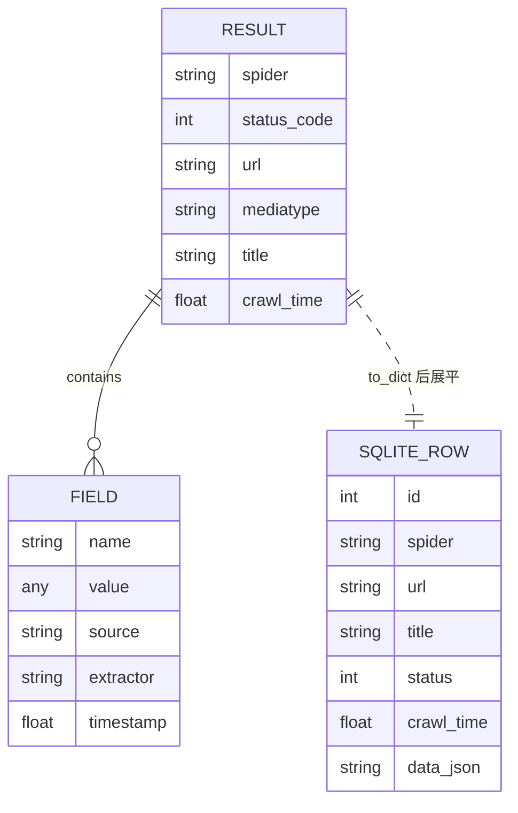
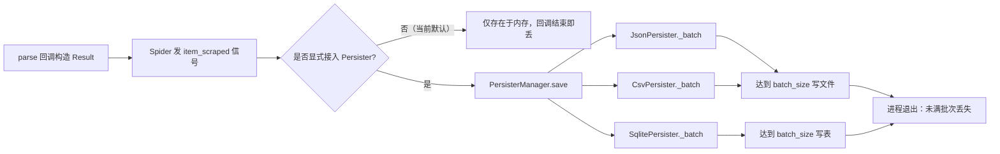

# 04 数据模型

WebAnts 没有默认数据库，也没有 ORM。数据模型分为两层：

1. **内存模型**：`Result` + `Field`（pydantic），所有爬取结果的标准形态；
2. **可选落盘模型**：`JsonPersister`、`CsvPersister`、`SqlitePersister` 三种后端，只有显式组装 `PersisterManager` 时才会写入。

## 4.1 内存模型：Result 与 Field



### Result 字段

| 字段 | 类型 | 默认 | 含义 | 写入点 |
|------|------|------|------|--------|
| `spider` | `str` | 必填 | 产生结果的爬虫名 | 构造参数（`webants/libs/result.py:74,89`） |
| `fields` | `Dict[str, Field]` | `{}` | 业务字段集合 | 构造时逐项转换（`:95-101`） |
| `status_code` | `int` | `200` | 来源响应状态 | 构造参数（`:103`） |
| `url` | `Optional[str]` | `None` | 来源 URL | 构造参数（`:104`） |
| `mediatype` | `Optional[str]` | `None` | 内容类型 | 构造参数（`:105`） |
| `title` | `Optional[str]` | `None` | 页面标题 | 构造参数（`:106`） |
| `crawl_time` | `float` | 当前时间 | 抓取时间 | `crawl_time or time.time()`（`:107`） |
| `_errors` | `List[str]` | `[]` | 字段校验错误 | 构造/`add_field`（`:91,101,134`） |
| `_warnings` | `List[str]` | `[]` | 预留警告 | 当前无写入点（`:92`） |

`Result` 使用 `__slots__`（`webants/libs/result.py:56-66`），不能动态添加属性；`save()` 是空实现（`:203-209`）。

### Field 字段与约束

| 字段 | 类型 | 约束 | 证据 |
|------|------|------|------|
| `value` | `Any` | 不能为 `None`，否则 `ValueError` | `webants/libs/result.py:22,28-33` |
| `source` | `Optional[str]` | 无 | `:23` |
| `extractor` | `Optional[str]` | 非空时必须是 `str` | `:24,35-40` |
| `timestamp` | `float` | `default_factory=time.time` | `:25` |
| `metadata` | `Dict[str, Any]` | `default_factory=dict` | `:26` |

模型配置：`validate_assignment=True`、`validate_default=True`、`extra="forbid"`（`webants/libs/result.py:42-46`）。因此给 `Field` 赋一个新属性会直接报错，给 `value` 赋 `None` 也会报错。

## 4.2 落盘模型：SQLite

`SqlitePersister` 使用标准库 `sqlite3`，无连接池、无 PRAGMA 设置（`webants/libs/persister.py:349-369`）。默认表名 `results`，可通过构造参数覆盖（`:331`）。

### DDL（与代码一致）

```sql
CREATE TABLE IF NOT EXISTS results (
    id INTEGER PRIMARY KEY AUTOINCREMENT,
    spider TEXT,
    url TEXT,
    title TEXT,
    status INTEGER,
    crawl_time REAL,
    data TEXT
);
```

来源：`webants/libs/persister.py:354-364`。`data` 列存放 `json.dumps(item["fields"])`（`:463`）。

### 字段表

| 列 | 类型 | 可空 | 默认 | 含义 | 写入点 |
|----|------|------|------|------|--------|
| `id` | INTEGER | 否 | 自增 | 主键 | SQLite |
| `spider` | TEXT | 是 | 无 | 爬虫名 | `item.get("spider")`（`:458`） |
| `url` | TEXT | 是 | 无 | 来源 URL | `item.get("url")`（`:459`） |
| `title` | TEXT | 是 | 无 | 页面标题 | `item.get("title")`（`:460`） |
| `status` | INTEGER | 是 | 无 | 状态码 | `item.get("status")`（`:461`） |
| `crawl_time` | REAL | 是 | 无 | 抓取时间 | `item.get("crawl_time")`（`:462`） |
| `data` | TEXT | 是 | 无 | `fields` 的 JSON 文本 | `json.dumps(item.get("fields", {}))`（`:463`） |

**索引**：除主键外没有任何索引（DDL 中无 `CREATE INDEX`）。按 `url`、`spider` 查询都会全表扫描。

### 插入与去重

- 插入是逐行 `INSERT`，没有 `INSERT OR REPLACE`、没有唯一约束（`webants/libs/persister.py:450-465`）。
- 去重只发生在调度器内存中的 `seen_urls`（`webants/scheduler.py:95,153`），**不落库**；进程重启后重复 URL 会再次抓取、再次插入。
- 批量写入阈值 `batch_size=100`（`webants/libs/persister.py:419`）；达到阈值自动写批，未满批次由 `flush()` / `close()` 强制写出（`:110-135`）。

## 4.3 其他落盘形态

| 后端 | 文件形态 | 关键行为 | 证据 |
|------|----------|----------|------|
| `JsonPersister` | NDJSON（每行一条紧凑 JSON） | 正常路径 `a` 追加，不再读全文件；旧 JSON 数组可读，并在下一次写入时用临时文件 + `os.replace` 原子迁移；`indent` 保留但忽略 | `webants/libs/persister.py:171-410` |
| `CsvPersister` | CSV，首行表头 | 首次写 `w` 并写表头，之后 `a` 追加；所有值 `str(v)` | `webants/libs/persister.py:205-321` |
| `SqlitePersister` | `.db` 文件 | 固定七列；`data` 存 fields JSON | `webants/libs/persister.py:324-473` |

`JsonPersister` 使用标准库 `json`：旧数组用 `json.load`，NDJSON 逐行 `json.loads`（`webants/libs/persister.py:247-306`）；同仓库 `utils/misc.py` 优先使用 `ujson`（`webants/utils/misc.py:5-8`），两处序列化实现仍不一致（P2-08 Open）。

`CsvPersister` 把 `Result` 转成 `{字段名: str(value)}`（`webants/libs/persister.py:242-246`）；如果不同批次的字段集合不同，追加行会出现缺列/多列，`csv.DictWriter` 不会校验（`:303-315`）。

## 4.4 实体关系



注意 SQLite 行不是 `Result` 的规范化表示：`fields` 被压成一个 JSON 字符串，`status_code` 改名为 `status`，`errors`/`warnings`/`mediatype` 丢失（`webants/libs/persister.py:450-465` 对比 `webants/libs/result.py:183-201`）。

## 4.5 生命周期



`Spider` 的 `item_scraped` 只做 `items_scraped += 1`（`webants/spider.py:252-254`），没有持久化动作；`SignalManager` 也未注册持久化接收器。因此默认运行不会产生任何结果文件。

## 4.6 数据快照

- 仓库内**没有** `.db`、`.sqlite`、`.jsonl` 结果文件；`data/` 下只有 `html/awesome-python.html`（约 152 KB，样例 HTML）。
- 因此本 Wiki 不提供行数、空值率、分布等统计；任何此类数字都需要在接入 `SqlitePersister` 后实际查询，当前标注为“未验证”。
- 未执行 `sqlite3` 只读查询，因为没有目标数据库文件。

## 4.7 数据质量问题

| 问题 | 影响 | 证据 |
|------|------|------|
| 无唯一约束/无索引 | 重复插入、查询慢 | `webants/libs/persister.py:354-364` |
| `fields` 存 JSON 文本 | 无法用 SQL 按字段过滤/聚合 | `:463` |
| 批缓存无 flush | 少于 `batch_size` 的尾部数据在进程结束时丢失 | `:119,139-140,198`；`:230,253-254,317`；`:346,389-390,469` |
| `errors`/`warnings`/`mediatype` 不落库 | 溯源信息缺失 | `Result.to_dict` 与 INSERT 列不一致 |
| 无迁移机制 | 表结构变更需手工处理 | 全文件无 migration 函数 |
| 表名 f-string 拼接 | 表名来自配置时可注入 SQL | `webants/libs/persister.py:354,416,451-453` |
| `crawl_time` 显式 0 被覆盖 | 时间语义不精确 | `webants/libs/result.py:107` |
