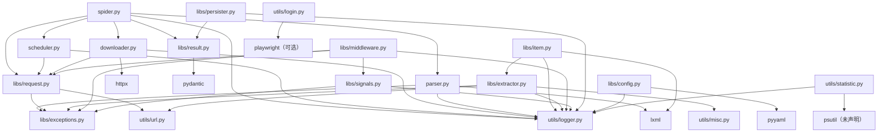

# 06 依赖与模块边界

## 6.1 运行时依赖

来自 `pyproject.toml:7-17`，与 `setup.py:17-26` 基本一致（`setup.py` 未列出 `setuptools`）。

| 依赖 | 约束 | 实际使用点 | 用途 |
|------|------|------------|------|
| `httpx` | `>=0.28.1` | `webants/downloader.py:16` | 异步 HTTP、连接池、超时 |
| `lxml` | `>=5.3.0` | `webants/parser.py:15-17`、`webants/libs/extractor.py:7-8`、`webants/libs/item.py:4` | HTML 解析、XPath、`lxml.cssselect` |
| `pydantic` | `>=2.11.3` | `webants/libs/result.py:8` | `Field` 校验与序列化 |
| `pyyaml` | `>=6.0.2` | `webants/libs/config.py:11` | YAML 配置 |
| `ujson` | `>=5.10.0` | `webants/utils/misc.py:6`、`webants/utils/login.py:10`（均 try/except 回退） | 更快的 JSON |
| `charset-normalizer` | `>=3.4.1` | `webants/parser.py:136`（函数内 import） | 编码检测 |
| `cssselect` | `>=1.3.0` | 未直接 import；`lxml.cssselect` 依赖它 | CSS 选择器后端 |
| `multidict` | `>=6.1.0` | 未直接 import；httpx 0.28.1 的 `Requires-Dist` 也不含它 | 声明但未使用，可考虑移除 |
| `setuptools` | `>=75.6.0` | 未 import | 打包工具，不应作为运行时依赖 |

## 6.2 开发依赖

`pyproject.toml:57-64`：

| 依赖 | 用途 | 证据 |
|------|------|------|
| `pytest>=8.3.5` | 测试框架 | `tests/` |
| `pytest-asyncio>=0.26.0` | 异步测试（`asyncio_mode=auto`） | `pyproject.toml:33-43`、`tests/conftest.py:12` |
| `pytest-cov>=6.1.1` | 覆盖率；`addopts` 带 `--cov-report=term-missing` | `pyproject.toml:40-43` |
| `isort>=6.0.1` | 导入排序 | 实测 `uv run isort --check .` 可运行 |
| `ipython>=9.1.0` | 交互调试 | 未在仓库中使用 |

**声明与实际不一致**：

- `ruff` 未写入 `pyproject.toml` 的 dev 组，但 `uv run ruff check .` 能解析到可执行文件（本机实测，17 个 F401）；要么来自 uv 的工具缓存，要么来自全局环境，仓库本身没有锁定版本。
- `black` 未声明，实测 `uv run black --check .` 失败（`Failed to canonicalize script path`），无法验证格式。
- `psutil` 未声明、`uv.lock` 中也未找到；`webants/utils/statistic.py:12` 直接 `import psutil`，实测 `ModuleNotFoundError`。
- `playwright` 在可选组 `[project.optional-dependencies].playwright` 中声明（`pyproject.toml:19-22`），`webants/utils/login.py:6-7` 直接导入，未安装时 import 该模块即失败。

`requirements.txt` 与 manifest 的漂移：缺少 `pyyaml`、`psutil`；包含 `setuptools`；版本是精确锁定的旧版（如 `httpx==0.28.1`、`lxml==5.3.2`）。它更像某次环境的冻结输出，而不是项目依赖清单。

## 6.3 模块依赖图

图中没有 `Spider → libs` 的**运行期 import 边**：ADR-0005 采用显式注入，`spider.py` 只在 `TYPE_CHECKING` 下引用 `Config`/`Middleware`/`Persister` 类型。Spider 构造时接收实例并调用其接口，默认不创建任何可选层；因此依赖图仍保持无入边，但“未接入”已不再成立，准确说法是“默认关闭、按需注入”。

## 6.4 导入风格

- 全部使用绝对导入：`from webants.libs.request import Request`（例：`webants/spider.py:16-21`），没有相对导入。
- `webants/__init__.py` 只有一行空行（`webants/__init__.py:1`），`webants/libs/__init__.py` 为空文件，因此 `import webants` 不会导出任何公共符号；使用方必须写完整路径。
- 测试通过 `conftest.py` 把仓库根加入 `sys.path`（`tests/conftest.py:7-9`），而不是依赖安装后的包。
- `webants/utils/misc.py` 与 `login.py` 用 `try: import ujson as json / except ImportError: import json` 做可选加速（`misc.py:5-8`、`login.py:9-12`）；`JsonPersister` 则直接 `import json`（`persister.py:11`），风格不统一。

## 6.5 边界契约（实测）

仓库没有 `import-linter`、`ruff` 的 `[tool.ruff]` 配置或 `mypy`/`pyright` 配置；`pyproject.toml` 只有 black、isort、pytest 三节（`:24-55`）。因此“边界规则”只存在于 `AGENTS.md` 的描述中，没有可执行检查。

本次实际执行的命令与结果：

| 命令 | 结果 | 说明 |
|------|------|------|
| `uv run pytest -q` | **212 passed** | 无失败用例（ADR-0005 T1–T5 后） |
| `uv run ruff check .` | **Found 10 errors**，全部为 `F401` 未使用导入 | 分布：`example/use_item.py` 7 处、`webants/utils/statistic.py` 3 处；其余历史 F401 已随 ADR-0004/0005 清理 |
| `uv run isort --check .` | **无法运行**（`Failed to canonicalize script path`） | 改用 `uv run python -m isort --check-only .`：10 个文件不合格、2 个跳过 |
| `uv run black --check .` | 无法运行 | `Failed to canonicalize script path`，black 未安装/未声明 |

`ruff` 的 10 个错误都是可自动修复的 `F401`，不影响运行，属于 8.11 阶段 5 的清理项（P2-05）。

## 6.6 耦合热点

| 热点 | 表现 | 影响 |
|------|------|------|
| `Downloader` 与回调契约 | `fetch` 只下载，Spider 统一调用并归一化回调 | 已按 ADR-0001 收敛（P0-01 Closed） |
| `Scheduler` 与 `Spider` 生命周期 | 入队返回 `ScheduleSlot`，`process_request` 的 `finally` 释放；Spider 关闭时取消在飞并 `discard_pending()` | 槽位模型见 ADR-0002、关闭契约见 ADR-0003（P1-01/04、P2-20/23 Closed） |
| `Parser` 实例缓存 | `OrderedDict`，key 仅内容哈希，返回深拷贝 | 实例可回收、统计区分命中/未命中（P1-07、P2-17 Closed，ADR-0004） |
| `Config` 嵌套合并 | `deepcopy` 默认值 + 递归深合并 + `__` 环境变量 | 嵌套键不再拍平，默认值不被实例污染（P1-06、P2-16 Closed，ADR-0004） |
| `ExtractorFactory` 元类注册表 | 类字典全局可变，按前缀匹配 | 新增/重名提取器行为隐式 |
| `utils/statistic.py` | 顶层 `import psutil` | 未安装即无法 import 整个模块（P2-06） |
| `SignalManager` | 全局单例 + 同步/异步两套 | 事件语义仍分裂；异步版改为高优先级先执行、同优先级按注册顺序（P1-08、P2-15 Closed，ADR-0004）；生命周期未桥接（BL-001） |
| 中间件 `lookup` | 缓存命中走独立阶段，请求链只接受 `Request` | 避免 `Response` 污染请求链（P1-10 Closed，ADR-0005） |
| Persister 生命周期 | `flush/close` + 实例锁；JSON 为 NDJSON 追加 | 关闭前落盘；旧数组自动迁移（P1-09、P2-19 Closed，ADR-0005） |
| Config → Spider | 显式注入、构造参数优先 | YAML/环境变量真正影响组件（P1-11 Closed，ADR-0005） |

外部系统依赖只有两类：目标 HTTP 站点（`Downloader`）与可选的 Playwright 浏览器二进制（`utils/login.py`）。没有数据库服务、缓存服务或消息中间件。
