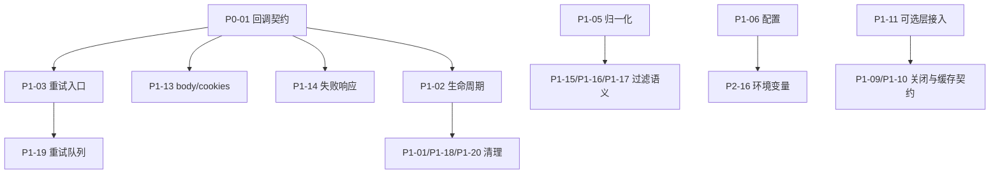

# 08 问题与建议（修订版）

> **修订说明**
>
> - 基线：`master @ 23f8051`，Python 3.12.11，`uv 0.13.6`；原版复核时间见 8.2，修订复核日期 2026-11-03。
> - 原版登记 29 条（P0 × 1、P1 × 14、P2 × 14）。本修订版**保留全部原编号**，新增 15 条（P1 × 6、P2 × 9），并修正 4 条原结论（P0-01 补充、P2-02 重写、P2-03 收窄、P2-12 更正）。
> - 新增问题统一编号为 P1-15 ~ P1-20、P2-15 ~ P2-23，不另起 N-xx 前缀，便于与既有引用兼容。
> - 本文档只登记问题、证据与修复建议，**不包含任何代码变更**。

## 8.1 分级与标注

| 级别 | 定义 | 处理要求 |
|------|------|----------|
| **P0** | 核心功能不可用、数据损坏、安全暴露 | 阻断发布，优先修复 |
| **P1** | 常见路径行为错误，或严重的可维护性/可观测性问题 | 本迭代内修复 |
| **P2** | 体验、性能、一致性问题，不阻断使用 | 排期修复 |

除级别外，本版为每条问题增加两个标注维度：

- **证据**：`实测`（有可执行复现）或 `静态`（基于源码阅读，结论确定但未单独运行）。
- **影响面**：`核心链路`（Spider/Scheduler/Downloader/Parser）、`可选层`（middleware/persister/config/signals/工具）、`工程`（测试、依赖、CI、仓库卫生）。

> 说明：`可选层` 不代表不重要，而是表示“当前默认运行路径不会触发”，修复优先级应结合接入计划判断。

## 8.2 验证环境与证据

所有结论基于 `master @ 23f8051`，Python 3.12.11，`uv 0.13.6`。下表中的数量为 **最近一次复测值（2026-11-05，ADR-0003 实施后）**。

| 验证项 | 命令 / 脚本 | 实际结果 |
|--------|-------------|----------|
| 测试套件 | `uv run pytest -q` | `242 passed`，无失败用例 |
| Lint | `uv run ruff check .` | `All checks passed`（阶段 5 清理后） |
| 导入排序 | `uv run python -m isort --check .` | 通过；CLI 入口在 Windows 下仍报 `Failed to canonicalize script path` |
| 格式检查 | `uv run ruff format --check .` | 通过（black 已由 `ruff format` 替代；`docs` 排除） |
| 配置合并 | 构造 `Config()` 后 `_merge_config({"downloader": {"concurrent_requests": 42}})` | 顶层出现 `concurrent_requests`，`downloader.concurrent_requests` 仍为 10 |
| 链接过滤 | `FilteringLinkExtractor(base_url=..., normalize=False).extract('<a href="/p">x</a>')` | `AttributeError: 'Link' object has no attribute 'decode'` |
| 链接归一化 | `normalize=True` 过滤 `http://EXAMPLE.com:80/a?b=2&a=1#f` | 返回的 `Link.url` 仍是原串，未被归一化 |
| 模块级链接过滤 | `extract_and_filter_links(html, base_url=...)`，不传 `hosts_allow` | 静态确认：所有链接在 `_host_allowed_lenient` 处被拒绝，返回空列表（见 P1-15） |
| Parser 统计 | 解析一次后读取 `stats` 与 `cache_info()` | `cache_hits == 1`，`cache_info().hits == 0` |
| Spider 处理 | mock `_fetch` 返回 200，调用 `process_request` | 回调在 `fetch` 内调用 1 次，随后 `async for` 协程抛 `TypeError`，统计 `failed_requests == 1` |
| 可选依赖 | `import psutil` | `ModuleNotFoundError` |
| 仓库卫生 | `ls webants/libs/__pycache__ tests/__pycache__` | 存在 `cpython-311/312/313` 多版本 `.pyc`，包含无对应源码的陈旧缓存 |

> 复现约定：`实测` 项应能由 8.11 的验收用例覆盖；`静态` 项在修复前需要补一条最小回归测试。

## 8.3 问题总表

> 修复状态见 [8.13 实施状态](#813-实施状态)。未列入 8.13 的条目仍为 Open。

### 8.3.1 P0

| ID | 领域 | 影响面 | 证据 | 摘要 | 位置 | 建议动作 |
|----|------|--------|------|------|------|----------|
| P0-01 | 主链路 | 核心链路 | 实测 | 回调契约冲突：`fetch` 调用一次回调，`process_request` 又对协程做 `async for`；且 `Request` 断言拒绝 async generator 回调，典型子类在 `start_requests` 阶段即失败 | `webants/spider.py:370-375`、`webants/downloader.py:361-375`、`webants/libs/request.py:110-118` | 统一回调契约，Downloader 只下载 |

### 8.3.2 P1

| ID | 领域 | 影响面 | 证据 | 摘要 | 位置 | 建议动作 |
|----|------|--------|------|------|------|----------|
| P1-01 | 生命周期 | 核心链路 | 实测 | 未入队请求在 `finally` 中触发 `KeyError`，掩盖原始异常 | `webants/spider.py:386-388`、`webants/scheduler.py:183-196` | 记录入队状态、容错释放 |
| P1-02 | 生命周期 | 核心链路 | 静态 | 主循环无超时等待；任务未跟踪；关闭不等待 | `webants/spider.py:413-425,432-448` | 超时 + Task 集合 + gather |
| P1-03 | 重试 | 核心链路 | 静态 | `fetch` 不重试，`fetch_retry` 只在 worker 路径生效 | `webants/downloader.py:289-378` | 重试内联到 `fetch` |
| P1-04 | 调度 | 核心链路 | 静态 | 先占信号量再 sleep/put，异常泄漏；入队串行化 | `webants/scheduler.py:117-168` | 调整 acquire 位置，锁内去重 |
| P1-05 | 提取 | 可选层 | 实测 | `normalize=False` 崩溃；`normalize=True` 对输出无效 | `webants/libs/extractor.py:307-313,889-930` | 用 URL 字符串做判断并重建 Link |
| P1-06 | 配置 | 可选层 | 实测 | 嵌套 YAML 被拍平到顶层，默认值不生效；默认配置是浅拷贝 | `webants/libs/config.py:92,157-171` | deepcopy + 递归深合并 |
| P1-07 | 解析 | 核心链路 | 实测 | 缓存统计失真；实例被类级 LRU 持有；缓存树可变共享 | `webants/parser.py:74-76,156-160` | 模块级纯函数缓存 + 命中差统计 |
| P1-08 | 事件 | 可选层 | 静态 | 等优先级接收器排序会 TypeError；优先级方向与文档相反 | `webants/libs/signals.py:46-85` | 显式 `key` 排序 + 稳定序号 |
| P1-09 | 持久化 | 可选层 | 静态 | 无 flush/close，未满批次数据丢失 | `webants/libs/persister.py:94-473` | 增加 `close()` 并接入 Spider |
| P1-10 | 中间件 | 可选层 | 静态 | `ResponseCache` 命中时返回 response，破坏链式契约 | `webants/libs/middleware.py:386-414,489-505` | 定义缓存命中语义 |
| P1-11 | 架构 | 可选层 | 实测 | 中间件/持久化/配置/异步信号均未接入 Spider | 全仓库 grep | 接入或明确标注为实验性 |
| P1-12 | 测试 | 工程 | 实测 | 1 个用例失败；Spider 无任何测试；存在真实网络用例 | `tests/test_item.py:62-65`、`tests/test_downloader.py:30` | 修测试 + 补主链路用例 |
| P1-13 | 下载 | 核心链路 | 静态 | 请求 body/cookies/encoding/referer 未传给 httpx | `webants/downloader.py:224-229` | 透传 body/cookies |
| P1-14 | 下载 | 核心链路 | 实测 | 失败被包装成 `status_code=600` 的“成功响应”，Spider 不检查 | `webants/downloader.py:377-378` | 抛专用异常或显式失败信号 |
| P1-15 | 提取 | 可选层 | 静态 | 模块级 `extract_and_filter_links` 在未配置 `hosts_allow` 时恒返回空列表 | `webants/libs/extractor.py:275-280,326-333` | 修正 lenient 空配置语义 |
| P1-16 | 提取 | 可选层 | 静态 | 模块级 `_extension_allowed` 对空扩展名返回 False，无路径 URL 被误杀 | `webants/libs/extractor.py:253-259,335-336` | 无 allow 列表时放行 |
| P1-17 | 提取 | 可选层 | 静态 | 类实现 `lenient=True` 且无 `hosts_allow` 时同样全量拒绝 | `webants/libs/extractor.py:845-850,915-916` | 与 P1-15 一并修正 |
| P1-18 | 生命周期 | 核心链路 | 静态 | 熔断拒绝时在 `try/finally` 之前 `return`，`_processing` 与信号量均泄漏 | `webants/spider.py:362-364` | 熔断判断移入 try 或提前释放 |
| P1-19 | 重试 | 核心链路 | 静态 | `_retry_request` 把请求放回 Downloader 私有队列，Spider 从不消费，重试静默丢失 | `webants/downloader.py:274-287` | 重试不跨队列投递 |
| P1-20 | 生命周期 | 可选层 | 静态 | `start_downloader` 结束时取消 `asyncio.all_tasks()` 中除当前任务外的所有任务 | `webants/downloader.py:401-405` | 只取消自己创建的 worker |

### 8.3.3 P2

| ID | 领域 | 影响面 | 证据 | 摘要 | 位置 | 建议动作 |
|----|------|--------|------|------|------|----------|
| P2-01 | 重试 | 核心链路 | 静态 | 403/404 被重试；退避指数使用 `max_retries` 而非已重试次数 | `webants/downloader.py:88-98,313-316` | 调整可重试状态码与指数 |
| P2-02 | 优先级 | 核心链路 | 静态 | **原结论已修正**：元组队列下 `priority += 10` 确实降优先级；真实问题是 `retry_failed` 注释与行为相反、`Request.__lt__` 非严格弱序 | `webants/downloader.py:279`、`webants/spider.py:340`、`webants/libs/request.py:175-177` | 统一优先级表达，去掉三套语义 |
| P2-03 | 提取 | 可选层 | 静态 | **范围收窄**：`except AttribExtractor`、模块级 `_scheme_denied`、恒真 `Link` 判断成立；类级 `_scheme_denied` 正确 | `webants/libs/extractor.py:212-220,301-305,655` | 只改模块级实现 |
| P2-04 | 仓库卫生 | 工程 | 实测 | readme 混入 AI 对话；多版本陈旧 `.pyc`；requirements 漂移 | `readme.md:25-347`、`requirements.txt` | 清理并重建依赖清单 |
| P2-05 | 质量 | 工程 | 实测 | 17 个 F401；11 个文件 isort 不合格；black 无法运行且未声明 | 实测 | 提交前统一 lint，并加入 dev 依赖 |
| P2-06 | 依赖 | 可选层 | 实测 | `psutil` 未声明，`statistic.py` 无法导入 | `webants/utils/statistic.py:12` | 加依赖或延迟导入并降级 |
| P2-07 | 工具 | 可选层 | 静态 | 登录工具硬编码论坛 IP；async 函数内 `time.sleep` | `webants/utils/login.py:50,53,110` | 参数化 + `asyncio.sleep` |
| P2-08 | 持久化 | 可选层 | 静态 | `JsonPersister` 用标准库 json，其他处优先 ujson | `webants/libs/persister.py:163-164` | 统一序列化入口 |
| P2-09 | 安全 | 可选层 | 静态 | SQLite 表名 f-string 拼接 | `webants/libs/persister.py:354,416,451-453` | 白名单校验 |
| P2-10 | 打包 | 工程 | 静态 | `webants/__init__.py` 为空，无公共导出 | `webants/__init__.py:1` | 定义 `__all__` |
| P2-11 | 数据 | 核心链路 | 静态 | `crawl_time` 显式传 0 被 `or` 覆盖 | `webants/libs/result.py:107` | 用 `is None` 判断 |
| P2-12 | 工具 | 可选层 | 静态 | **结论更正**：`url_to_path` 对**空路径**（`http://x`）IndexError，而非根路径 `/`；`url_with_host` 在 `hostname` 为 None 时 `replace(None, ...)` 报错 | `webants/utils/url.py:253,270-275` | 增加空值判断与回退 |
| P2-13 | 打包 | 工程 | 静态 | `readme = "README.md"` 与实际 `readme.md` 大小写不一致 | `pyproject.toml:5`、`setup.py:14` | 统一命名 |
| P2-14 | 流程 | 工程 | 静态 | 无 CI、无 `[build-system]` | 仓库根目录 | 增加 CI 与构建声明 |
| P2-15 | 事件 | 可选层 | 静态 | `sender=None` 时 `_receivers[None]` 被拼接两次，同一处理器执行两遍 | `webants/libs/signals.py:143-146` | 单独处理 None 分支 |
| P2-16 | 配置 | 可选层 | 静态 | 环境变量名不能含 `.`，`_set_nested_value` 按 `.` 拆分，嵌套覆盖实际失效 | `webants/libs/config.py:122-137` | 改用 `__` 分隔或映射表 |
| P2-17 | 解析 | 核心链路 | 静态 | LRU 返回同一个可变 lxml 树，调用方修改会污染后续同内容解析 | `webants/parser.py:74-96` | 返回副本或声明只读 |
| P2-18 | 下载 | 核心链路 | 静态 | `Request` 总是填充默认 headers，导致 Downloader 级自定义 headers 被覆盖 | `webants/downloader.py:219`、`webants/libs/request.py:105` | 合并而非二选一 |
| P2-19 | 持久化 | 可选层 | 静态 | JSON 每批全量读改写，O(n²)；非原子写，中断损坏文件 | `webants/libs/persister.py:181-202` | NDJSON 追加或临时文件 + 原子替换 |
| P2-20 | 生命周期 | 核心链路 | 静态 | `_processing` 以 URL 为 key，同 URL 并发时 `finally` 二次 `remove` 抛 KeyError | `webants/spider.py:357,387` | 改用对象引用或计数 |
| P2-21 | 统计 | 核心链路 | 静态 | `avg_request_time` 用未完成请求数作分母，并发下失真 | `webants/spider.py:390-395` | 用累计耗时 / 已完成数 |
| P2-22 | 事件 | 核心链路 | 静态 | `request_scheduled` 信号在 `process_request` 中发送，而非真正入队时 | `webants/spider.py:367` | 移到 `schedule_request` 成功分支 |
| P2-23 | 生命周期 | 核心链路 | 静态 | `close()` 在 `_running=False` 时直接返回，未启动即关闭会泄漏 client | `webants/spider.py:432-435` | 资源释放与运行状态解耦 |
| P2-24 | 提取 | 可选层 | 实测 | `extract_and_filter_links(unique=True)` 用 `set(links)` 去重，而 `Link` 未定义 `__eq__`/`__hash__`，相同 URL 不会被去重（ADR-0006 取证新发现） | `webants/libs/extractor.py:384-403` | 按 URL 保序去重 |

## 8.4 问题簇与修复依赖

这些问题不是彼此独立的，建议按“问题簇”组织修复，避免改一处又被另一处抵消。

| 簇 | 包含条目 | 共同根因 | 修复顺序 |
|----|----------|----------|----------|
| **A. 下载职责** | P0-01、P1-03、P1-13、P1-14、P1-19、P2-01、P2-02、P2-18 | Downloader 同时承担下载、重试、回调、失败包装四种职责 | 先定契约，再一次改完 |
| **B. 生命周期** | P1-01、P1-02、P1-04、P1-18、P1-20、P2-20、P2-23 | 资源获取与释放不在同一层级，缺少 `finally` 兜底 | 与 A 可并行 |
| **C. 数据正确性** | P1-05、P1-06、P1-07、P1-08、P1-15、P1-16、P1-17、P2-15、P2-16、P2-17 | 过滤/合并/缓存/排序的边界语义不一致 | 可并行 |
| **D. 可选层** | P1-09、P1-10、P1-11、P2-08、P2-09、P2-19 | 能力已实现但未接入，且缺少关闭语义 | 已按 ADR-0005 完成接入；P2-08/P2-09 留给阶段 5 |
| **E. 工程质量** | P1-12、P2-04、P2-05、P2-06、P2-13、P2-14 | 缺少 CI 与统一命令 | 最后收口 |



**关键依赖**：P0-01 是 P1-03、P1-14 的前置。在契约未定时单独改重试或失败响应，后续大概率需要返工。

## 8.5 P0 详解

> **状态：Closed（2026-11-04）。** 以下保留问题记录；修复依据 [ADR-0001](../adr/0001-callback-contract-and-retry-ownership.md)，当前行为以 [03 主链路](03-crawler.md) 与 8.13 为准。

### P0-01 回调契约冲突导致 Spider 主链路不可用

**现象**：`Spider.process_request` 在 `await downloader.fetch(request)` 之后，执行 `async for result in request.callback(response)`（`webants/spider.py:370-375`）。但 `Downloader.fetch` 内部已经 `await request.callback(result, request.cb_kwargs)`（`webants/downloader.py:371-375`）。因此：

1. 回调被调用第一次（在 downloader 内）；
2. 回到 Spider 后，`request.callback(response)` 只是再次创建协程对象，`async for` 迭代协程对象立即抛 `TypeError`；
3. 异常被 `except` 捕获，走 errback，页面被统计为失败。

**更早的失败点（本版补充）**：`Request.__init__` 使用 `iscoroutinefunction(callback)` 断言（`webants/libs/request.py:110-114`）。而 `Spider.parse` 的正常用法是 `async def parse(...): yield Request/Result`，这是一个 **async generator function**，`iscoroutinefunction` 返回 `False`。也就是说：

- 若子类按文档写成 async generator，`start_requests()` 构造 `Request` 时就会 `AssertionError`，根本走不到网络阶段；
- 若子类写成普通协程并 `return` 结果，`process_request` 的 `async for` 又会失败。

这两条路径在当前实现下**没有一条能走通**，这是 P0 的直接依据。

**实测**（mock `_fetch` 返回 200，回调为普通协程）：

```text
RuntimeWarning: coroutine 'S.parse' was never awaited
  async for result in request.callback(response):
ERROR Request failed: ... 'async for' requires an object with __aiter__ method, got coroutine
callback invocation count: 1
stats: {'total_requests': 1, 'successful_requests': 0, 'failed_requests': 1}
```

另外，`fetch` 以位置参数传 `cb_kwargs`，与 `async def parse(self, response, **kwargs)` 不兼容，实测先报 `S.parse() takes 2 positional arguments but 3 were given`。

**根因**：五处假设互相矛盾：

- `Request` 要求 callback 是 coroutine function，排除了 async generator；
- `Spider.parse` 的注解/文档说它 yield `Request`/`Result`；
- `process_request` 用 `async for` 消费回调结果；
- `Downloader.fetch` 假定回调是“接收 (response, kwargs)、返回 response”的普通协程；
- `fetch_retry` 又假定回调返回的是可放入 response queue 的对象。

**修复建议**：只保留一个契约。推荐“**Downloader 只负责下载，Spider 负责回调**”：

```python
# webants/downloader.py
async def fetch(self, request: Request) -> httpx.Response:
    result = await self._fetch(request)
    if isinstance(result, Request):
        raise RequestError(f"fetch failed: {request.url}")
    return result


# webants/spider.py
callback_result = request.callback(response)
if inspect.isasyncgen(callback_result):
    async for item in callback_result:
        ...
else:
    item = await callback_result
    ...
```

配套修改：

- `Request` 的回调校验改为 `iscoroutinefunction(...) or isasyncgenfunction(...)`；
- `fetch_retry` 不再调用业务回调，只处理下载与重试；
- `cb_kwargs` 若保留，统一用关键字参数传递，禁止位置参数。

**回归测试**：新增 `tests/test_spider.py`，mock `_fetch`，覆盖：

1. 子类 `parse` 为 async generator，能正常启动；
2. 回调返回单个 `Result`；
3. 回调抛异常走 errback；
4. `cb_kwargs` 以关键字传递。

## 8.6 P1 详解

> **已关闭：P1-01、P1-02、P1-03、P1-04、P1-13、P1-14、P1-18、P1-19、P1-20。** 以下保留原始分析与修复建议；当前实现以 8.13 与 [03 主链路](03-crawler.md) 为准。

### P1-01 未入队请求在 finally 中触发 KeyError

`process_request` 的 `finally` 无条件调用 `scheduler.request_completed(request)`（`webants/spider.py:388`）。`request_completed` 直接访问 `self.domain_stats[domain]["active_requests"]`（`webants/scheduler.py:190`），若该请求从未 `schedule_request`（例如直接调用 `process_request`、或调度在 `sleep` 阶段被取消），就会抛 `KeyError`，并把原始异常替换掉。

实测：未先调度时，`process_request` 最终抛 `KeyError: 'example.com'`，而不是回调错误。

**修复**：

```python
def request_completed(self, request: Request) -> None:
    domain = self._get_domain(request.url)
    stats = self.domain_stats.get(domain)
    if stats is None or stats["active_requests"] <= 0:
        self.logger.warning(f"request_completed for unscheduled request: {request.url}")
        return
    stats["active_requests"] -= 1
    self.stats["current_requests"] = max(0, self.stats["current_requests"] - 1)
    sem = self.domain_semaphores.get(domain)
    if sem is not None:
        sem.release()
```

并在 `process_request` 中记录 `scheduled` 标志，只有成功入队才释放。注意 P1-18 是同一类问题的另一个入口（熔断提前 return）。

### P1-02 主循环无超时等待、任务未跟踪

- `get_request()` 内部 `await self.request_queue.get()` 没有超时（`webants/scheduler.py:176`），主循环在队列空时无法执行 `if not request: break`（`webants/spider.py:414-419`），爬虫可能永远挂着；
- `asyncio.create_task(...)` 没有保存引用（`webants/spider.py:421`），任务可能被垃圾回收，且 `close()` 不等待它们（`:432-448`）；
- 任务中的异常无人消费，只会在事件循环关闭时打印。

**修复**：

```python
self._tasks: set[asyncio.Task] = set()
...
task = asyncio.create_task(self.process_request(request))
self._tasks.add(task)
task.add_done_callback(self._tasks.discard)
...
try:
    request = await asyncio.wait_for(self.scheduler.get_request(), timeout=0.2)
except asyncio.TimeoutError:
    if not self._processing and self.scheduler.request_queue.empty():
        break
    continue
...
if self._tasks:
    await asyncio.gather(*self._tasks, return_exceptions=True)
```

**落地（ADR-0003，2026-11-05）**：未采用 `wait_for(get_request())`（取消 `Queue.get()` 有丢件风险），而是让 `get_request()` 按 `poll_interval` 轮询返回 `None`；退出条件为「无在飞任务 ∧ 静默 ≥ `idle_grace`（默认 0.5s）」。任务登记复用 `_inflight`（task → Request），由 `_on_task_done` 清理并消费逃逸异常；`close()` 取消在飞、排空队列并保证幂等。回归用例见 `tests/test_spider.py` 的 `test_close_*`、`test_task_escape_is_counted_and_consumed`、`test_idle_grace_controls_exit_delay`。

### P1-03 fetch 不重试

`Spider` 用的是 `fetch`（`webants/spider.py:368`），而重试逻辑只在 `fetch_retry`（`webants/downloader.py:289-359`）。因此主链路遇到 500/429 等状态码只会返回响应，不会重试；`retry_times` 参数在 Spider 路径上实际无效。

**修复**：把重试内联到 `fetch`，用一个局部 `attempt` 计数完成“请求 → 判断状态/异常 → 退避 → 再请求”，对外只返回最终 `Response` 或抛 `RequestError`。删除 `fetch_retry` 的独立入口，避免两套行为。参见 P1-19。

### P1-04 调度器信号量泄漏与串行化

`schedule_request` 的顺序是 acquire → 计算延迟 → `sleep` → `put`（`webants/scheduler.py:118-163`）。问题：

- `sleep` 期间持有信号量，降低同域名并发；
- 队列满时 `put` 永久等待，信号量不释放；
- 任意异常被 `except` 吞掉，仅返回 `False`，不 `release`（`:166-168`）；
- `seen_urls` 在 `sleep` 之后才写入，并发下可能重复入队；
- `max_requests` 的检查与实际入队之间跨越了 `await`，并发下可能超限。

**修复**：先在锁内完成“去重 + 计数占位”，`put_nowait` 成功后再 acquire；或把信号量移到 worker 消费侧，由 `process_request` 的 `finally` 负责释放。队列满时应拒绝并回滚计数，而不是无限阻塞。

### P1-05 normalize=False 崩溃、normalize=True 不生效

> **状态：Closed（2026-11-05）。** 修复依据 [ADR-0004](../adr/0004-data-correctness-link-filter-config-cache-signal.md)：判定统一走 `_LinkFilter`（输入为 URL 字符串），`normalize` 只决定输出是否重建为归一化 URL。

`FilteringLinkExtractor.link_allowed`：

```python
if self.normalize:
    link = normalize_url(link.url)  # link 变成 str
parts = urlparse(link)  # normalize=False 时仍是 Link 对象
```

证据：`webants/libs/extractor.py:889-895`；模块级 `extract_and_filter_links` 同样写法（`:307-313`）。实测 `normalize=False` 抛 `AttributeError: 'Link' object has no attribute 'decode'`。而 `normalize=True` 时只把局部变量变成字符串用于判断，最终返回的 `links` 仍是原始 `Link`（`:942-949`），归一化对输出无效。类实现的 `_regex_allowed(link)` 在 `normalize=False` 时也会收到 `Link`，存在同类风险。

**修复**：

```python
url = normalize_url(link.url) if self.normalize else link.url
parts = urlparse(url)
...
if allowed and self.normalize:
    link = Link(url=url, unique=link.unique)
```

并让所有过滤函数统一接收 `str`，在最后一步再重建 `Link`。与 P1-15 ~ P1-17 一起测试。

### P1-06 Config 嵌套合并污染顶层

> **状态：Closed（2026-11-05）。** 修复依据 [ADR-0004](../adr/0004-data-correctness-link-filter-config-cache-signal.md)：`deepcopy` 默认值 + 递归深合并；`as_dict()` 返回深拷贝。

`_merge_config` 递归调用时始终使用 `self._config` 作为目标（`webants/libs/config.py:157-171`），而不是当前层级的 dict：

```python
for key, value in config.items():
    if key in self._config and isinstance(self._config[key], dict) and isinstance(value, dict):
        self._merge_config(value)  # 仍然合并到顶层
    else:
        self._config[key] = value  # 顶层写入
```

实测 `_merge_config({"downloader": {"concurrent_requests": 42}})` 后，顶层多出 `concurrent_requests=42`，而 `downloader.concurrent_requests` 仍为 10。另外 `DEFAULT_CONFIG.copy()` 是浅拷贝（`:92`），嵌套默认值会被就地修改。

**修复**：

```python
def _deep_merge(self, base: dict, patch: dict) -> None:
    for key, value in patch.items():
        if isinstance(value, dict) and isinstance(base.get(key), dict):
            self._deep_merge(base[key], value)
        else:
            base[key] = value
```

并用 `copy.deepcopy(DEFAULT_CONFIG)` 初始化。环境变量覆盖另见 P2-16。

### P1-07 Parser 缓存统计失真与实例泄漏

> **状态：Closed（2026-11-05）。** 修复依据 [ADR-0004](../adr/0004-data-correctness-link-filter-config-cache-signal.md)：缓存改为实例级 `OrderedDict`（key 仅内容哈希），新增 `cache_misses`，命中统计按实际命中累加。

- `@functools.lru_cache` 修饰 `_cached_parse(self, content_hash, content)`（`webants/parser.py:74-76`），缓存 key 包含 `self`，Parser 实例无法被回收，多个实例共享同一个类级缓存；
- 缓存 key 同时包含 hash 与全文，内容被保存两份；
- `parse` 每次调用都 `cache_hits += 1`（`:159`），`css`/`xpath` 也无条件累加命中数（`:191,210`）。实测首次解析 `cache_hits=1`、`cache_info().hits=0`；
- 返回的是同一个可变 `etree` 树，调用方修改会影响后续同内容解析（见 P2-17）。

**修复**：把缓存改为模块级函数或 `dict`，key 只用内容哈希；命中统计用 `cache_info()` 前后差值，或显式 `if hash in cache`；对返回树明确只读约定，必要时返回副本。

### P1-08 异步信号排序与优先级方向

> **状态：Closed（2026-11-05）。** 修复依据 [ADR-0004](../adr/0004-data-correctness-link-filter-config-cache-signal.md)：接收器存 `(priority, seq, handler)`，按 `(-priority, seq)` 排序；高优先级先执行，同优先级按注册顺序。

`Signal.send` 使用 `sorted(receivers)`（`webants/libs/signals.py:68`），receivers 是 `(priority, handler)` 元组。两个接收器优先级相同（默认都是 0）时，Python 会比较函数对象，抛 `TypeError: '<' not supported between instances of 'function' and 'function'`。同时升序排序与文档“higher = earlier”相反（`:92-105`）。

**修复**：

```python
for priority, receiver in sorted(receivers, key=lambda x: (-x[0], x[1])):
```

更稳妥的是在 `connect` 时分配自增序号，排序键用 `(-priority, seq)`，避免比较函数对象。另见 P2-15 的 `sender=None` 重复问题。

### P1-09 Persister 无 flush/close

> **状态：Closed（2026-11-05）。** 修复依据 [ADR-0005](../adr/0005-optional-layer-wiring-and-persistence-lifecycle.md)：`BasePersister` 增加实例锁、`flush/close`/异步上下文；三个后端在成功写批后清空批次并记录 `total_written`；`Spider.close()` 在关闭 downloader 前 flush + close 注入的 persister。测试见 `tests/test_persister.py`、`tests/test_spider_optional.py`。

三个后端都只有 `save`/`load`/`_write_batch`，`_batch` 达到 `batch_size` 才写（`webants/libs/persister.py:139-140,253-254,389-390`），没有公开的 `flush()` 或 `close()`。进程正常退出时，尾部不足 100 条的数据全部丢失。SQLite 每次写入都新建连接，也没有显式关闭语义。

**修复**：在 `BasePersister` 增加：

```python
async def flush(self) -> None:
    await self._write_batch()


async def close(self) -> None:
    await self.flush()
```

并在 `PersisterManager` 与 `Spider.close()` 中调用。建议同时实现 `__aenter__/__aexit__`。

### P1-10 ResponseCache 破坏中间件链

> **状态：Closed（2026-11-05）。** 修复依据 [ADR-0005](../adr/0005-optional-layer-wiring-and-persistence-lifecycle.md)：新增 `Middleware.lookup` 阶段，`ResponseCache` 命中只从 `lookup` 返回响应；`process_request` 改为透传，`MiddlewareManager` 校验请求链返回值必须是 `Request | None`。测试见 `tests/test_middleware.py`。

`ResponseCache.process_request` 命中缓存时 `return response`（`webants/libs/middleware.py:408`），但 `MiddlewareManager.process_request` 把返回值当作 `current_request` 继续传给下一个中间件（`:489-505`）。后续中间件会对 `httpx.Response` 调用 `process_request`，语义完全错位。

**修复**：缓存命中不应通过 request 链返回。可以抛一个 `CacheHit(response)` 控制流异常，或在 Manager 中定义独立的 `lookup(request)` 阶段。返回类型应严格为 `Optional[Request]`。

### P1-11 可选层未接入

> **状态：Closed（2026-11-05）。** 修复依据 [ADR-0005](../adr/0005-optional-layer-wiring-and-persistence-lifecycle.md)：`Spider` 显式注入 `config/middleware/persister`，请求流水线接入 `lookup`/`process_request`/`process_response`/`process_exception`，`Result` 分发后持久化，关闭时 flush。异步 `SignalManager` 按该 ADR 明确标注为实验性、未桥接生命周期，桥接条件见 [待办 BL-001](../backlog.md#bl-001-异步信号桥接)。测试见 `tests/test_spider_optional.py`、`tests/test_config.py`。

grep 结果显示，除 `libs/middleware.py:25` 引用 `libs/signals.py` 外，没有任何核心模块 import `persister`、`config`、`middleware` 或 `utils.statistic`。因此：

- 中间件不会执行；`Request.prepare()` 也从未被 Spider 调用（`webants/libs/request.py:278-289`）；
- 持久化不会发生；
- YAML/环境变量配置不影响爬虫；
- 异步信号不会触发。

**建议**：短期在 README/架构文档明确标注“实验性、需手工组装”，并给出组装示例；中期在 `Spider.__init__` 中注入 `MiddlewareManager`、`PersisterManager`，在 `process_request`/`item_scraped` 处调用。不要在没有测试的情况下直接默认启用。

### P1-12 测试失败与主链路零覆盖

- `tests/test_item.py:62-65` 期望 `item.html = 123` 抛 `AssertionError`，但 `_Item.html` 是普通属性，没有描述符校验（`webants/libs/item.py:86-87`），实测 `DID NOT RAISE`；
- `tests/` 中没有 `test_spider.py`，主链路（P0-01、P1-01、P1-02）完全未被测试覆盖；
- `test_normal_request` 直接访问 `www.httpbin.org`（`tests/test_downloader.py:30`），离线环境会失败；
- `test_url.py` 只有陈旧 `.pyc`，没有源码。

**建议**：删除或改写失败用例（若要保留校验，应在 `_Item` 上增加 `html` 描述符）；为 Spider 增加 mock 测试；把网络用例标记为 `integration` 并默认跳过。

**落地（2026-11-05）**：采用“保留校验”方案——`_Item.html` 改为 property，只接受 `str` / `etree._Element` / `None`（构造期允许 `None`），非法类型抛 `TypeError`（不用 `assert`，避免 `python -O` 失效）；`test_invalid_html` 同步改为断言 `TypeError`，并补充字符串与 lxml 元素两种合法输入。Spider 与 Downloader 的离线用例已在前序阶段补齐，`uv run pytest -q` 现为 `212 passed`。

### P1-13 body/cookies 未发送

`_fetch` 只传 `method/url/headers/timeout`（`webants/downloader.py:224-229`），`Request.body`、`Request.cookies`、`Request.encoding`、`Request.referer` 完全没传给 httpx。POST/PUT 实际发送空体，需要登录态的请求也不会带 cookie。

**修复**：按 httpx 约定传 `content=`/`data=`/`json=` 与 `cookies=`，并在 `Request` 中明确 body 类型语义；`referer` 转为 `Referer` 头；`encoding` 用于响应解码。

### P1-14 失败被伪装为 600 成功响应

`fetch` 在 `_fetch` 返回 `Request` 时构造 `httpx.Response(status_code=600, extensions={"Request": request})`（`webants/downloader.py:377-378`）。`process_request` 不检查状态码，直接把它交给回调，回调可能把空响应当正常页面解析；统计上也不会增加 `failed_requests`。

另外 `fetch_retry` 在“状态码触发重试且 retries 耗尽”时返回 `None`（`:309-332`），与异常路径的 600 不一致，worker 会直接丢弃该结果。

**建议**：让 `fetch` 在失败时抛专用异常（携带 `url`、`status_code`、`retryable`），由 Spider 明确走 errback；删除 600 哨兵，统一两种失败路径。若短期保留 600，至少 `process_request` 要判断 `response.status_code >= 600` 并走 errback。

### P1-15 模块级链接过滤在无 hosts_allow 时恒为空

> **状态：Closed（2026-11-05）。** 修复依据 [ADR-0004](../adr/0004-data-correctness-link-filter-config-cache-signal.md)：空 `hosts_allow` 时 host 检查直接通过，模块级与类级共用同一判定核心。

`extract_and_filter_links._link_allowed` 同时执行：

```python
if not _host_allowed(host):
    return False
if not _host_allowed_lenient(host):
    return False
```

而 `_host_allowed_lenient` 在 `hosts_allow` 为空时返回 `False`（`webants/libs/extractor.py:275-280`）。因此只要调用方没有显式配置 `hosts_allow`，**所有链接都会在第 328 行被拒绝**，函数默认返回空列表。这是一个默认参数即可触发的功能性错误。

**修复**：`_host_allowed_lenient` 在无 allow 列表时应返回 `True`，与 `_host_allowed` 保持一致；或让 `_link_allowed` 只在 `hosts_allow` 非空时执行 lenient 检查。

### P1-16 模块级空扩展名被误判

> **状态：Closed（2026-11-05）。** 修复依据 [ADR-0004](../adr/0004-data-correctness-link-filter-config-cache-signal.md)：未配置 `extensions_allow` 时扩展名检查直接通过；扩展名按路径最后一段解析。

模块级 `_extension_allowed` 对空扩展名返回 `False`（`webants/libs/extractor.py:253-259`），而 `http://example.com` 这类无路径 URL 的 `ext = ""`，会在第 335-336 行被拒绝。类实现的该函数在无 `extensions_allow` 时返回 `True`（`:823-829`），两者语义不一致。

**修复**：模块级改为“无 `extensions_allow` 时直接放行；有 allow 列表时空扩展名才拒绝”，与类实现对齐。

### P1-17 类实现 lenient 模式的空配置问题

> **状态：Closed（2026-11-05）。** 修复依据 [ADR-0004](../adr/0004-data-correctness-link-filter-config-cache-signal.md)：`lenient` 只改变比较方式，空列表仍放行；`lenient × hosts_allow` 四种组合已有参数化测试。

`FilteringLinkExtractor._host_allowed_lenient` 在无 `hosts_allow` 时返回 `False`（`webants/libs/extractor.py:845-850`），而 `link_allowed` 在 `lenient=True` 时只检查 lenient 分支（`:909-918`）。因此 `FilteringLinkExtractor(lenient=True)` 若不配 `hosts_allow`，同样会拒绝所有链接。默认 `lenient=False`，所以该问题只在显式开启时触发。

**修复**：与 P1-15 统一语义，并补充参数化测试覆盖 `lenient × hosts_allow` 四种组合。

### P1-18 熔断拒绝路径跳过资源释放

`process_request` 在 `try` 之前判断熔断器：

```python
if not circuit.allow_request():
    self.logger.warning(...)
    return
```

此时 `_processing.add(request.url)` 已经执行（`webants/spider.py:357`），但 `finally` 尚未进入，导致：

- `_processing` 永久保留该 URL；
- `scheduler.request_completed` 不被调用，`active_requests` 与域名信号量不释放；
- 后续同域名请求会逐渐耗尽并发额度。

**修复**：把熔断判断移入 `try`，或在 `return` 前显式回滚占位并释放调度资源。建议统一用“获取占位 → try → finally 释放”的结构。

### P1-19 重试请求被投递到无人消费的队列

`_retry_request` 使用 `self.request_queue.put_nowait((request.priority, request))`（`webants/downloader.py:285`）。在 Spider 场景中，Downloader 由 `BaseDownloader.__init__` 创建了自己的 `asyncio.PriorityQueue`，而 Spider 只从 `Scheduler.request_queue` 取请求。因此：

- 重试请求进入 Downloader 私有队列；
- 没有任何 worker 消费它（Spider 不走 `start_worker`）；
- 重试静默丢失，统计上却增加了 `total_retries`。

**修复**：重试不要跨队列投递。在 `fetch` 内部用循环完成重试即可；若确实需要异步延迟重试，应把请求重新交给 `Scheduler.schedule_request`，并显式处理去重标志。

### P1-20 start_downloader 取消所有任务

`start_downloader` 在 `request_queue.join()` 完成后执行：

```python
for task in asyncio.all_tasks():
    if task is not asyncio.current_task():
        task.cancel()
```

（`webants/downloader.py:403-405`）这会取消事件循环中**所有**其他任务，包括调用方自己的后台任务、服务器任务等。作为库代码，这是不可接受的副作用。

**修复**：保存本方法创建的 worker task 列表，只取消这些任务；或使用 `asyncio.TaskGroup` 管理生命周期。

## 8.7 P2 详解

> **已关闭：P2-20、P2-22、P2-23。** P2-20 随 `_inflight` 改为 task 键、P2-22 随 `request_scheduled` 移入 `_schedule`、P2-23 随 ADR-0003 的 `close()` 状态机一并修复。

### 8.7.1 原结论修正

#### P2-02 优先级语义：三套规则并存（原结论已修正）

原版认为“`priority += 10` 注释说降低、实际提高”，这个判断只对“直接比较 `Request` 对象”成立。实际入队路径是：

```python
await self.request_queue.put((request.priority, request))
```

`PriorityQueue` 先比较元组第一项，数值小的先出队。因此 `priority += 10` **确实是降低出队优先级**，与注释一致；`Request.__lt__` 只在优先级数值相等时作为第二比较项生效。

真实问题有两个：

1. `retry_failed` 使用 `priority=100` 并注释 “High priority retry”（`webants/spider.py:340`），按元组语义这是**最低优先级**，注释与行为相反；
2. `Request.__lt__` 对相等优先级返回 `not (p < p) == True`，两个方向都为真，不满足严格弱序，堆内同优先级排序行为不稳定。

**建议**：统一优先级表达，只保留一种约定。推荐从 `Request` 移除 `priority` 比较语义，队列统一使用 `(-priority, seq, request)`；这样文档、注释、实现三者一致，也不会再出现“数值大是优先还是数值小是优先”的歧义。

#### P2-03 提取器类型与条件错误（范围收窄）

成立的部分（均在模块级 `extract_and_filter_links`）：

- `except AttribExtractor` 捕获的是类而非异常（`webants/libs/extractor.py:655`），应改为 `AttributeError`；
- `_scheme_denied` 判断的是 `schemes_allow`（`:301-305`），应改为 `schemes_deny`；
- `if link := Link(...)` 恒为真（`:212-220`），应显式判空。

不成立的部分：类实现 `FilteringLinkExtractor._scheme_denied` 使用的是 `self.schemes_deny`（`:871-875`），**无需修改**。修复时请按作用域区分，避免误改正确代码。

#### P2-05 Lint 与格式（数量更新）

- `ruff check .`：17 个 `F401`，与原文一致；
- `isort --check .`：**11 个文件不合格，2 个跳过**，原文的“7 个”已过期；
- `black --check .`：`Failed to canonicalize script path`；同时 `pyproject.toml` 的 `dev` 组没有声明 black，即使本机可运行，CI 也无法稳定复现。

**建议**：把 `ruff`、`black` 加入 `dev` 依赖组，并在 CI 中固定版本；提交前统一执行 `ruff check --fix`、`isort .`、`black .`。

#### P2-12 URL 工具边界（结论更正）

原版写“`url_to_path` 对根路径 `IndexError`”，不准确：

- `http://example.com/` 的 `path` 是 `/`，`"/".split("/", 1)` 得到 `["", ""]`，`[1]` 是空串，**不会** IndexError；
- `http://example.com` 的 `path` 是空串，`"".split("/", 1)` 得到 `[""]`，访问 `[1]` 才 IndexError。

`url_with_host` 的问题成立：`urlparse(url).hostname` 为 `None` 时，`url.replace(None, new_host, 1)` 会抛 `TypeError`（`webants/utils/url.py:270-275`）。

**建议**：`url_to_path` 先判断 `parts.path` 是否为空或 `/`；`url_with_host` 在 `host_old is None` 时直接返回原 URL 或抛明确的 `ValueError`。

### 8.7.2 其余原版 P2

| ID | 证据 | 修复建议 |
|----|------|----------|
| P2-01 | `RETRY_CODES` 含 403/404（`webants/downloader.py:88-90`）；退避指数 `max_retries - request.retries`（`:313-316`） | 移除 403/404 或改为可配置；用 `attempt` 计数计算指数 |
| P2-04 | `readme.md:25-347` 混入 AI 对话；`__pycache__` 存在 311/312/313 多版本陈旧 `.pyc`；`requirements.txt` 缺 pyyaml/psutil | 清理 readme、删除陈旧 pyc（走回收站）、重建依赖清单 |
| P2-06 | `webants/utils/statistic.py:12` 顶层 import psutil；`pyproject.toml`/`requirements.txt` 均未声明 | 加入依赖，或改为函数内延迟导入并降级 |
| P2-07 | 异步登录硬编码 `http://108.170.5.99/...`（`webants/utils/login.py:53`）；async 函数内 `time.sleep`（`:50,120-135`） | URL 参数化；改 `await asyncio.sleep(...)` |
| P2-08 | `JsonPersister.load` 用 `json.load`（`webants/libs/persister.py:163-164`），`misc.py` 优先 ujson（`webants/utils/misc.py:5-8`） | 统一从 `utils.misc` 导入 json |
| P2-09 | 表名 f-string（`webants/libs/persister.py:354,451-453`） | 用正则白名单校验表名，或固定枚举 |
| P2-10 | `webants/__init__.py:1` 为空 | 导出 `Spider`、`Request`、`Result` 等常用符号并定义 `__all__` |
| P2-11 | `crawl_time or time.time()`（`webants/libs/result.py:107`） | 改为 `time.time() if crawl_time is None else crawl_time` |
| P2-13 | `pyproject.toml:5` 写 `README.md`，实际为 `readme.md`；`setup.py:14` 同样 | 统一改成 `readme.md`（或重命名文件） |
| P2-14 | 无 `.github/workflows`、无 `[build-system]` | 增加最小 CI（pytest + ruff + isort）与构建后端声明 |

### 8.7.3 新增 P2

| ID | 证据 | 修复建议 |
|----|------|----------|
| P2-15 | `_get_receivers(None)` 返回 `receivers[None] + receivers[None]`（`webants/libs/signals.py:143-146`） | **Closed（2026-11-05，ADR-0004）**：`sender is None` 单独分支，只取一次 |
| P2-16 | 环境变量名不能含 `.`，`_set_nested_value` 却按 `.` 拆分（`webants/libs/config.py:122-137`） | **Closed（2026-11-05，ADR-0004）**：改用 `__` 分隔；未知键忽略并告警，类型不匹配回退 |
| P2-17 | `lru_cache` 返回同一个可变 lxml 树（`webants/parser.py:74-96`） | **Closed（2026-11-05，ADR-0004）**：`parse()` 每次返回深拷贝，缓存树不逃逸 |
| P2-18 | `Request` 总是填充默认 headers（`webants/libs/request.py:105`），`_fetch` 的 `request.headers or self.headers` 永远取前者（`webants/downloader.py:219`） | 改为合并：`{**self.headers, **request.headers}`，或区分“显式 headers” |
| P2-19 | `JsonPersister._write_batch` 每批全量读改写（`webants/libs/persister.py:181-202`），非原子 | **Closed（2026-11-05，ADR-0005）**：改为 NDJSON 追加写；旧 JSON 数组在下一次写入时用临时文件 + `os.replace` 原子迁移；坏行跳过并计 `load_errors` |
| P2-20 | `_processing` 以 URL 为 key（`webants/spider.py:357,387`），同 URL 并发时二次 remove 抛 KeyError | 改用请求对象引用或引用计数 |
| P2-21 | `avg_request_time` 用 `total_requests` 作分母（`webants/spider.py:390-395`），包含未完成请求 | 用累计耗时 / 已完成请求数 |
| P2-22 | `request_scheduled` 在 `process_request` 中发送（`webants/spider.py:367`），不是入队时 | 移到 `schedule_request` 成功分支，统计才有意义 |
| P2-23 | `close()` 在 `_running=False` 时直接返回（`webants/spider.py:432-435`） | 资源释放与运行状态解耦，`client.aclose()` 应幂等 |

## 8.8 安全专项

| 风险 | 位置 | 评估 |
|------|------|------|
| SQL 标识符注入 | `webants/libs/persister.py:354,416,451-453` | 表名来自构造参数；若上层允许用户输入表名则存在注入，当前默认值安全 |
| SSRF（任意 URL 抓取） | `webants/downloader.py:205-229` | 框架不限制目标地址；若 URL 来自不可信输入，需要调用方自行做 host 白名单 |
| 硬编码内网地址 | `webants/utils/login.py:53,110` | 暴露内部论坛 IP；示例代码不应提交真实地址 |
| 凭据落盘 | `webants/utils/login.py:65-67,154-156` | `state.json`/`cookies.json` 明文保存，需限制目录权限 |
| TLS 校验 | `webants/downloader.py:195-203` | httpx 默认校验证书，未主动关闭；风险低 |
| 无认证/授权 | 全仓库 | 这是库而非服务，安全边界由调用方负责 |

## 8.9 技术债与测试缺口

- **测试覆盖**：`config.py`、`signals.py`、`persister.py`、`middleware.py` 已随 ADR-0004/0005 补齐生命周期、缓存与迁移用例；`spider.py`/`scheduler.py`/`downloader.py` 主路径与可选层接线均有离线覆盖。`utils/` 仍大多没有测试；`test_url.py` 只有陈旧 `.pyc`，没有源码。
- **双实现**：两套 Signal、两套 CircuitBreaker，维护成本高；建议先统一接口，再合并实现。
- **无类型检查**：没有 mypy/pyright 配置；大量 `Any` 与 `# type: ignore` 缺失。
- **文档漂移**：`docs/architecture.md:234` 声称若干历史问题“已修正”，但本次实测仍存在回调契约、Config 合并等问题；`readme.md` 大段内容与代码无关。
- **无 CI**：lint 与测试未在提交前自动执行，导致 17 个 F401 与 1 个失败用例长期存在。
- **版本漂移**：`requirements.txt` 与 `pyproject.toml` 不同步，缺少 pyyaml、psutil；`__pycache__` 混入 311/312/313 多版本产物。

## 8.10 已知但暂不建议处理

以下问题属于设计取舍，建议记录而不在近期修复，避免扩大范围：

| 项 | 原因 | 建议 |
|----|------|------|
| SSRF 不做默认限制 | 通用爬虫库不应预设业务白名单 | 在 README 明确安全边界，提供 `hosts_allow` 示例 |
| 无认证/授权 | 库而非服务 | 由调用方负责 |
| 两套 Signal / CircuitBreaker 合并 | 破坏性变更，影响面大 | 中期做兼容层，不阻塞 P0/P1；异步信号桥接的最小条件见 [待办 BL-001](../backlog.md#bl-001-异步信号桥接) |
| 可选层默认不启用 | 一次默认启用会改变既有行为 | 已按 ADR-0005 改为显式注入、默认关闭；需要时自行组装 |
| `priority` 语义重构 | 涉及队列、重试、用户代码 | 与 P0-01 契约重构一起做，避免二次破坏 |

## 8.11 修订后的路线

按依赖顺序而非自然周排期。每个阶段完成后再进入下一阶段。

| 阶段 | 内容 | 理由 | 验收 |
|------|------|------|------|
| 0 | 写 [ADR-0001](../adr/0001-callback-contract-and-retry-ownership.md)：确定回调契约、重试归属、失败信号（已完成 2026-11-04） | 避免后续反复改 | 文档评审通过，P0-01 方案冻结 |
| 1 | P0-01、P1-03、P1-13、P1-14、P1-19 + `tests/test_spider.py`（已完成 2026-11-04） | 同一问题簇，必须一起改 | MockTransport 端到端：初始页 → 解析 2 个链接 → 抓取子页 → 产出 Result |
| 2 | P1-01、P1-02、P1-04、P1-18、P1-20、P2-20、P2-23（已完成 2026-11-05） | 生命周期与资源泄漏 | 异常、取消、熔断三种场景下计数恢复；ADR-0002 落地槽位所有权，ADR-0003 落地关闭/取消/收敛契约 |
| 3 | P1-05、P1-06、P1-07、P1-08、P1-15 ~ P1-17、P2-15 ~ P2-17（已完成 2026-11-05，[ADR-0004](../adr/0004-data-correctness-link-filter-config-cache-signal.md)） | 数据正确性 | 提取器矩阵、Config 合并、缓存统计、信号排序全部通过 |
| 4 | P1-09、P1-10、P1-11、P2-19（已完成 2026-11-05，[ADR-0005](../adr/0005-optional-layer-wiring-and-persistence-lifecycle.md)） | 可选层接入与关闭语义 | flush 后条数一致；缓存命中语义明确；组装示例可运行（`example/optional_layers.py`） |
| 5 | 其余 P2 + CI + 仓库卫生（ADR 已接受：[ADR-0006](../adr/0006-engineering-closeout-p2-ci-and-hygiene.md)，实施中） | 收口 | `ruff`、`isort`、`ruff format`、`pytest` 在 CI 全绿 |

## 8.12 验收清单

- [x] `uv run pytest -q` 无失败，且包含 `tests/test_spider.py`（2026-11-05：242 passed）。
- [ ] 子类以 `async def parse(...): yield ...` 定义时，`start_requests()` 不再触发 `AssertionError`。
- [ ] 回调三种形态（async generator / 普通协程返回单值 / 抛异常）均有测试覆盖。
- [ ] 用 mock HTTP 完成一次“初始页 → 解析出 2 个链接 → 抓取子页 → 产出 Result”的端到端测试。
- [ ] 调度器在异常、取消、熔断三种场景下，`active_requests` 与域名信号量恢复到初始值。
- [x] `FilteringLinkExtractor(normalize=False)` 不再抛异常；`normalize=True` 的返回 URL 已归一化。
- [x] `extract_and_filter_links` 在不传 `hosts_allow`/`extensions_allow` 时返回非空结果。
- [x] `Config` 加载嵌套 YAML 后，顶层不出现子键，默认值保持不变；环境变量可覆盖嵌套键。
- [x] Persister 在进程退出前能 flush 全部缓存；SQLite 行数与 `save` 次数一致（`tests/test_persister.py`）。
- [x] `ruff format --check`、`ruff check`、`isort --check` 在 CI 中可稳定运行（Python 3.12/3.14，ADR-0006）。
- [x] README 与 `docs/architecture.md` 的能力描述与运行路径一致（可选层已显式接入且默认关闭；异步信号标注为实验性）。

## 8.13 实施状态

> 更新于 2026-11-05。实现依据 [ADR-0001](../adr/0001-callback-contract-and-retry-ownership.md)（Accepted）、[ADR-0002](../adr/0002-schedule-slot-ownership-and-request-lifecycle.md)（Accepted）、[ADR-0003](../adr/0003-shutdown-cancellation-and-loop-quiescence.md)（Accepted）、[ADR-0004](../adr/0004-data-correctness-link-filter-config-cache-signal.md)（Accepted）、[ADR-0005](../adr/0005-optional-layer-wiring-and-persistence-lifecycle.md)（Accepted）与 [ADR-0006](../adr/0006-engineering-closeout-p2-ci-and-hygiene.md)（Accepted）。

| 条目 | 状态 | 证据 / 说明 |
|------|------|-------------|
| P0-01 | **Closed** | `Downloader.fetch` 不再调用回调；Spider 单点调用并归一化 async generator/coroutine；`Request` 双类型校验。`tests/test_request.py`、`tests/test_spider.py` |
| P1-01 | **Closed** | 调度资源以 `ScheduleSlot` 为凭据，由 `process_request` 的 `finally` 幂等释放；未入队的直接调用不接触调度资源。`test_cancelled_request_releases_its_slot`、`test_double_slot_release_is_idempotent` |
| P1-02 | **Closed** | 主循环按 `poll_interval` 轮询，退出需「队列空 ∧ 无在飞 ∧ 静默 ≥ `idle_grace`」；任务登记在 `_inflight`，`_on_task_done` 消费异常。`test_close_cancels_inflight_and_drains_queue`、`test_task_escape_is_counted_and_consumed`、`test_idle_grace_controls_exit_delay` |
| P1-03 | **Closed** | 重试内联到 `Downloader.fetch`；`fetch_retry` 仅兼容别名。`tests/test_downloader.py` |
| P1-04 | **Closed** | 入队路径无跨挂起点：先占位去重，`put_nowait` + 队列满回滚，取消时归还凭据。`test_queue_full_returns_reason_without_leaking`、`test_cancel_while_waiting_for_permit_keeps_accounting_balanced` |
| P1-13 | **Closed** | `_fetch` 透传 body（dict→json）、cookies（显式 Cookie 头）、referer；测试 `test_body_cookies_and_referer_are_sent` |
| P1-14 | **Closed** | 删除 600 哨兵；失败抛 `RequestError(FETCH_FAILED/RETRY_EXHAUSTED)`；测试 `test_downloader_failure_reaches_errback` |
| P1-18 | **Closed** | 熔断判断移入 `try`，`finally` 释放；测试 `test_circuit_blocked_request_releases_resources` |
| P1-19 | **Closed** | 删除 `_retry_request` 与跨队列投递；重试在 `fetch` 内完成 |
| P1-20 | **Closed** | `start_downloader` 只取消自建 worker（`try/finally` + `gather`）。`test_start_downloader_does_not_cancel_host_tasks` |
| P2-01 | **Closed** | 移除 403/404/420；新增 425；退避按已重试次数计算；支持 `Retry-After` |
| P2-20 | **Closed** | `_inflight` 以 task 为键，同 URL 并发互不覆盖。`test_inflight_keeps_same_url_requests_distinct` |
| P2-22 | **Closed** | `request_scheduled` 仅在真正入队后由 `_schedule` 发送。`test_scheduled_signal_fires_only_for_queued_requests` |
| P2-23 | **Closed** | `close()` 与 `_running` 解耦、幂等、并发安全，未启动也释放 client。`test_close_before_start_releases_resources`、`test_close_is_idempotent_and_concurrent_safe` |
| P1-12 | **Closed** | 修 `test_invalid_html`：`_Item.html` 增加类型校验（`str`/`etree._Element`/`None`，否则 `TypeError`），并补齐合法输入断言；主链路由 `tests/test_spider.py` 覆盖。`tests/test_item.py` 6 passed |
| P1-05 | **Closed** | 新增共享 `_LinkFilter`（输入恒为 `str`）；判定用 canonical URL，`normalize` 只决定输出是否重建。`test_filtering_link_extractor_normalize_false`、`test_filtering_link_extractor_normalize_true_rewrites_output` |
| P1-06 | **Closed** | `deepcopy(DEFAULT_CONFIG)` + `_deep_merge`；`as_dict()` 返回深拷贝。`tests/test_config.py` |
| P1-07 | **Closed** | 实例级 `OrderedDict`、key 仅内容哈希；首次解析计 miss，新增 `cache_misses`。`test_parser_cache_hit_statistics`、`test_parser_advanced_caching` |
| P1-08 | **Closed** | 接收器 `(priority, seq, handler)`，按 `(-priority, seq)` 排序。`tests/test_signals.py` |
| P1-15 / P1-16 / P1-17 | **Closed** | 空配置放行；无路径 URL 不再被扩展名检查误杀；`lenient × hosts_allow` 四种组合覆盖。`test_lenient_host_matrix` 等 |
| P2-15 / P2-16 / P2-17 | **Closed** | `send(None)` 只执行一次；环境变量改为 `__` 分层并做类型守卫；解析树每次返回深拷贝。`tests/test_signals.py`、`tests/test_config.py`、`test_parser_cache_returns_independent_trees` |
| P1-09 | **Closed** | `BasePersister` 增加实例锁、`flush/close`/异步上下文，三个后端成功写批后清空并计 `total_written`；`Spider.close()` 先 flush + close 注入的 persister。`tests/test_persister.py`、`test_results_are_persisted_and_flushed_on_close` |
| P1-10 | **Closed** | 新增 `Middleware.lookup`；`ResponseCache` 命中只走 lookup，`process_request` 纯透传；Manager 校验请求链返回 `Request \| None`。`tests/test_middleware.py` |
| P1-11 | **Closed** | `Spider` 显式注入 `config/middleware/persister`，请求流水线接入四阶段，`Result` 分发后持久化，关闭 flush；异步信号按 ADR-0005 标注实验性、未桥接（BL-001）。`tests/test_spider_optional.py`、`tests/test_config.py` |
| P2-19 | **Closed** | `JsonPersister` 改为 NDJSON 追加写；旧数组在下一次写入时临时文件 + `os.replace` 原子迁移；坏行跳过并计 `load_errors`。`tests/test_persister.py` |
| P2-02 | **Closed** | `Request.__lt__` 改为严格弱序（低值先出），调度器继续用 `(priority, sequence)` 元组。`test_priority_ordering_is_strict_weak_order` |
| P2-03 | **Closed** | `except AttribExtractor` 改为 `hasattr(element, "attrib")` 判断；`extract_links` 跳过空/缺失 URL；模块级 scheme deny 已随 ADR-0004 修正。`tests/test_extractor.py` |
| P2-04 | **Closed** | README 删除 49–370 行 AI 对话并重构为安装/快速开始/开发/许可；本地 `__pycache__` 清理；`requirements.txt` 删除（ADR-0006） |
| P2-05 | **Closed** | `ruff check .` 0 错误、`python -m isort --check .` 通过、`ruff format --check .` 通过；新增 CI 门禁 |
| P2-06 | **Closed** | `psutil` 改为可选 extra `monitoring` + 导入降级；`PerformanceMonitor` 缺依赖时抛带安装提示的 `RuntimeError`。`tests/test_statistic.py` |
| P2-07 | **Closed** | 登录工具新增 `sample_url` 参数；async 版本改用 `asyncio.sleep`，移除硬编码 IP。`tests/test_login_tool.py` |
| P2-08 | **Closed** | `JsonPersister` 全部经 `misc.dumps/loads` 序列化；坏输入仍按 `ValueError` 跳过 |
| P2-09 | **Closed** | `SqlitePersister` 校验 `table_name`（`^[A-Za-z_][A-Za-z0-9_]{0,63}$`）；非法值抛 `ValueError`。`tests/test_persister.py` |
| P2-10 | **Closed** | `webants/__init__.py` 导出核心爬取类型；可选层仍从 `webants.libs.*` 导入。`tests/test_package.py` |
| P2-11 | **Closed** | `crawl_time=None` 才取当前时间，显式 `0` 保留。`tests/test_result.py` |
| P2-12 | **Closed** | `url_to_path` 空路径返回 `""`；`url_with_host` 对无 hostname 的 URL 原样返回。`tests/test_url.py` |
| P2-13 | **Closed** | 文件名统一为 `README.md`；`setup.py` 删除，元数据并入 `pyproject.toml` |
| P2-14 | **Closed** | 新增 `[build-system]` 与 `.github/workflows/ci.yml`（Python 3.12/3.14） |
| P2-18 | **Closed** | `Request.headers` 只存显式头；`Downloader.effective_headers()` 按「默认 < Downloader < Request」合并。`test_downloader_headers_reach_the_wire` 等 |
| P2-21 | **Closed** | 新增 `total_request_time`，`avg_request_time = total_request_time / completed_requests`。`test_avg_request_time_uses_completed_requests` |
| P2-24 | **Closed** | `extract_and_filter_links(unique=True)` 按 URL 保序去重，保留首次出现；不改变 `Link` 相等性。`test_extract_and_filter_links_deduplicates_by_url` |

阶段 3（P1-05/06/07/08/15/16/17、P2-15/16/17）的依据是 [ADR-0004](../adr/0004-data-correctness-link-filter-config-cache-signal.md)（Accepted，2026-11-05，含 E1–E15 实测证据），已于 2026-11-05 按 T1–T6 实施完成。

阶段 4（P1-09/10/11、P2-19）的依据是 [ADR-0005](../adr/0005-optional-layer-wiring-and-persistence-lifecycle.md)（Accepted，2026-11-05），已按 T1–T6 实施完成：Persister 生命周期与 NDJSON、中间件 `lookup`、Spider 可选层注入、配置映射、测试与文档/示例同步。异步信号桥接不在阶段 4 范围，见 [待办 BL-001](../backlog.md#bl-001-异步信号桥接)。

阶段 5（P2-02/03/04/05/06/07/08/09/10/11/12/13/14/18/21 + 新登记的 P2-24）的依据是 [ADR-0006](../adr/0006-engineering-closeout-p2-ci-and-hygiene.md)（Accepted，2026-11-05），已按 T1–T8 实施完成：依赖与构建收口、README 重构、请求头/排序/提取器/序列化/URL/统计边界修正、`ruff format` 与 CI 双版本门禁。`setup.py`、`requirements.txt` 已删除。

当前测试基线：`uv run pytest -q` → `242 passed`（离线）。`uv run ruff check .`、`uv run python -m isort --check .`、`uv run ruff format --check .` 全部通过，CI 在 Python 3.12 与 3.14 上复跑。`isort` 需用 `uv run python -m isort`（CLI 入口报 `Failed to canonicalize script path`）。

## 附录 A 原版勘误表

| 原条目 | 原结论 | 修订 |
|--------|--------|------|
| P0-01 | 回调在 `fetch` 与 `process_request` 重复调用 | 补充：`Request` 的 `iscoroutinefunction` 断言还会在 `start_requests` 阶段拒绝 async generator 回调 |
| P2-02 | `priority += 10` 注释说降低、实际提高 | **推翻**：元组队列下确实是降低；改为“`retry_failed` 注释与行为相反、`__lt__` 非严格弱序” |
| P2-03 | `_scheme_denied` 用错条件 | **收窄**：仅模块级实现有误，类级实现正确 |
| P2-05 | isort 7 个文件不合格 | 更新为 11 个文件不合格、2 个跳过；补充 black 未声明 |
| P2-12 | `url_to_path` 对根路径 IndexError | **更正**：对空路径（`http://x`）IndexError；根路径 `/` 返回空串 |

## 附录 B 校验命令

```bash
uv run pytest -q
uv run ruff check .
uv run isort --check .
uv run black --check .

# 配置合并
uv run python -c "from webants.libs.config import Config; c=Config(); c._merge_config({'downloader': {'concurrent_requests': 42}}); print(c.as_dict().get('concurrent_requests'), c.get('downloader.concurrent_requests'))"

# 链接过滤
uv run python -c "from webants.libs.extractor import FilteringLinkExtractor; print(FilteringLinkExtractor(base_url='http://example.com', normalize=False).extract('<a href=\"/p\">x</a>'))"

# 模块级默认过滤
uv run python -c "from webants.libs.extractor import extract_and_filter_links; print(extract_and_filter_links('<a href=\"/p\">x</a>', base_url='http://example.com'))"
```
