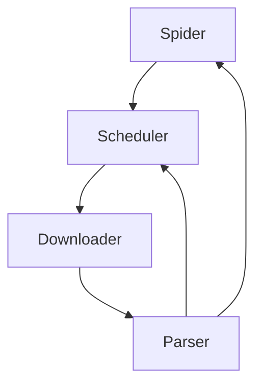

# WebAnts

基于 `httpx` 与 `lxml` 的异步网络爬虫框架。

WebAnts 保持核心精简：`Spider` 负责调度，`Downloader` 负责带重试的 HTTP 请求，
`Parser` 负责解析。配置、中间件与持久化是可选层，需要显式注入。

## 特性

- 异步调度，支持按域名并发与自适应延迟
- 优先级队列与 URL 去重
- HTTP 重试：指数退避，支持 `Retry-After`
- 基于 `lxml` 的解析，支持 CSS 选择器、XPath 与 LRU 缓存
- 描述符式提取器（`AttrItem`、`LinkItem`、`ElementItem`、`TextItem`）
- 可选中间件（`ResponseCache`、`RequestDeduplicator`、`RateLimiter`、`CircuitBreaker`）
- 可选持久化后端（`JsonPersister`、`CsvPersister`、`SqlitePersister`）
- YAML 配置与 `WEBANTS_*` 环境变量覆盖

## 环境要求

- Python 3.12 或更高版本

## 安装

使用 `uv`（推荐）：

```bash
uv sync
```

或使用 pip：

```bash
pip install .
```

可选依赖：

```bash
uv sync --extra monitoring     # 基于 psutil 的 PerformanceMonitor
uv sync --extra playwright     # Playwright 登录工具
```

## 快速开始

```python
import asyncio

from webants import Result, Spider


class ExampleSpider(Spider):
    name = "example"
    start_urls = ["http://example.com/"]

    async def parse(self, response, **kwargs):
        title = response.text.split("<title>")[1].split("</title>")[0]
        yield Result(
            spider=self.name,
            fields={"title": title},
            url=str(response.url),
        )


async def main() -> None:
    spider = ExampleSpider()
    await spider.start()  # 退出时关闭 Spider 并释放资源


if __name__ == "__main__":
    asyncio.run(main())
```

`parse` 是异步生成器：产出 `Result` 表示抓取到的数据，产出 `Request` 表示后续页面。

## 架构



| 模块 | 职责 |
|------|------|
| `spider.py` | `Spider` 生命周期、请求流水线、统计与信号 |
| `scheduler.py` | 优先级队列、去重、域名并发与延迟 |
| `downloader.py` | `httpx` 客户端、重试、请求头/Cookie/Body |
| `parser.py` | `lxml` 解析与选择器缓存 |
| `libs/request.py` | `Request` 数据对象 |
| `libs/result.py` | `Result` 与 `Field` 模型 |
| `libs/item.py` | 描述符式 Item 类 |
| `libs/extractor.py` | 链接、属性、元素与文本提取器 |
| `libs/middleware.py` | 中间件链与内置实现 |
| `libs/persister.py` | JSON（NDJSON）、CSV、SQLite 存储后端 |
| `libs/config.py` | YAML 配置与 `WEBANTS_*` 环境变量覆盖 |

## 主数据流

1. `Spider` 构造初始请求并交给调度器。
2. 调度器把请求分发给下载器。
3. 下载器返回 HTTP 响应。
4. 回调把响应转换为 `Result` 或 `Request`。
5. `Result` 被分发（可选持久化），新请求重新入队。

## 可选层

`Spider()` 默认保持旧行为。配置、中间件与持久化需要显式注入：

```python
from pathlib import Path

from webants import Spider
from webants.libs.config import Config
from webants.libs.middleware import MiddlewareManager, ResponseCache
from webants.libs.persister import JsonPersister, PersisterManager

config = Config()
middleware = MiddlewareManager()
middleware.add_middleware(ResponseCache(ttl=60))

persister = PersisterManager(Path("data"))
persister.add_persister("json", JsonPersister(Path("data/results.json")))

spider = MySpider(config=config, middleware=middleware, persister=persister)
await spider.start()  # close() 会 flush 并关闭注入的 persister
```

可离线运行的完整示例见 `example/optional_layers.py`：

```bash
PYTHONPATH=. uv run python example/optional_layers.py
```

异步 `signal_manager` 仍为实验性，暂未桥接 Spider 生命周期。生命周期事件请订阅
`Spider.signals`。

## 开发

```bash
uv run pytest -q
uv run pytest -m "not slow"
uv run ruff check .
uv run ruff format --check .
uv run python -m isort --check .
```

Windows 下请使用 `python -m isort`，`isort` 控制台入口可能报
`Failed to canonicalize script path`。

格式化：

```bash
uv run ruff format .
uv run python -m isort .
```

## 测试

全部测试离线运行；HTTP 行为通过 `httpx.MockTransport` 或 mock 客户端覆盖，不访问外网。

测试标记：`slow`、`integration`、`unit`。

```bash
uv run pytest -q
uv run pytest tests/test_spider.py
uv run pytest -m "not slow"
```

## 许可证

MIT，详见 [LICENSE](LICENSE)。
